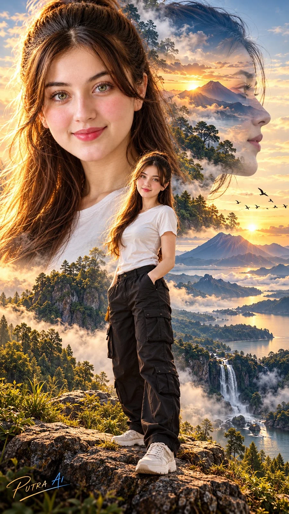

# Identity-Locked Multi-Panel Character Editorial

**中文标题：** 锁定身份的多联角色编辑海报  
**ID:** `gi25-x-809` · **Mode:** `edit`  
**Categories:** `character-consistency`, `poster-typography`  
**Tags:** `x-twitter`, `community`, `gpt-image-2.5`, `x-direct`, `en`



### Identity-Locked Multi-Panel Character Editorial

```text
CREATE A MASTERPIECE — “SOUL OF THE HORIZON”
DOUBLE EXPOSURE CINEMATIC PORTRAIT

Gunakan gambar referensi sebagai acuan utama karakter wanita. Pertahankan identitas wajah secara konsisten dan natural: bentuk wajah, struktur tulang, mata, hidung, bibir, warna kulit, karakter rambut, dan proporsi tubuh tetap mengikuti referensi. Jangan melakukan face swap, jangan mengubah struktur wajah, jangan melakukan beautification berlebihan.

SUBJECT:
Seorang wanita dewasa muda dengan penampilan natural dan elegan, tinggi sekitar 170 cm, tubuh proporsional atletis, rambut cokelat gelap panjang bergelombang natural, kulit cerah natural, mata cokelat. Mengenakan kaus putih sederhana, celana cargo hitam longgar, dan sneakers putih.

KOMPOSISI DOUBLE EXPOSURE:
Buat komposisi artistik premium dengan tiga lapisan visual yang menyatu sempurna:

1. LARGE PORTRAIT:
Close-up wajah wanita mendominasi sisi kiri frame, ekspresi tenang, percaya diri, natural, tatapan lembut ke arah kamera. Detail mata, rambut, kulit, dan tekstur wajah sangat realistis.

2. PROFILE EXPOSURE:
Siluet/profil wajah wanita berukuran besar di sisi kanan, semi-transparan dan menyatu dengan lanskap. Di dalam siluet terdapat pegunungan vulkanik, awan, hutan, air terjun, danau, kabut pagi, serta cahaya matahari terbit.

3. FULL-BODY SUBJECT:
Versi full body wanita berdiri dengan pose elegan dan percaya diri di atas batu pada sebuah dataran tinggi. Satu tangan santai di saku celana, postur natural, kaki terlihat penuh, sneakers putih terlihat jelas.

ENVIRONMENT:
Lanskap sinematik spektakuler berupa pegunungan Indonesia, gunung vulkanik, hutan hijau, air terjun, danau luas, lembah berkabut, burung terbang jauh, serta golden sunrise di horizon.

VISUAL FUSION:
Pastikan transisi antara wajah dan lanskap sangat halus.
Rambut berubah secara artistik menjadi kabut dan pepohonan.
Area wajah menyatu dengan langit dan pegunungan.
Tubuh menyatu dengan lanskap tanpa terlihat seperti kolase.
Gunakan teknik professional fine-art double exposure photography.
Layering kompleks tetapi tetap bersih dan elegan.
Tidak boleh terlihat seperti tempelan dua gambar.

LIGHTING:
Golden hour sunrise,
soft cinematic backlight,
warm rim light pada rambut,
natural volumetric light,
subtle atmospheric haze,
realistic shadows,
HDR balanced exposure,
cinematic dynamic range.

CAMERA & QUALITY:
Ultra-photorealistic,
professional flagship DSLR look,
85mm portrait lens,
f/1.8,
shallow depth of field,
extreme micro-detail,
realistic skin pores,
natural hair strands,
realistic fabric texture,
cinematic color grading,
HDR,
8K ultra detailed,
high dynamic range,
professional fashion editorial photography,
premium fine-art photography,
photorealistic,
no CGI appearance.

COLOR PALETTE:
Warm gold sunrise,
deep emerald green,
soft blue atmospheric shadows,
natural skin tones,
subtle cinematic contrast.

BRANDING:
Tambahkan signature elegan “PUTRA AI” di bagian kiri bawah, handwritten premium signature, subtle blue-to-gold gradient, elegant swoosh, kecil namun jelas, menyatu dengan artwork dan tidak menutupi subjek.

FORMAT:
Vertical 9:16,
masterpiece composition,
subject fully visible,
balanced visual hierarchy,
high-end cinematic poster,
gallery-quality artwork.

NEGATIVE PROMPT:
face distortion, altered identity, face swap, different person, asymmetrical eyes, distorted hands, extra fingers, extra limbs, duplicate body, duplicate face, plastic skin, excessive beauty filter, unrealistic skin, CGI, 3D render, cartoon, anime, blurry face, low resolution, oversharpening, bad anatomy, warped clothing, floating objects, harsh artifacts, obvious collage, poorly blended double exposure, text errors, watermark selain “Enaya AI”.
```

- **Recommended model:** `gpt-image-2.5-sunburst`
- **Settings:** _(defaults)_
- **Source:** [community](https://x.com/Enaya_ai/status/2107793961641500830) — @Enaya_ai
- **License note:** Original public X post; quoted with attribution — remix with attribution
- **Notes:** Collected directly from X; prompt posted as the author's reply https://x.com/Enaya_ai/status/2107793961641500830 to https://x.com/Enaya_ai/status/2107793955807207567, which carries the images and names GPT Image 2.5; discovered via Bin0754/gpt-image-gallery index, prompt re-verified against the original X post via api.fxtwitter.com; verified=True
- **Preview:** `previews/gi25-x-809.webp`
