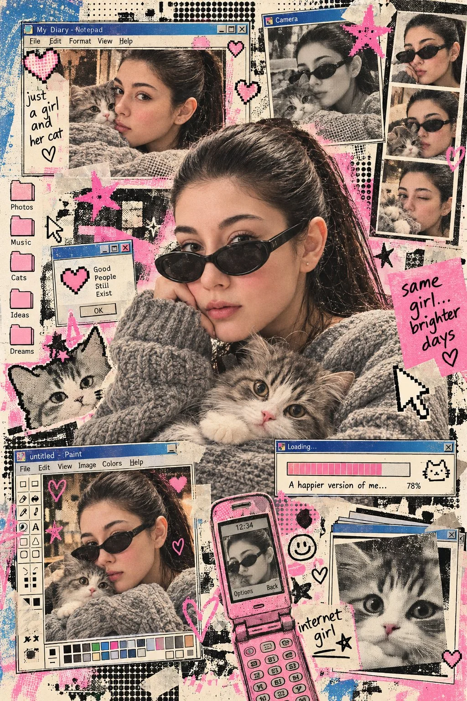

# Identity-Locked High-Fashion Street Editorial

**中文标题：** 锁定身份的高端街拍时装大片  
**ID:** `gi25-x-817` · **Mode:** `edit`  
**Categories:** `character-consistency`, `edit-change-preserve`  
**Tags:** `x-twitter`, `community`, `gpt-image-2.5`, `x-direct`, `en`



### Identity-Locked High-Fashion Street Editorial

```text
Using the uploaded reference image, preserve the exact same face, identity, facial features, and natural skin texture of the subject in an early internet nostalgia visual concept. Combine editorial image-making with retro digital print aesthetics: halftone dot grid screen, Risograph grain, ink bleed, early GUI interface fragments, 8-bit pixel geometry, soft airbrush gradients, and stencil overspray texture. Build the layout with browser-window frames, pixel icons, loading bars, dialog boxes, folders, cursors, or chat-window shapes. Keep the composition graphic, layered, playful, and slightly imperfect, with a mix of analog print noise and primitive digital design. Dress the subject in an oversized chunky grey knit sweater with black oval sunglasses. Include an adorable fluffy grey-and-white kitten clearly. Use vintage cream, faded bubblegum pink, muted blue, charcoal black, and subtle beige tones.
```

- **Recommended model:** `gpt-image-2.5-sunburst`
- **Settings:** _(defaults)_
- **Source:** [community](https://x.com/TheVirtualMuse/status/2110210247801672152) — @TheVirtualMuse
- **License note:** Original public X post; quoted with attribution — remix with attribution
- **Notes:** Collected directly from X; original post https://x.com/TheVirtualMuse/status/2110210247801672152; post text names GPT Image 2.5; discovered via Bin0754/gpt-image-gallery index, prompt re-verified against the original X post via api.fxtwitter.com; verified=True
- **Preview:** `previews/gi25-x-817.webp`
