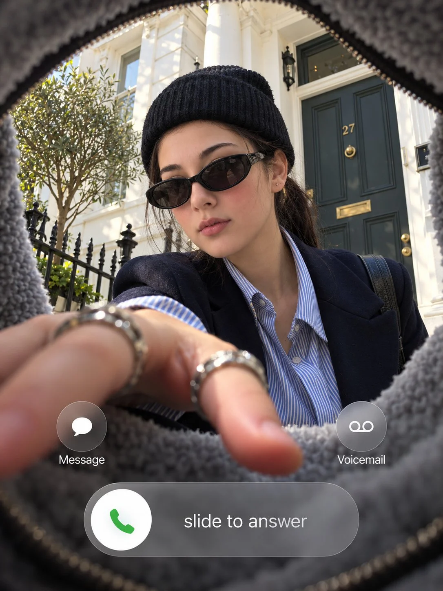

# POV Companion Selfie from Face Reference

**中文标题：** 参考人脸→第一人称同伴自拍  
**ID:** `gi25-x-818` · **Mode:** `edit`  
**Categories:** `character-consistency`  
**Tags:** `x-twitter`, `community`, `gpt-image-2.5`, `x-direct`, `en`



### POV Companion Selfie from Face Reference

```text
Use my uploaded photo as the face reference. 3:4 vertical. Point-of-view shot from inside a grey fleece-lined bag looking up. The soft
fuzzy lining frames every edge of the image. the person in reference, keeping her exact face, hairstyle and identity, reaches down into the
bag toward the camera, her fingers foreshortened in the foreground and stacked with chunky silver rings. She wears a black ribbed beanie,
black oval sunglasses, a navy blazer and a blue-and-white striped shirt: a white London
townhouse with a dark grey-green front door numbered 27, black iron railings and a small olive tree. Overlaid iOS incoming call interface
in white system font: a "Message" button on the left and a "Voicemail" button on the right as frosted round icons, and at the bottom a
frosted glass pill slider reading "slide to answer" with a white circle holding a green phone icon. Natural daylight, candid street-style
fashion photography, realistic skin texture.
Make it realistic
Improve its colour grading
```

- **Recommended model:** `gpt-image-2.5-sunburst`
- **Settings:** _(defaults)_
- **Source:** [community](https://x.com/TheVirtualMuse/status/2110015285323559093) — @TheVirtualMuse
- **License note:** Original public X post; quoted with attribution — remix with attribution
- **Notes:** Collected directly from X; original post https://x.com/TheVirtualMuse/status/2110015285323559093; post text names GPT Image 2.5; discovered via Bin0754/gpt-image-gallery index, prompt re-verified against the original X post via api.fxtwitter.com; verified=True
- **Preview:** `previews/gi25-x-818.webp`
