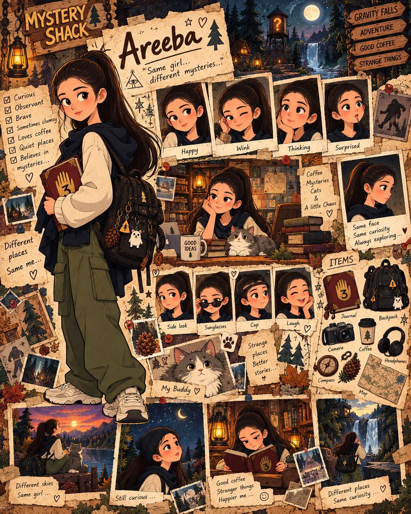

# Character Moodboard Sheet from Reference

**中文标题：** 参考图→角色情绪板设定表  
**ID:** `gi25-x-819` · **Mode:** `edit`  
**Categories:** `character-consistency`  
**Tags:** `x-twitter`, `community`, `gpt-image-2.5`, `x-direct`, `en`



### Character Moodboard Sheet from Reference

```text
Using the uploaded reference image, create a stunning vertical 4:5 character moodboard inspired by the Gravity Falls animated series, designed as a highly detailed vintage mystery scrapbook.

IDENTITY LOCK: Transform the reference person into a charming 2D cartoon character while faithfully preserving her recognizable facial features, face shape, eyes, skin tone, hairstyle, hair color, and overall identity. Maintain perfect character consistency across every illustration.

MAIN COMPOSITION:
Feature a large, full-body illustration of the character on the left, wearing an oversized cream sweater, navy scarf, olive-green cargo pants, chunky sneakers, and a black backpack decorated with cute charms. She holds a mysterious burgundy journal with a golden hand symbol.

At the top, display her name "Areeba" in beautiful handwritten lettering on torn vintage paper, surrounded by mysterious symbols and forest illustrations.

SURROUNDING DETAILS:
Create a visually rich, layered scrapbook featuring:
• 6–8 expressive character portraits showing happiness, winking, surprise, curiosity, laughter, and thoughtful expressions.
• Small cinematic scenes of the character exploring enchanted forests, watching sunsets beside a fluffy cat, reading mysterious journals, and discovering hidden places.
• Cute Polaroid photographs, taped memories, handwritten notes, pinned postcards, and miniature adventure illustrations.
• A dedicated accessories section featuring her journal, backpack, vintage camera, coffee cup, headphones, compass, and illustrated map.
• Mysterious forest creatures, glowing lanterns, waterfalls, pine trees, mountain landscapes, crescent moons, cryptic symbols, and wooden Mystery Shack signs.

ART DIRECTION:
Authentic Gravity Falls-inspired 2D animation aesthetic with expressive eyes, clean dark outlines, slightly quirky proportions, warm cinematic lighting, and beautiful hand-drawn textures.

Use a sophisticated palette of aged parchment, warm browns, deep forest greens, midnight blues, muted burgundy, and glowing amber.

Make the composition exceptionally polished, visually addictive, and packed with charming discoveries. Every section should feel like a tiny story, with overlapping torn paper, realistic tape, subtle shadows, vintage stickers, and carefully arranged illustrations.

The final artwork should resemble an extraordinary personal character dossier discovered inside the Mystery Shack—nostalgic, mysterious, adorable, cinematic, and instantly eye-catching.

Ultra-detailed 2D illustration, premium editorial composition, beautiful visual storytelling, crisp details, cohesive character design, 4:5 vertical.

IMPORTANT: No photorealism, no 3D rendering, no generic character faces, no inconsistent facial features, no cluttered or unreadable layout. Every illustration must feature the exact same recognizable character.
```

- **Recommended model:** `gpt-image-2.5-sunburst`
- **Settings:** _(defaults)_
- **Source:** [community](https://x.com/TheVirtualMuse/status/2110295494442332329) — @TheVirtualMuse
- **License note:** Original public X post; quoted with attribution — remix with attribution
- **Notes:** Collected directly from X; prompt posted as the author's reply https://x.com/TheVirtualMuse/status/2110295494442332329 to https://x.com/TheVirtualMuse/status/2110295405032505705, which carries the images and names GPT Image 2.5; discovered via Bin0754/gpt-image-gallery index, prompt re-verified against the original X post via api.fxtwitter.com; verified=True
- **Preview:** `previews/gi25-x-819.webp`
