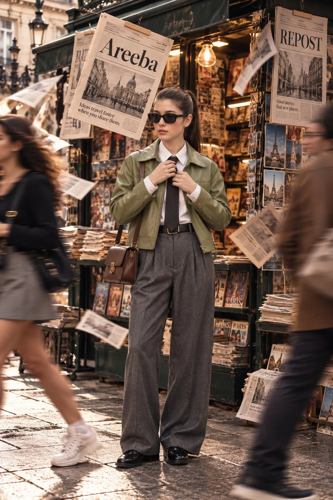

# Ultra-Photoreal High-Fashion Street Editorial

**中文标题：** 超写实高端街拍时装编辑大片  
**ID:** `gi25-x-820` · **Mode:** `edit`  
**Categories:** `character-consistency`, `edit-change-preserve`  
**Tags:** `x-twitter`, `community`, `gpt-image-2.5`, `x-direct`, `en`



### Ultra-Photoreal High-Fashion Street Editorial

```text
Using the uploaded reference image, create an ultra-photorealistic, premium high-fashion street editorial photograph. Preserve the woman's exact facial identity, natural skin texture, facial proportions, eye shape, nose, lips, and hairstyle. No facial modifications, artificial beautification, or AI-generated appearance.

COMPOSITION:
Vertical 2:3 full-body editorial portrait. A beautiful young woman stands confidently in the center of a bustling Parisian street, directly in front of a charming vintage dark-green European newsstand. Straight-on camera angle, entire body visible from head to polished shoes, comfortable headroom, perfectly balanced composition.

MODEL & STYLING:
She wears a luxurious sage-green leather jacket over a crisp white button-down shirt, a neatly tied charcoal-black necktie, elegant high-waisted pleated gray wool trousers, polished black leather loafers, narrow rectangular black sunglasses, and a structured chocolate-brown leather shoulder bag with gold hardware.

Her dark hair is styled into a sleek, naturally textured high ponytail. Minimal sophisticated makeup, realistic skin pores, soft natural lips, subtle rosy cheeks, and an effortlessly elegant expression.

POSE:
Standing naturally with relaxed shoulders, both hands gently adjusting her necktie. Her head faces slightly toward the camera, maintaining a calm, confident, sophisticated fashion-editorial attitude.

ENVIRONMENT:
A richly detailed vintage Parisian newsstand overflowing with newspapers, fashion magazines, travel postcards, and stacked publications. Warm tungsten bulbs illuminate the interior.

One large vintage newspaper hangs prominently above the model's left shoulder, displaying the perfectly readable headline "Areeba" in elegant black serif typography.

A second newspaper on the upper right displays the bold headline "REPOST".

Several loose newspaper pages flutter naturally through the air, creating dynamic movement.

MOTION & ATMOSPHERE:
A young woman wearing a dark top, gray skirt, white socks, and chunky white sneakers walks briskly across the left foreground. Another pedestrian wearing a brown jacket crosses the right foreground.

Both pedestrians appear naturally motion-blurred through realistic long-exposure photography, while the central model remains perfectly sharp and detailed.

LIGHTING & COLOR:
Beautiful golden-hour daylight mixed with warm tungsten newsstand lighting. Sophisticated cinematic color grading featuring muted sage green, warm champagne beige, charcoal gray, rich chocolate brown, and soft golden highlights.

Natural skin tones, realistic shadows, gentle film grain, subtle atmospheric depth, and beautifully controlled contrast.

PHOTOGRAPHY:
Shot on a professional full-frame camera, 50mm editorial lens, f/2.8, natural perspective, realistic depth of field, exceptionally detailed clothing textures, authentic leather reflections, and magazine-quality sharpness.

Premium European fashion campaign aesthetic, timeless street-style photography, authentic urban atmosphere, sophisticated visual storytelling.

FINAL REQUIREMENTS:
100% photorealistic live-action photography.
Exact reference facial identity.
Natural human anatomy and realistic proportions.
Correct hands and fingers.
Perfectly readable "Areeba" and "REPOST" headlines.
Sharp central subject with naturally blurred pedestrians.
Full body visible, no cropped head or feet.
No CGI, no illustration, no plastic skin, no excessive smoothing, no artificial AI glow, no distorted objects, no unnatural lighting.

Aspect ratio: 2:3 vertical.
Quality: Ultra-high-resolution, premium luxury fashion editorial.
```

- **Recommended model:** `gpt-image-2.5-sunburst`
- **Settings:** _(defaults)_
- **Source:** [community](https://x.com/TheVirtualMuse/status/2110575533981593858) — @TheVirtualMuse
- **License note:** Original public X post; quoted with attribution — remix with attribution
- **Notes:** Collected directly from X; original post https://x.com/TheVirtualMuse/status/2110575533981593858; post text names GPT Image 2.5; discovered via X search, prompt re-verified against the original X post via api.fxtwitter.com; verified=True
- **Preview:** `previews/gi25-x-820.webp`
