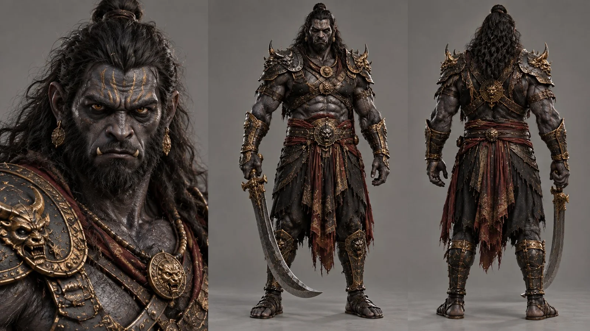

# Ramayana Rakshasa Soldier Character Sheet

**中文标题：** 《罗摩衍那》罗刹士兵角色设定表  
**ID:** `gi25-x-836` · **Mode:** `generate`  
**Categories:** `character-consistency`  
**Tags:** `x-twitter`, `community`, `gpt-image-2.5`, `x-direct`, `en`



### Ramayana Rakshasa Soldier Character Sheet

```text
Ultra-photorealistic character sheet of a Rakshasa soldier from the Ramayana, a terrifying demonic warrior serving Ravana's army. Tall, imposing, extremely muscular humanoid physique, dark charcoal-gray skin with subtle bluish undertones, realistic rough skin texture, powerful jaw, prominent brow ridge, slightly pointed ears, small lower fangs, intense amber eyes, long messy black hair, thick beard, intimidating but anatomically realistic facial features. No extra heads or limbs.

Wearing heavy ancient Indian-inspired blackened steel armor with intricate gold engravings, aggressive shoulder guards, ornate bronze armbands, leather straps, dark crimson waistcloth, black dhoti, armored greaves and leather sandals. Carrying a massive brutal curved sword with a dark steel blade and engraved golden hilt.

Clean symmetrical three-panel character sheet layout: detailed frontal face and upper-body close-up on the left, full-body strictly frontal standing view in the center holding the sword, full-body direct back view on the right. Consistent character identity, identical armor, anatomy and proportions across all views.

Plain seamless neutral gray studio background, soft professional three-point studio lighting, realistic contact shadows, extremely detailed natural skin, hair, fabric, leather and metal textures. Cinematic live-action photorealism, realistic anatomy, dark mythological fantasy aesthetic, no CGI appearance, no 3D render look, no illustration, no text. 16:9 aspect ratio.
```

- **Recommended model:** `gpt-image-2.5-sunburst`
- **Settings:** _(defaults)_
- **Source:** [community](https://x.com/MayorKingAI/status/2110049244501639490) — @MayorKingAI
- **License note:** Original public X post; quoted with attribution — remix with attribution
- **Notes:** Collected directly from X; original post https://x.com/MayorKingAI/status/2110049244501639490; post text names GPT Image 2.5; discovered via Bin0754/gpt-image-gallery index, prompt re-verified against the original X post via api.fxtwitter.com; verified=True
- **Preview:** `previews/gi25-x-836.webp`
