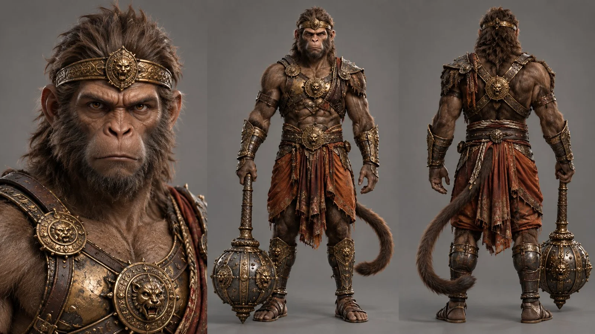

# Ramayana Vanara Warrior Character Sheet

**中文标题：** 《罗摩衍那》猴族战士角色设定表  
**ID:** `gi25-x-837` · **Mode:** `generate`  
**Categories:** `character-consistency`  
**Tags:** `x-twitter`, `community`, `gpt-image-2.5`, `x-direct`, `en`



### Ramayana Vanara Warrior Character Sheet

```text
Ultra-photorealistic character sheet of a Vanara warrior from the Ramayana, a powerful humanoid monkey warrior with a muscular athletic build, broad shoulders, strong arms, realistic primate facial anatomy, expressive amber eyes, short dense dark brown fur covering his body, and a long muscular monkey tail. Fierce but intelligent appearance, strong jaw, natural simian features, realistic proportions, no cartoonish elements.

Wearing ancient Indian-inspired warrior attire, weathered bronze and gold chest armor, ornate golden armbands, leather straps, decorative waist belt, dark saffron dhoti, and traditional leather sandals. Carrying a massive traditional Indian gada mace, made of dark metal with intricate golden engravings, heavy spherical head and long handle.

Clean symmetrical three-panel character sheet layout: detailed frontal face and upper-body close-up on the left, full-body strictly frontal standing view in the center holding the mace, full-body direct back view on the right showing his tail, armor and equipment. Consistent character identity, identical clothing and proportions across all views.

Plain seamless neutral gray studio background, soft professional three-point studio lighting, realistic contact shadows, extremely detailed natural fur, skin, fabric, leather and metal textures. Cinematic live-action photorealism, realistic creature anatomy, no CGI appearance, no 3D render look, no illustration, no text. 16:9 aspect ratio.
```

- **Recommended model:** `gpt-image-2.5-sunburst`
- **Settings:** _(defaults)_
- **Source:** [community](https://x.com/MayorKingAI/status/2110049228043190397) — @MayorKingAI
- **License note:** Original public X post; quoted with attribution — remix with attribution
- **Notes:** Collected directly from X; original post https://x.com/MayorKingAI/status/2110049228043190397; post text names GPT Image 2.5; discovered via Bin0754/gpt-image-gallery index, prompt re-verified against the original X post via api.fxtwitter.com; verified=True
- **Preview:** `previews/gi25-x-837.webp`
