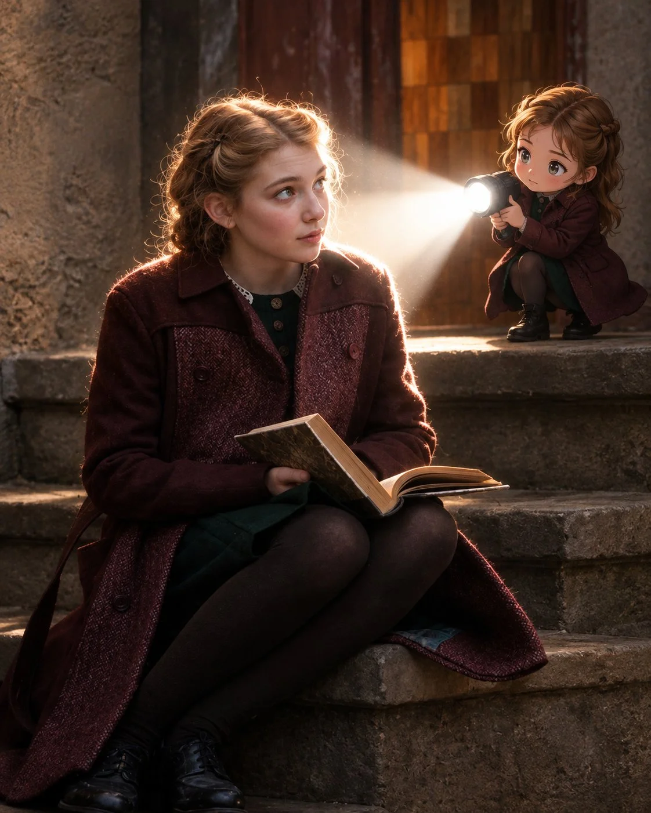

# Reference → Small Full-Body Anime Figure

**中文标题：** 参考图→全身小号动漫形象  
**ID:** `gi25-x-840` · **Mode:** `edit`  
**Categories:** `character-consistency`, `edit-change-preserve`  
**Tags:** `x-twitter`, `community`, `gpt-image-2.5`, `x-direct`, `en`



### Reference → Small Full-Body Anime Figure

```text
Transform the main subject into a small full-body anime/cartoon version of themselves, matching their hairstyle, outfit, accessories, colors, and recognizable details. Use the reference's clean modern anime aesthetic sharp linework slightly oversized head, compact proportions, cel shading, and expressive details. Position the anime character directly behind the real subject, holding a flashlight aimed forward at their back. Create an intense realistic white beam that fully illuminates the subject from behind, producing bright rim light, glow, and natural shadows. Dim the surrounding outdoor light for dramatic contrast. Preserve the original scene, camera angle, composition, and realism. Ratio 4:5.
```

- **Recommended model:** `gpt-image-2.5-sunburst`
- **Settings:** _(defaults)_
- **Source:** [community](https://x.com/Shorelyn_/status/2110623786295079368) — @Shorelyn_
- **License note:** Original public X post; quoted with attribution — remix with attribution
- **Notes:** Collected directly from X; original post https://x.com/Shorelyn_/status/2110623786295079368; post text names GPT Image 2.5; discovered via X search, prompt re-verified against the original X post via api.fxtwitter.com; verified=True
- **Preview:** `previews/gi25-x-840.webp`
