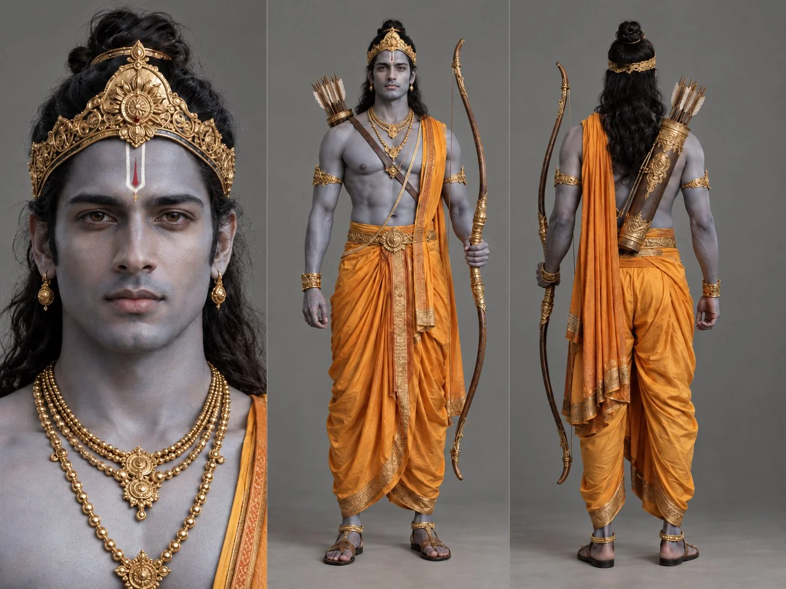

# Ramayana Rama Character Sheet

**中文标题：** 《罗摩衍那》罗摩角色设定表  
**ID:** `gi25-x-846` · **Mode:** `generate`  
**Categories:** `character-consistency`  
**Tags:** `x-twitter`, `community`, `gpt-image-2.5`, `x-direct`, `en`



### Ramayana Rama Character Sheet

```text
Photorealistic character sheet of Rama, a young athletic warrior with subtly dark blue skin in a natural human tone, not bright blue or cartoonish. He has long black hair tied in a bun, a tall ornate golden crown, a bare chest adorned with layered gold necklaces and armbands, a saffron dhoti, a long wooden bow with gold details, and a quiver on his back. Clean, symmetrical character sheet layout: frontal face close-up on the left, full-body front view in the center, and full-body back view on the right. Plain neutral gray background, soft professional studio lighting, highly photorealistic style, realistic skin, fabric, wood, and metal textures, no 3D, no CGI.
```

- **Recommended model:** `gpt-image-2.5-sunburst`
- **Settings:** _(defaults)_
- **Source:** [community](https://x.com/MayorKingAI/status/2110049193188524472) — @MayorKingAI
- **License note:** Original public X post; quoted with attribution — remix with attribution
- **Notes:** Collected directly from X; original post https://x.com/MayorKingAI/status/2110049193188524472; post text names GPT Image 2.5; discovered via Bin0754/gpt-image-gallery index, prompt re-verified against the original X post via api.fxtwitter.com; verified=True
- **Preview:** `previews/gi25-x-846.webp`
