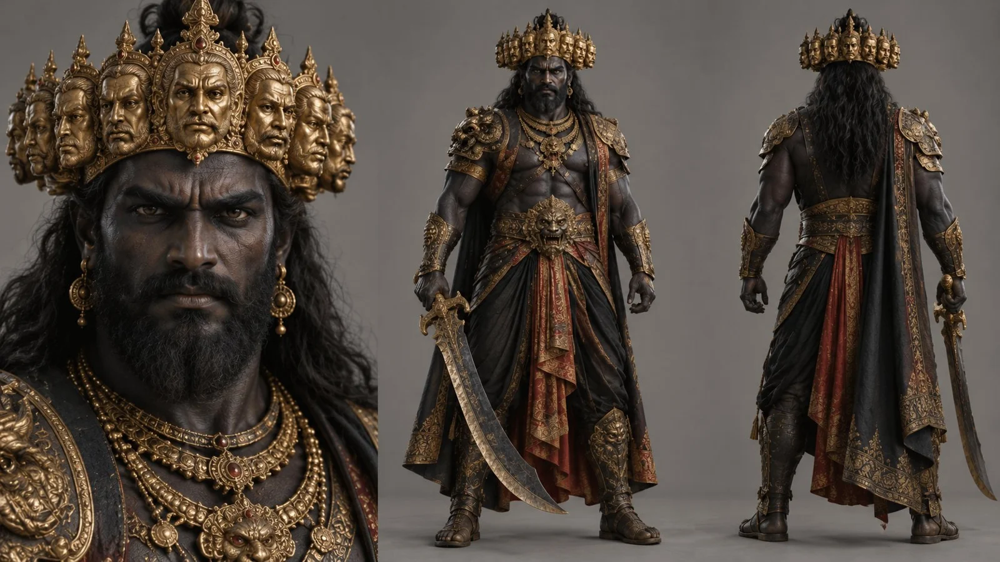

# Ramayana Ravana Character Sheet

**中文标题：** 《罗摩衍那》罗波那角色设定表  
**ID:** `gi25-x-847` · **Mode:** `generate`  
**Categories:** `character-consistency`  
**Tags:** `x-twitter`, `community`, `gpt-image-2.5`, `x-direct`, `en`



### Ramayana Ravana Character Sheet

```text
Photorealistic character sheet of Ravana, an enormous and imposing mythological warrior king with very dark skin, almost black, with subtle cool bluish undertones, rendered in a natural human tone. He has a thick black beard, long dark hair, and a powerful, intimidating presence. He wears elaborate black and gold armor with rich ornamental detail, layered royal jewelry, and a large curved sword. Instead of ten real heads, he wears a majestic golden crown carved with ten faces integrated into the design, to avoid anatomical deformities while preserving the symbolic look. Clean, symmetrical character sheet layout: frontal face close-up on the left, full-body front view in the center, and full-body back view on the right. Plain neutral gray background, soft professional studio lighting, highly photorealistic style, realistic skin, fabric, metal, and weapon textures, no 3D, no CGI, no text.
```

- **Recommended model:** `gpt-image-2.5-sunburst`
- **Settings:** _(defaults)_
- **Source:** [community](https://x.com/MayorKingAI/status/2110049210636918849) — @MayorKingAI
- **License note:** Original public X post; quoted with attribution — remix with attribution
- **Notes:** Collected directly from X; original post https://x.com/MayorKingAI/status/2110049210636918849; post text names GPT Image 2.5; discovered via Bin0754/gpt-image-gallery index, prompt re-verified against the original X post via api.fxtwitter.com; verified=True
- **Preview:** `previews/gi25-x-847.webp`
