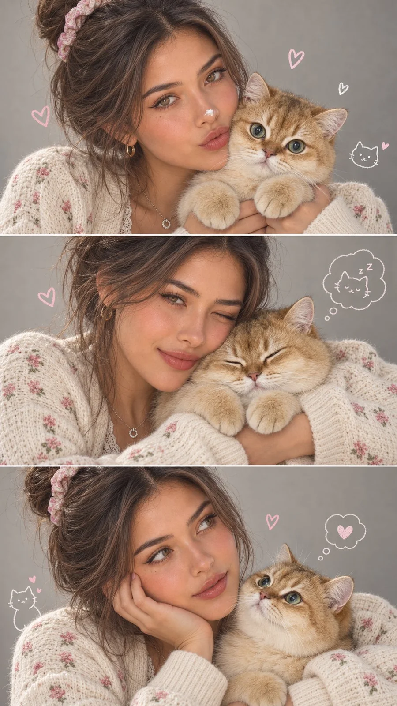

# Korean Kawaii Three-Panel Collage from Reference

**中文标题：** 参考图→韩系可爱三格拼贴  
**ID:** `gi25-x-857` · **Mode:** `edit`  
**Categories:** `character-consistency`, `edit-change-preserve`  
**Tags:** `x-twitter`, `community`, `gpt-image-2.5`, `x-direct`, `en`



### Korean Kawaii Three-Panel Collage from Reference

```text
Using the uploaded reference photo, create an ultra-realistic, high-resolution 9:16 vertical Korean-inspired kawaii editorial portrait collage featuring the exact same young woman. Strictly preserve her facial identity, eyes, nose, lips, facial structure, and natural skin texture.

Divide the composition into three perfectly equal horizontal panels, separated by thin, clean white lines. Each panel must show a complete, beautifully framed close-up portrait with no awkward cropping.

STYLE & OUTFIT:
Soft, voluminous dark hair styled in a slightly messy high bun with delicate loose strands and a pink floral scrunchie. She wears a cozy cream knitted cardigan with tiny pink floral patterns, a delicate cream lace-trimmed inner top, and a minimalist silver necklace. Naturally rosy cheeks, soft pink lips, expressive eyes, and realistic skin texture.

CAT:
The same adorable, extremely fluffy grey-and-white Ragdoll kitten with big crystal-blue eyes, a tiny pink nose, and soft pink paw pads appears consistently in all three panels.

PANEL 1 — PLAYFUL CUTENESS:
She gently cuddles the fluffy kitten against her cheek, making an adorable tiny pout toward the camera. The kitten looks directly at the viewer with wide blue eyes, both fluffy front paws clearly visible. A tiny white cream dot on her nose adds playful charm.

PANEL 2 — SWEETEST MOMENT:
She rests her cheek against the peacefully sleeping kitten, giving the camera a cute, natural wink and a gentle closed-mouth smile. Both look comfortable and affectionate, creating a heartwarming portrait.

PANEL 3 — DREAMY CONNECTION:
She rests her cheek on one hand while holding the kitten close. The kitten gazes lovingly up at her with curious blue eyes as she looks thoughtfully to the side. Soft, innocent, naturally adorable expressions.

BACKGROUND & DETAILS:
Clean, minimal soft-grey studio background. Add a few delicate hand-drawn pastel pink and white hearts, tiny cat doodles, and playful thought bubbles around the subjects, without cluttering the composition.

PHOTOGRAPHY:
Premium Korean lifestyle editorial photography, professional DSLR quality, 85mm portrait lens, beautifully diffused studio lighting, perfectly sharp faces, detailed eyelashes, realistic hair strands, visible knitted fabric textures, and exceptionally detailed kitten fur. Soft pastel color grading, balanced contrast, natural highlights, and gentle depth of field.

FINAL QUALITY:
Photorealistic, crystal-clear, beautifully composed, irresistibly cute, premium Instagram-worthy aesthetic. Maintain identical facial identity, hairstyle, outfit, and kitten appearance across all three panels. Natural human proportions, accurate hands and paws, no facial distortion, no excessive skin smoothing, no artificial CGI or plastic appearance.
```

- **Recommended model:** `gpt-image-2.5-sunburst`
- **Settings:** _(defaults)_
- **Source:** [community](https://x.com/NoravaleAI/status/2110716767677096293) — @NoravaleAI
- **License note:** Original public X post; quoted with attribution — remix with attribution
- **Notes:** Collected directly from X; original post https://x.com/NoravaleAI/status/2110716767677096293; post text names GPT Image 2.5; discovered via Bin0754/gpt-image-gallery index, prompt re-verified against the original X post via api.fxtwitter.com; verified=True
- **Preview:** `previews/gi25-x-857.webp`
