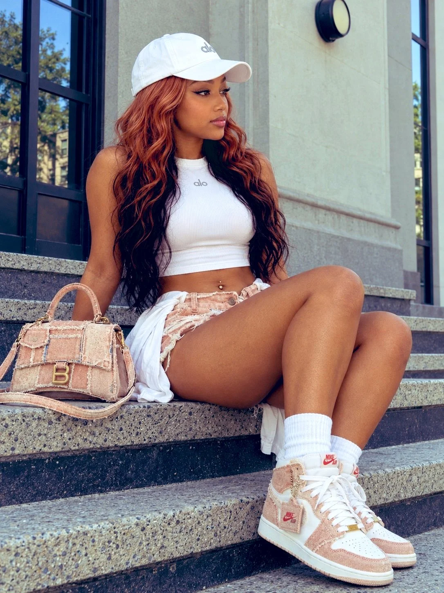

# Identity-Locked Balcony Editorial Portrait

**中文标题：** 锁定身份的阳台编辑人像  
**ID:** `gi25-x-862` · **Mode:** `edit`  
**Categories:** `character-consistency`, `edit-change-preserve`  
**Tags:** `x-twitter`, `community`, `gpt-image-2.5`, `x-direct`, `en`



### Identity-Locked Balcony Editorial Portrait

```text
Native vertical 1200×1600 (3:4). The supplied image alone governs the adult woman’s visible identity, warm tan skin, natural asymmetry, projected anatomy, blonde hair, outfit, accessories, pose, architecture and finish.

She sits on the upper speckled stone tread, pelvis planted, torso leaning back. Near arm extends behind the denim handbag to a concealed bracing hand; far arm stays occluded, without invented fingers. Both knees bend upward: near thigh angles to the central-right knee and overlaps the far leg; far knee is slightly higher and image-right. Shins descend to overlapping sneakers on the lower tread. Preserve weight compression, continuous anatomy and foreground scale.

Head nearly in profile to image-right beneath a forward-curved white cap brim. Visible eye open, looking off-frame right; far eye mostly hidden. Retain brim shadow, defined liner/lashes, relaxed brow, softly resting nude-pink lips; no smile/teeth. Long pale golden-blonde hair hangs mostly straight under cap, bends at shoulders, drapes over image-right chest.

Cap: white baseball style, curved brim, stitching, small gray original logo. Top: very short white ribbed sleeveless high-neck with centered gray alo logo, original curved hem and exposed underbust/abdomen; never extend or redesign. Shorts: pale distressed denim, frayed irregular hems, buttons, raised/open-appearing front waistband tab. White shirtlike hip wrap: retain folds and sleeve/tail lengths falling beside/between legs, no conspicuous knot. Tiny metallic navel stud.

Footwear: white ribbed crew socks; pale blue denim/white high-tops with frayed overlays, perforated white toes, white laces, rubber soles, source side marks, tiny gold lace ornaments. Near shoe is enlarged with full toe visible and a rectangular denim-blue hanging tag with red NIKE AIR lettering on fine metal chain; far shoe partly overlaps.

Bag: one structured patchwork denim handbag standing beside image-left hip on upper tread, upright short handle, flap/pocket stitching, distressed seams, B-shaped metal hardware. Long strap lies across bag and loops onto stone. Bag obscures supporting hand/arm but is independently grounded.

Background: tall gray facade with large dark-framed tinted panels image-left, broad blank gray wall above and to right, sliver of far-right glazing, small black round pale-centered fixture high in left window section. Speckled stone treads, dark metal-like risers, scuffed sill and angled step edges. Cap starts about one-third down; retain ample architecture overhead.

Broad daylight, warm skin, textured bright whites, pale denim, subdued gray building, localized cap shadow. Camera slightly below face height, moderate detail and legible background, natural perspective/near-far scaling. No ultra-wide distortion, synthetic bokeh, hard flash, strong grain or tighter cropping.
```

- **Recommended model:** `gpt-image-2.5-sunburst`
- **Settings:** _(defaults)_
- **Source:** [community](https://x.com/RougeHalo_AI/status/2110851139356758051) — @RougeHalo_AI
- **License note:** Original public X post; quoted with attribution — remix with attribution
- **Notes:** Collected directly from X; original post https://x.com/RougeHalo_AI/status/2110851139356758051; post text names GPT Image 2.5; discovered via X search, prompt re-verified against the original X post via api.fxtwitter.com; verified=True
- **Preview:** `previews/gi25-x-862.webp`
