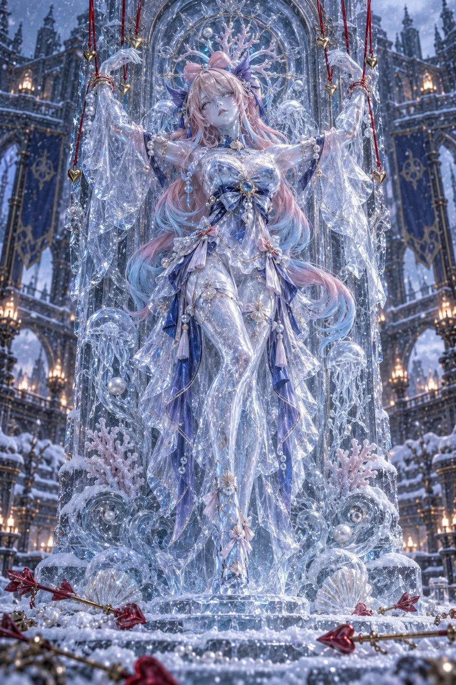

# Frozen Ice-Statue Character Cosplay Editorial

**中文标题：** 冰雕化角色 Cosplay 暗黑时尚大片  
**ID:** `gi25-x-913` · **Mode:** `generate`  
**Categories:** `character-consistency`  
**Tags:** `x-twitter`, `community`, `gpt-image-2.5`, `x-direct`, `en`



### Frozen Ice-Statue Character Cosplay Editorial

```text
Extraordinary ultra-photorealistic high-budget live-action cosplay photography, luxury dark fantasy fashion editorial, cinematic fantasy realism, breathtaking practical costume craftsmanship, vertical 2:3, full-body portrait.

One female character.

Faithful canonical [character's] identity:  elegant mature facial features, refined feminine proportions.

Her expression is calm, melancholic and quietly determined. She gazes toward the camera as though consciousness remains trapped inside a frozen sculpture.

Her entire body is visually transformed into a translucent, sculpted ice statue.

An extraordinary bespoke full-body crystalline costume, constructed from optical-clear resin, translucent silicone prosthetics, frosted acrylic and intricately sculpted artificial ice.

The ice follows natural human anatomy, creating the illusion of a woman sculpted from a single block of ancient glacial crystal.

Realistic internal ice fractures, subsurface light scattering, trapped microbubbles, delicate frost crystals, irregular frozen textures, realistic caustic reflections and razor-sharp crystalline highlights.

Her face features realistic human anatomy beneath sophisticated translucent frost makeup, with visible eyelashes, delicate facial structure and extremely fine icy surface texture.

All body surfaces and clothing are monochromatic icy silver, translucent white and pale glacial blue.

ONLY her hair and accessories retain their original colors.

No natural exposed skin tones, no metallic armor appearance.

Her body is integrated into a towering vertical gothic relief slab made from ancient blue ice.

Her arms are raised symmetrically, wrists near the upper corners, while her elongated crystalline silhouette follows the sculpted contours of the frozen monument.

Fine frost joins her costume to the surrounding relief, making the character appear suspended within the architecture.

Elegant engraved heart motifs, intricate frozen filigree, ornamental ice formations, crystalline carvings and hanging icicles decorate the monument.

Several deep-crimson silk puppet strings descend from outside the upper frame.

The strings are visibly attached to her wrists and shoulders, showing gentle realistic tension.

Tiny polished golden heart charms hang from selected strands.

The fabric remains naturally red and contrasts dramatically against the frozen monochromatic figure.

An immense frozen ceremonial courtyard in Snezhnaya, inspired by the northernmost nation of Teyvat.

Monumental gothic architecture, snow-covered stone towers, towering cathedral-like facades, weathered crimson ceremonial banners and distant warm-burning braziers.

Dense drifting snowfall, wind-driven ice particles, layered atmospheric fog, frost-covered stone flooring and enormous icicles.

Scattered cupid arrows with ruby-red heart-shaped tips lie partially buried in fresh snow around the monument.

A few frozen crimson rose petals create restrained symbolic accents.

Authentic large-format full-frame digital photography, premium 85mm portrait lens, natural optical depth of field, physically plausible perspective, high dynamic range.

Luxury theatrical production with real physical sets, practical artificial snow, professional cinematic lighting and meticulously constructed costume props.

Cold blue-white overhead key lighting reveals the translucent crystalline costume.

Subtle warm amber illumination from distant braziers creates cinematic contrast.

Physically accurate reflections, natural shadow falloff, realistic fabric tension, atmospheric depth and fine photographic microdetail.

Genuine human facial proportions, realistic photographic sharpness, premium editorial retouching without artificial skin smoothing.

Perfectly centered symmetrical composition.

Full-length figure integrated into the towering ice relief, with a slight low-angle camera perspective emphasizing the monument's enormous scale.

The face remains the primary focal point, surrounded by luminous ice formations and contrasting crimson puppet strings.

Snow-covered foreground with scattered heart-tipped arrows.

Gothic architecture softly fades into the background blizzard.

Tragic winter fairytale, supernatural elegance, frozen devotion, silent resistance, mysterious Fatui-inspired atmosphere, haunting beauty.

A luxury live-action fantasy film still photographed during an elaborate practical-effects production.
```

- **Recommended model:** `gpt-image-2.5-sunburst`
- **Settings:** _(defaults)_
- **Source:** [community](https://x.com/livybabie/status/2112240653564248153) — @livybabie
- **License note:** Original public X post; quoted with attribution — remix with attribution
- **Notes:** Collected directly from X; original post https://x.com/livybabie/status/2112240653564248153; post text names GPT Image 2.5; discovered via X search, prompt re-verified against the original X post via api.fxtwitter.com; verified=True
- **Preview:** `previews/gi25-x-913.webp`
