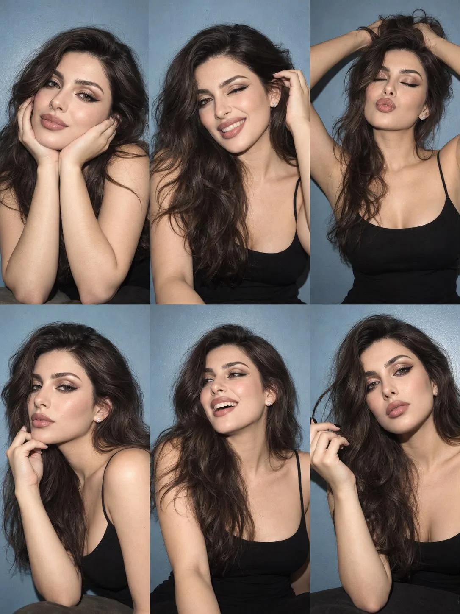

# Flash Photo-Dump 6-Frame Portrait Grid from Reference

**中文标题：** 参考图→闪光灯随拍六宫格人像  
**ID:** `gi25-x-916` · **Mode:** `edit`  
**Categories:** `character-consistency`, `edit-change-preserve`  
**Tags:** `x-twitter`, `community`, `gpt-image-2.5`, `x-direct`, `en`



### Flash Photo-Dump 6-Frame Portrait Grid from Reference

```text
Create an ultra-realistic 6-frame portrait collage arranged in a clean 3×2 grid, featuring the exact same girl from the uploaded reference photo. Use the reference exclusively for identity preservation, accurately retaining her facial structure, eye color, natural hair color, hairstyle, hair length, volume, texture, and distinctive facial features. Her identity must remain consistent across all six frames.

Overall aesthetic: Casual Instagram photo dump with an authentic early-2000s digital camera vibe. A simple muted powder-blue wall, fitted black spaghetti-strap top, delicate minimal accessories, and effortless everyday makeup. Shot on a Canon PowerShot G7 X Mark III with direct on-camera flash, crisp facial details, realistic skin pores, subtle grain, natural imperfections, strong flash highlights, and distinct shadows against the wall.

Six different candid moments:

1. Playful charm: Leaning slightly toward the camera, cheeks gently resting against her palms, giving a small, natural smile.
2. Cheeky energy: One eye closed in a wink, grinning brightly while sweeping a section of hair behind her ear.
3. Carefree mood: Eyes softly closed, lips forming a playful pout, both hands raised above her head as she loosely gathers her hair.
4. Cool and confident: Face turned slightly sideways, looking into the lens from the corner of her eyes, fingertips lightly touching her jawline.
5. Unfiltered laughter: Looking off-camera with a genuine open smile, head tilted back slightly, hair falling naturally across one shoulder.
6. Soft, dreamy moment: Chin tilted down, eyes gazing thoughtfully toward the camera, one hand loosely twirling a strand of hair.

Composition and realism: Every frame must have a distinct facial expression, head angle, hand placement, and hair arrangement. Keep the same outfit, background, lighting style, and identity throughout, while varying the crop and camera distance subtly. Natural anatomy, believable fingers, realistic hair strands, and authentic compact-camera flash photography. The result should feel like six spontaneous photos taken during one fun evening, not a polished studio campaign.

Avoid: Face swapping artifacts, altered facial features, inconsistent identity, plastic skin, excessive retouching, artificial beauty filters, duplicated poses, malformed hands, extra fingers, excessive sharpening, and obvious AI-generated details.

Vertical 3:4 canvas, six equally sized photographs, precise grid alignment, no borders, no text, no watermarks.
```

- **Recommended model:** `gpt-image-2.5-sunburst`
- **Settings:** _(defaults)_
- **Source:** [community](https://x.com/mehvishs25/status/2112208561673740615) — @mehvishs25
- **License note:** Original public X post; quoted with attribution — remix with attribution
- **Notes:** Collected directly from X; original post https://x.com/mehvishs25/status/2112208561673740615; post text names GPT Image 2.5; discovered via X search, prompt re-verified against the original X post via api.fxtwitter.com; verified=True
- **Preview:** `previews/gi25-x-916.webp`
