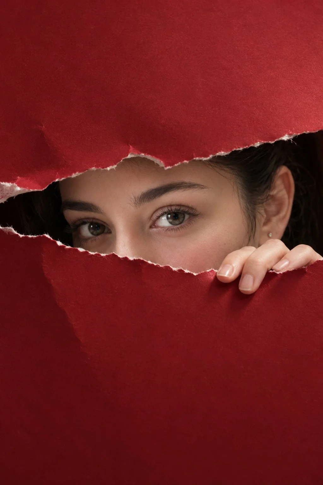

# Eyes Through Torn Burgundy Paper Editorial Portrait

**中文标题：** 撕开酒红纸面露出双眼的时尚人像  
**ID:** `gi25-x-923` · **Mode:** `edit`  
**Categories:** `character-consistency`, `edit-change-preserve`  
**Tags:** `x-twitter`, `community`, `gpt-image-2.5`, `x-direct`, `en`



### Eyes Through Torn Burgundy Paper Editorial Portrait

```text
Create an extraordinary, ultra-photorealistic luxury editorial portrait featuring the woman from the uploaded reference image. Preserve her exact facial identity, natural eye shape, iris color, eyebrows, skin texture, facial proportions, and distinctive features with absolute accuracy. No facial alterations, beautification, or artificial enhancements.

SCENE & COMPOSITION:

A large sheet of luxurious, deep burgundy-red textured paper fills the entire vertical frame. An organically torn horizontal opening stretches across the middle, revealing only the woman's captivating eyes, upper nose bridge, a subtle glimpse of her cheeks, and a few natural strands of dark hair.

The torn opening features beautifully irregular edges, delicate exposed white paper fibers, realistic material thickness, and naturally curled sections creating authentic depth and dimension.

Her right hand emerges gently from behind the lower torn edge, with three slender fingers resting naturally against the paper. Perfectly realistic hand anatomy, subtle skin creases, short natural nails, and believable physical contact.

EXPRESSION & IDENTITY:

Her gaze is intensely captivating yet effortlessly natural, combining quiet curiosity, subtle mystery, and understated confidence. She looks directly into the camera with relaxed, expressive eyes.

Preserve her original facial proportions, natural asymmetry, individual eyelashes, realistic eyebrows, delicate under-eye texture, and authentic skin imperfections. No exaggerated makeup, artificial skin smoothing, or doll-like features.

LIGHTING & COLOR GRADING:

Beautifully controlled cinematic studio lighting inspired by luxury international fashion campaigns.

A large diffused softbox positioned 45 degrees camera-left creates soft, dimensional illumination across her eyes and exposed skin. Gentle negative fill adds depth, while subtle natural catchlights bring life to her gaze.

Rich burgundy paper contrasts elegantly with warm, naturally rendered skin tones. Sophisticated editorial color grading featuring deep wine-red shadows, muted warm highlights, delicate contrast, and beautifully balanced saturation.

Absolutely no artificial orange tint, excessive HDR, glowing skin, or synthetic AI color grading.

CAMERA & PHOTOGRAPHIC REALISM:

Photographed using a professional full-frame camera with an 85mm portrait lens, f/2.8 aperture, ISO 100.

Exceptionally sharp focus on both eyes, natural optical depth, realistic microcontrast, authentic photographic detail, and subtle organic film grain.

Every visible element must obey real-world physics, including paper thickness, torn fibers, natural shadows, finger placement, and interaction between skin and material.

FINAL VISUAL DIRECTION:

The composition must resemble an exclusive international fashion magazine campaign: mysterious, intimate, visually striking, and effortlessly elegant.

Maintain generous uninterrupted areas of rich burgundy paper above and below the opening, creating beautiful negative space and directing complete attention toward her expressive eyes.

Premium photographic realism, natural skin pores, individual eyelashes, authentic material textures, refined cinematic lighting, sophisticated color science, and extraordinary attention to detail.

The final photograph must feel genuinely captured by a world-class fashion photographer, not digitally generated.

STRICT NEGATIVE CONSTRAINTS:

No AI-generated appearance, no CGI, no illustration, no plastic skin, no face modification, no excessive retouching, no unnatural eye colors, no distorted fingers, no extra fingers, no floating hands, no unrealistic paper tears, no exaggerated expressions, no artificial glow, no oversaturation, no fantasy effects, no text, no watermark.

ASPECT RATIO: 2:3 vertical.
QUALITY: Ultra-high-resolution, premium 8K photographic finish.
IDENTITY LOCK: Absolute preservation of the reference woman's exact identity.
```

- **Recommended model:** `gpt-image-2.5-sunburst`
- **Settings:** _(defaults)_
- **Source:** [community](https://x.com/TheVirtualMuse/status/2112170405159182816) — @TheVirtualMuse
- **License note:** Original public X post; quoted with attribution — remix with attribution
- **Notes:** Collected directly from X; original post https://x.com/TheVirtualMuse/status/2112170405159182816; post text names GPT Image 2.5; discovered via X search, prompt re-verified against the original X post via api.fxtwitter.com; verified=True
- **Preview:** `previews/gi25-x-923.webp`
