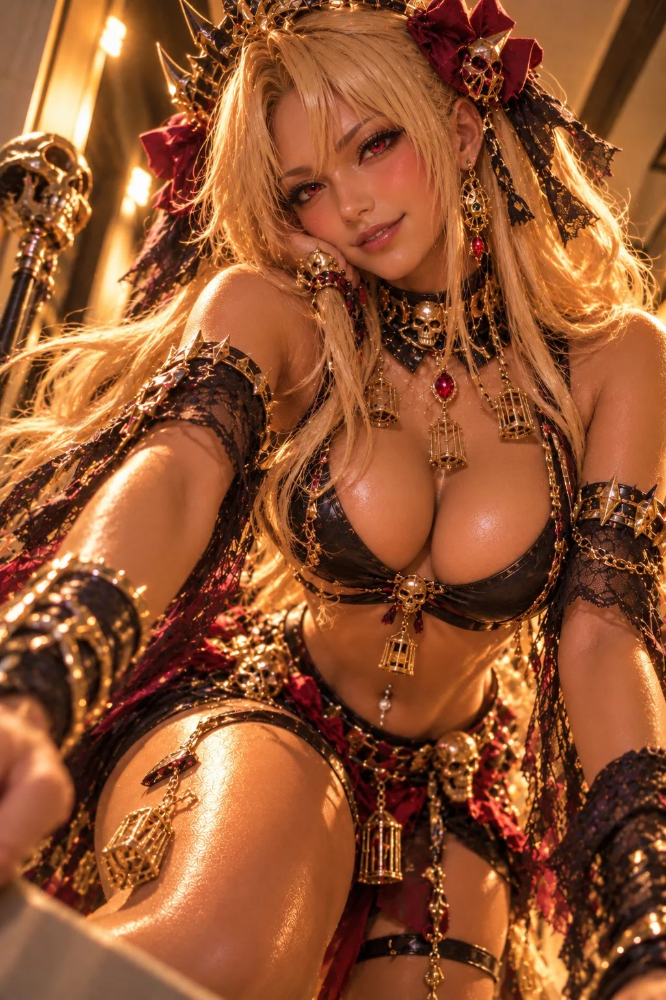

# Anime Character Halloween Gyaru Costume Template

**中文标题：** 动漫角色万圣节辣妹装模板  
**ID:** `gi25-x-931` · **Mode:** `generate`  
**Categories:** `character-consistency`  
**Tags:** `x-twitter`, `community`, `gpt-image-2.5`, `x-direct`, `en`



### Anime Character Halloween Gyaru Costume Template

```text
Character] ([Franchise]), adult, [canonical hair], [canonical eyes], [distinctive features]. Halloween [costume archetype]: [color] crop top, low-rise mini skirt, [signature accessories], belt, jewelry. Low-angle close-up photo, leaning forward, [personality gaze], modern corridor, amber HDR, gyaru styling.
```

- **Recommended model:** `gpt-image-2.5-sunburst`
- **Settings:** _(defaults)_
- **Source:** [community](https://x.com/livybabie/status/2111933617102372906) — @livybabie
- **License note:** Original public X post; quoted with attribution — remix with attribution
- **Notes:** Collected directly from X; original post https://x.com/livybabie/status/2111933617102372906; post text names GPT Image 2.5; discovered via X search, prompt re-verified against the original X post via api.fxtwitter.com; verified=True; the opening bracket of “[Character]” is missing in the original post and is kept verbatim
- **Preview:** `previews/gi25-x-931.webp`
