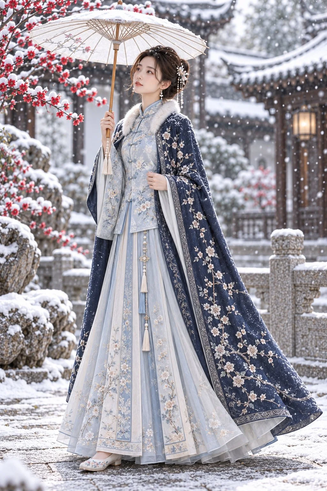

# Snowy Garden Oil-Paper Umbrella Hanfu Portrait

**中文标题：** 雪中园林油纸伞中式人像  
**ID:** `gi25-x-941` · **Mode:** `edit`  
**Categories:** `character-consistency`, `edit-change-preserve`  
**Tags:** `x-twitter`, `community`, `gpt-image-2.5`, `x-direct`, `zh`



### Snowy Garden Oil-Paper Umbrella Hanfu Portrait

```text
竖幅2:3，全身构图，高质量写实中式女性写真。以参考图中的成年女性为人物参考，保持相近的面部特征、温婉气质与自然人体比例。黑发挽成精致发髻，搭配白色花形发簪、细珠流苏与小巧垂坠耳饰，妆容清淡，肌肤纹理自然。

人物身穿霜蓝色立领斜襟中式长袄，精巧盘扣，银白色花枝刺绣，下搭月白色马面长裙，裙门平整、两侧褶裥清晰。外披深蓝色绣花长披风，领缘带柔软白色绒毛，披风表面点缀细密白色梅花与枝蔓刺绣，衣料厚度真实、垂坠自然。脚穿浅色绣花鞋。

人物站在薄雪覆盖的中式园林石径上，身体呈四分之三侧面，一只手在胸前握住油纸伞柄，将素白油纸伞撑于头顶，另一只手轻拢披风。头微微抬起，目光望向上方飘落的雪花，表情安静柔和。双肩放松，手指自然，披风下摆略微展开。

背景为积雪的灰瓦庭院、石栏与古典门廊，画面左上方伸入盛开的红梅枝，远处一盏暖色灯笼柔和发光。细雪飘落，伞面、梅枝与屋檐覆盖薄雪，背景适度虚化，保留园林空间层次。

明亮柔和的冬日漫射光，面部曝光自然，蓝白服装与红梅、暖色灯光形成协调配色。平视全身拍摄，完整保留油纸伞、裙摆和鞋履，头顶与脚下留出空间。真实人像摄影质感，清晰的刺绣、绒毛和织物纹理。

避免：动漫感、塑料皮肤、过度磨皮、夸张身材比例、手指畸形、多余肢体、伞骨扭曲、裙摆裁切、杂乱背景、文字、水印、拼图。
```

- **Recommended model:** `gpt-image-2.5-sunburst`
- **Settings:** _(defaults)_
- **Source:** [community](https://x.com/krienknight/status/2112332978571612397) — @krienknight
- **License note:** Original public X post; quoted with attribution — remix with attribution
- **Notes:** Collected directly from X; prompt posted as the author's reply https://x.com/krienknight/status/2112332978571612397 to https://x.com/krienknight/status/2112332978181607614, which carries the images and names GPT Image 2.5; discovered via X search, prompt re-verified against the original X post via api.fxtwitter.com; verified=True
- **Preview:** `previews/gi25-x-941.webp`
