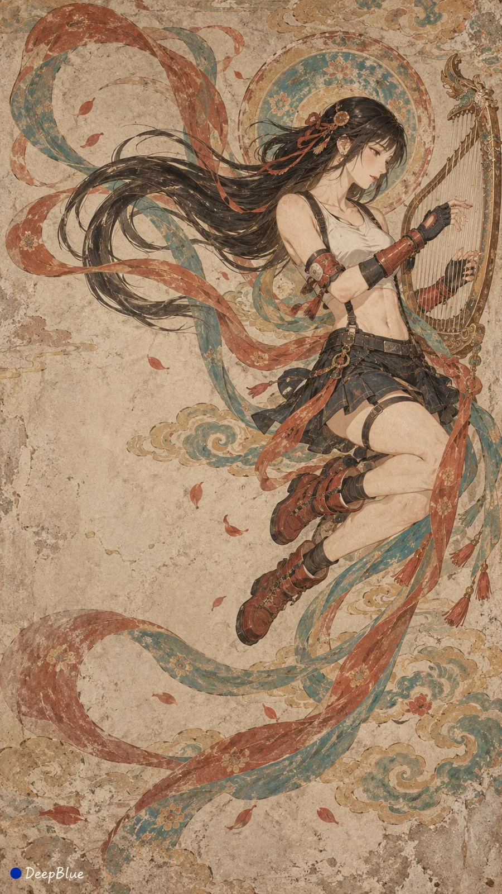

# Dunhuang Mural Anime Heroines Flying-Apsara Series

**中文标题：** 敦煌壁画风动漫游戏女角色飞天乐舞系列  
**ID:** `gi25-x-946` · **Mode:** `generate`  
**Categories:** `character-consistency`  
**Tags:** `x-twitter`, `community`, `gpt-image-2.5`, `x-direct`, `zh`



### Dunhuang Mural Anime Heroines Flying-Apsara Series

```text
主题：敦煌壁画 × 动漫游戏女性角色 × 经典飞天与乐舞姿态

以下十位女性角色，每张呈现一位，角色不重复：
春丽、不知火舞、蒂法、2B、雷电将军、金克丝、D.Va、月野兔、绫波丽、波雅·汉库克。

保留角色标志性的发型、面部特征、原有服装轮廓、代表配色与关键配饰，使角色清楚可辨。以敦煌壁画的造型与设色语言重新描绘，服饰随动作自然展开，繁复细节适度概括。

动作从以下经典形象中选择，十张采用不同动作：
反弹琵琶、抱弹琵琶、拈花持莲、扬手散花、散香供养、横吹笛管、竖持吹箫、捧笙吹奏、拨奏箜篌、抱阮弹拨、持板击拍、持鼓击奏。

参照敦煌壁画中对应动作的经典造型，保留其头部朝向、肩胯关系、手势、持物方式、躯干曲线、腿部屈伸与脚部方向。飞天沿用凌空舒展的体态，乐舞人物保留相应支撑关系。动作延伸仅在经典姿态基础上小幅调整，保持古典气韵。乐器与供养物采用传统形制，角色随身装备服从姿态与构图。

流畅有力的线描、平面化造型、舒展衣纹与回旋飘带。石青、石绿、朱砂、赭石与土黄协调铺陈，保留角色代表色的辨识度。哑光矿物颜料与细腻泥灰墙面质感，局部轻微剥蚀、褪色，画面干净，肌理克制。

每张以一位角色为中心，完整呈现关键姿态与持物。少量祥云、散花或装饰纹样呼应人物，背景疏朗，留白自然。十张独立变化人物朝向、画面位置、飘带走势与疏密关系，避免重复构图。

9:16竖版，n=10。分别输出10张独立单图，每张单独画布，不拼图、不分屏、不合并。

左下签名：深蓝色实心圆点在前，白色自然手写体“DeepBlue”在后。
```

- **Recommended model:** `gpt-image-2.5-sunburst`
- **Settings:** _(defaults)_
- **Source:** [community](https://x.com/DeepBlueX0/status/2112724256052355332) — @DeepBlueX0
- **License note:** Original public X post; quoted with attribution — remix with attribution
- **Notes:** Collected directly from X; original post https://x.com/DeepBlueX0/status/2112724256052355332; post text names GPT Image 2.5; discovered via X search, prompt re-verified against the original X post via api.fxtwitter.com; verified=True; the author posted this prompt as a reply under their own image thread https://x.com/DeepBlueX0/status/2112724240265048483; the character name “D.Va” is auto-linked in the X post text and is kept as plain text
- **Preview:** `previews/gi25-x-946.webp`
