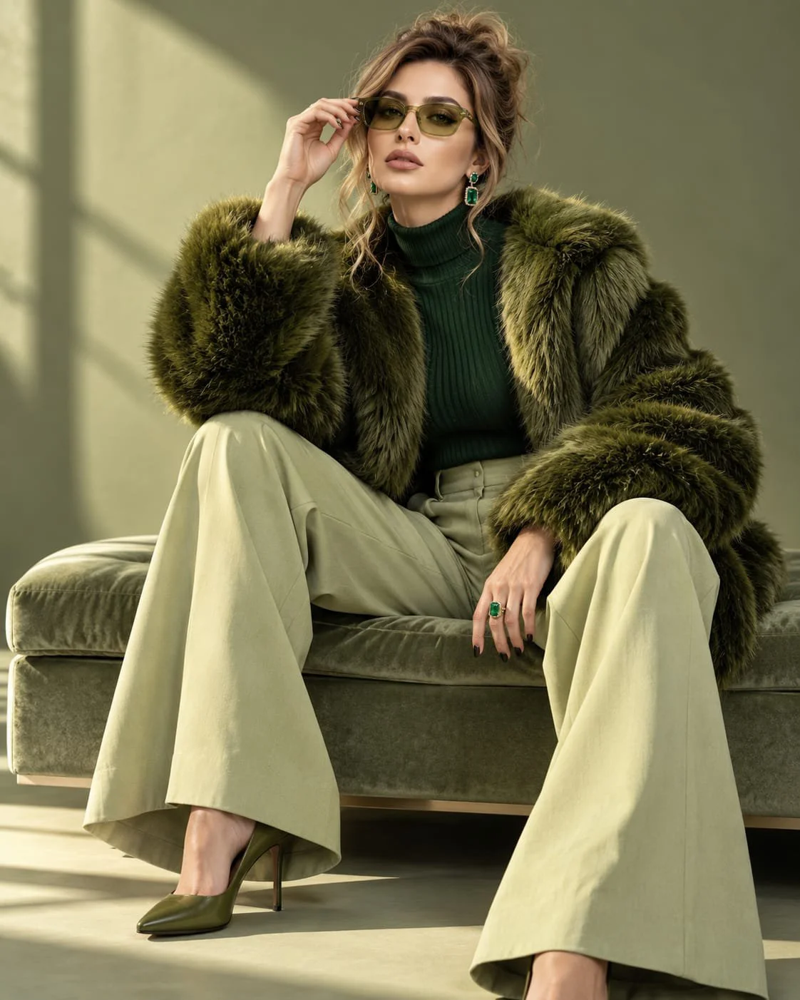

# Olive Faux-Fur Luxury Editorial from Reference

**中文标题：** 参考图→橄榄绿皮草奢华时尚大片  
**ID:** `gi25-x-958` · **Mode:** `edit`  
**Categories:** `character-consistency`, `edit-change-preserve`  
**Tags:** `x-twitter`, `community`, `gpt-image-2.5`, `x-direct`, `en`



### Olive Faux-Fur Luxury Editorial from Reference

```text
Create a striking luxury fashion editorial portrait of Vanya, faithfully preserving her exact identity from the provided reference photograph. Maintain her distinctive facial structure, natural eye shape and color, nose, lips, eyebrows, complexion, and authentic skin details without beautifying or altering her likeness.

Styling & Wardrobe: Dress her in an opulent deep-olive faux-fur jacket with an oversized sculptural silhouette, layered over a fitted dark emerald ribbed knit top. Pair it with tailored pale-sage trousers featuring a fluid, wide-leg cut. Add statement emerald earrings, a delicate gemstone ring, and translucent olive-tinted fashion sunglasses for a sophisticated, contemporary edge. Her blonde hair is swept into an intentionally undone updo, with wispy strands falling naturally around her temples and cheeks.

Pose & Composition: Vanya sits gracefully on a minimalist sage-upholstered studio bench, her torso angled slightly away from the camera while her face turns toward the lens. One hand rests loosely on her thigh, while the other gently touches the edge of her sunglasses. Her posture feels effortless and self-assured, with naturally positioned legs and relaxed shoulders. Capture the entire outfit in a balanced, full-length composition.

Environment & Photography: A muted pistachio-green studio backdrop creates a seamless, monochromatic setting. Soft afternoon sunlight enters from one side, casting delicate architectural shadows across the background and adding subtle highlights to the fur, jewelry, and blonde hair. Use a restrained palette of olive, emerald, cream, and sage, with rich textures and carefully controlled contrast.

Visual Direction: Avant-garde European fashion magazine aesthetic, understated luxury, modern editorial styling, realistic fabric fibers, lifelike skin pores, natural facial proportions, subtle photographic grain, sophisticated color grading, soft directional lighting, and a premium medium-format camera look. The final image should resemble an authentic luxury fashion campaign photographed in a professional studio, not a digitally generated illustration.

Technical specifications: Photorealistic, exceptionally detailed, vertical 4:5 aspect ratio, full-body framing, natural anatomy, realistic hands, crisp subject focus, softly graduated background, and consistent facial identity throughout.
```

- **Recommended model:** `gpt-image-2.5-sunburst`
- **Settings:** _(defaults)_
- **Source:** [community](https://x.com/mehvishs25/status/2112568369828467119) — @mehvishs25
- **License note:** Original public X post; quoted with attribution — remix with attribution
- **Notes:** Collected directly from X; original post https://x.com/mehvishs25/status/2112568369828467119; post text names GPT Image 2.5; discovered via X search, prompt re-verified against the original X post via api.fxtwitter.com; verified=True; “Vanya” is the name of the person in the author's reference photo
- **Preview:** `previews/gi25-x-958.webp`
