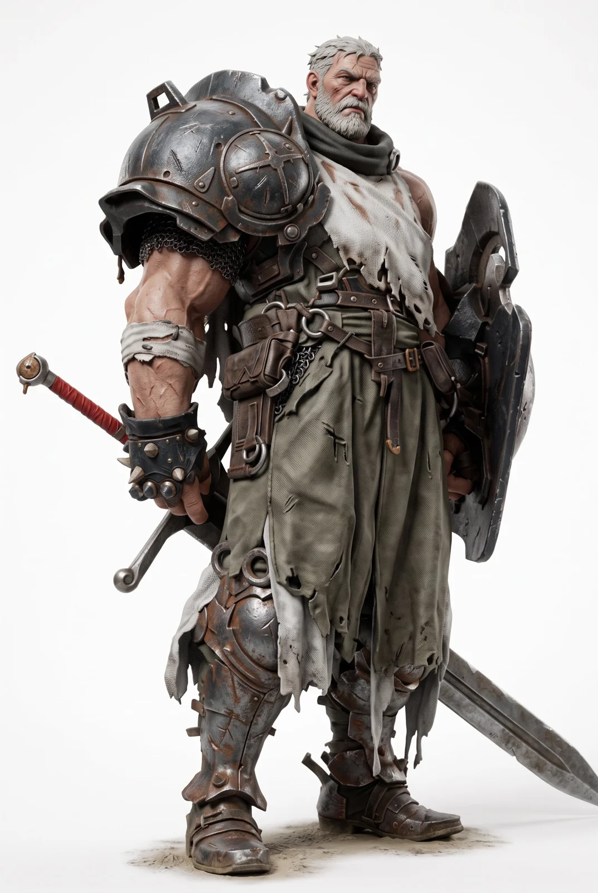

# Cinematic Character Concept Sheet from Reference

**中文标题：** 参考图→电影感角色设定表  
**ID:** `gi25-x-960` · **Mode:** `edit`  
**Categories:** `character-consistency`  
**Tags:** `x-twitter`, `community`, `gpt-image-2.5`, `x-direct`, `en`



### Cinematic Character Concept Sheet from Reference

```text
Create a premium CHARACTER CONCEPT SHEET in a 16:9 widescreen layout on a neutral background. THE ATTACHED REFERENCE IMAGE DEFINES THE PHOTOGRAPHIC STYLE.

[STYLE — MIRROR THE REFERENCE EXACTLY]: Replicate the reference image's rendering verbatim: photorealistic cinematic character photography, shot on a real digital cinema camera with a prime lens, true-to-life color science, natural film grain, real human anatomy at natural adult proportions, soft photographic three-point lighting with a subtle rim light matching the reference. Every figure must match the reference image's lighting rig, camera, and photographic fidelity.

[STYLE PROHIBITIONS — ABSOLUTE]: no CGI-rendered look, no video-game-character look, no toy or figurine look, no flat 2D, no cel-shading, no anime style, no painterly brushwork, no cartoon outlines, no synthetic/plastic-looking skin, no idealized doll-like symmetric face, no exaggerated proportions, no fused or malformed fingers.

[PROPORTIONS]: Match the reference's exact body proportions: muscular barrel-chested adult male anatomy, 7.8 heads tall, heavy physical weight.

[SUBJECT_DESCRIPTION]: The Iron Gatebreaker. Veteran warrior with short grey hair, grey beard, scarred face. Wears an oversized domed cast-iron right pauldron with cross detail, torn cream canvas cowl, bare right arm wrapped in linen bandages, spiked gauntlet, loose torn olive trousers, leather utility belts, mud-caked iron greaves, wielding a massive notched iron slab shield and red-hilted greatsword.

Layout Composition:

1. LEFT PANEL: METADATA & TURNAROUND

- Bold vertical name: "TORSTEIN, THE GATEBREAKER"

- Metadata: "ROLE: Breach Sapper", "MOOD: Immovable Resolve", "SIGNATURE: Forged Mantlet & Cross Pauldron"

- MINI TURNAROUND: 3 vertical figures ("neutral", "back view showing cape and sword scabbard", "profile") in full photographic fidelity.

- SILHOUETTE STUDY: 3 solid-black silhouettes underneath.

- EXPRESSION STUDY: 4 close-ups showing grim focus, heavy breathing, combat roar, stoic silence.

2. CENTRAL PANEL: THE CENTERPIECE

- Dominant full-body figure standing in signature wide stance, slab shield planted into earth, right hand resting on sword pommel.

3. RIGHT PANEL: MULTI-POSE & THEMATIC STUDIES

- POSE STUDY: 4 action stances: shield brace impact, wide two-handed sword swing, walking through smoke, kneeling behind shield.

4. BOTTOM RIGHT PANEL: DETAIL STUDY

- 5 square crops: (1) scarred weathered face and grey beard, (2) riveted cross pauldron texture, (3) spiked leather gauntlet on red hilt, (4) jagged iron shield cutout, (5) dented steel greaves and buckles.
```

- **Recommended model:** `gpt-image-2.5-sunburst`
- **Settings:** _(defaults)_
- **Source:** [community](https://x.com/itsPixieVerse/status/2112554396391493636) — @itsPixieVerse
- **License note:** Original public X post; quoted with attribution — remix with attribution
- **Notes:** Collected directly from X; original post https://x.com/itsPixieVerse/status/2112554396391493636; post text names GPT Image 2.5; discovered via X search, prompt re-verified against the original X post via api.fxtwitter.com; verified=True; posted in the author's own thread https://x.com/itsPixieVerse/status/2112554391496712605, where the sheet is then animated with Kling 4.0
- **Preview:** `previews/gi25-x-960.webp`
