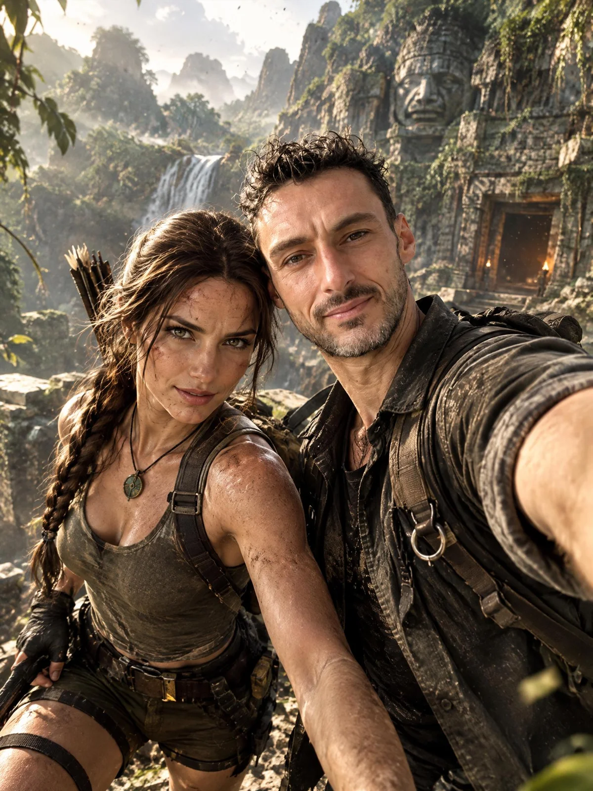

# Selfie Adventure with a Video-Game Character

**中文标题：** 自拍与游戏角色同框冒险  
**ID:** `gi25-x-963` · **Mode:** `edit`  
**Categories:** `character-consistency`, `edit-change-preserve`  
**Tags:** `x-twitter`, `community`, `gpt-image-2.5`, `x-direct`, `en`



### Selfie Adventure with a Video-Game Character

```text
Use the uploaded portrait as the main character reference and keep his face, hairstyle, and identity clearly recognizable. Create a spectacular cinematic selfie featuring this man and Lara Croft together, both close to the camera in a dynamic wide-angle selfie composition. The man should look excited and confident, while Lara Croft stands beside him with her iconic adventurous attitude, ready for action. Place them in a dramatic action-adventure setting such as a lush jungle, ancient ruins, or a mysterious temple, with cinematic lighting, dust in the air, subtle motion, and an epic exploration mood. Make the selfie feel spontaneous but visually powerful, with realistic facial details, natural expressions, immersive depth, and a high-end blockbuster look.
```

- **Recommended model:** `gpt-image-2.5-sunburst`
- **Settings:** _(defaults)_
- **Source:** [community](https://x.com/CharaspowerAI/status/2112499071223054502) — @CharaspowerAI
- **License note:** Original public X post; quoted with attribution — remix with attribution
- **Notes:** Collected directly from X; original post https://x.com/CharaspowerAI/status/2112499071223054502; post text names GPT Image 2.5; discovered via X search, prompt re-verified against the original X post via api.fxtwitter.com; verified=True; the author used Lara Croft and says the character can be swapped
- **Preview:** `previews/gi25-x-963.webp`
