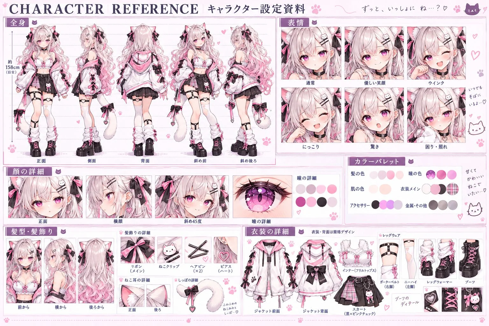

# Anime Character Reference Sheet from an Image (Japanese)

**中文标题：** 参考图→动漫角色设定资料（日文）  
**ID:** `gi25-x-966` · **Mode:** `edit`  
**Categories:** `character-consistency`  
**Tags:** `x-twitter`, `community`, `gpt-image-2.5`, `x-direct`, `ja`



### Anime Character Reference Sheet from an Image (Japanese)

```text
添付したキャラクター画像を参照し、アニメ・ゲーム制作に使用できる高品質で詳細なキャラクター設定資料（Character Reference Sheet）を1枚の画像として制作してください。

最重要条件：キャラクターのデザインを忠実に再現すること。

参照画像の顔立ち、髪型、髪色、瞳の色、体型、服装、アクセサリー、配色、特徴的な装飾を維持してください。

複数の角度や表情でも同一人物と認識できるようにしてください。デザインを勝手に簡略化したり、新しい衣装に変更したりしないでください。

画像全体の仕様

アスペクト比：横長3:2
推奨解像度：1536×1024以上
描画スタイル：高品質な日本のアニメイラスト
背景：白または淡いパステルカラー
デザイン：プロ仕様のキャラクター設定資料
各セクションを細い罫線で区切り、整然と配置
日本語の見出しを使用
キャラクターのテーマに合った装飾とカラーパレット
各パーツは見切れず、十分な余白を確保

① 全身設定（三面図＋斜め）

同じキャラクターを以下の5方向から描写する。

正面
真横（側面）
真後ろ（背面）
斜め45度前方
斜め45度後方

全身を頭頂から靴底まで表示。

各方向で身長、頭身、体型、衣装の構造が一致していること。

背面の髪型、服装、装飾は正面のデザインと矛盾しないように補完する。

② 表情差分（6種類）

顔のアップを2行×3列で配置。

通常：自然な表情
微笑み：優しい笑顔
笑顔：明るく楽しそう
ウインク：片目を閉じた表情
驚き：目を大きく開いた表情
照れ：頬を赤らめた表情

すべて同じ顔立ち、髪型、瞳のデザインを維持する。

③ 顔の詳細設定

顔の正面アップ
横顔アップ
斜め45度の顔
瞳の超拡大
瞳のグラデーションとハイライト
まつ毛、眉毛、前髪の形状

顔の輪郭と目鼻の位置関係を統一する。

④ 髪型・アクセサリー詳細

前から見た髪型
横から見た髪型
後ろから見た髪型
髪飾りの拡大図
耳飾りや首飾り
キャラクター固有の装飾

特徴的なパーツは個別の小さな枠に配置する。

⑤ カラーパレット

キャラクターの主要カラーを円形のカラースウォッチで表示。

髪の基本色と影色
瞳の基本色とハイライト
肌の色
衣装のメインカラー
衣装のサブカラー
アクセサリーの色
金属パーツの色

参照画像から色を抽出したような統一感を持たせる。

⑥ 衣装の詳細設定

衣装の各パーツを単体で描写する。

上着の正面と背面
インナー
ボトムス
靴下やレッグウェア
靴
ベルト、リボン、装飾品
キャラクター特有の衣装パーツ

装飾の位置、素材感、縫い目、留め具も細かく表現する。

レイアウト・仕上げ

画面上部に大きく「CHARACTER REFERENCE」と「キャラクター設定資料」を配置。
上段左側に全身設定、上段右側に表情差分。

中段に顔の詳細とカラーパレット。

下段に髪型、アクセサリー、衣装の詳細を配置。

高密度で情報量が多く、それでいて整理された美しいレイアウト。

精密な線画、丁寧な陰影、鮮やかで統一された色彩。

最優先事項：すべてのイラストが同一キャラクターであり、元画像のデザインを忠実に再現していること。

文字は読みやすい日本語で表記し、意味不明な文字や不要な説明文を極力排除する。

完成画像は、プロのキャラクターデザイナーが制作した公式設定資料集の1ページのような仕上がりにする。
```

- **Recommended model:** `gpt-image-2.5-sunburst`
- **Settings:** _(defaults)_
- **Source:** [community](https://x.com/nezukichii/status/2112686803333558365) — @nezukichii
- **License note:** Original public X post; quoted with attribution — remix with attribution
- **Notes:** Collected directly from X; prompt posted as the author's reply https://x.com/nezukichii/status/2112686803333558365 to https://x.com/nezukichii/status/2112686802729624001, which carries the images and names GPT Image 2.5; discovered via X search, prompt re-verified against the original X post via api.fxtwitter.com; verified=True; the reply also gives usage steps: attach the character image in ChatGPT, then paste the prompt
- **Preview:** `previews/gi25-x-966.webp`
