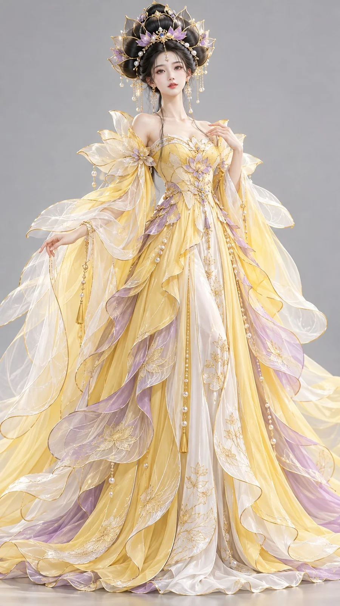

# Goose-Yellow Lotus Oriental Fantasy 3D Character

**中文标题：** 鹅黄灵妃东方幻想 3D 角色原型  
**ID:** `gi25-x-967` · **Mode:** `generate`  
**Categories:** `character-consistency`  
**Tags:** `x-twitter`, `community`, `gpt-image-2.5`, `x-direct`, `zh`



### Goose-Yellow Lotus Oriental Fantasy 3D Character

```text
9:16竖版，高精度风格化3D东方幻想女性角色原型，电影级CG渲染，融合东方莲花美学、明亮中国色与高级幻想服装设计。

一位24–27岁的成年东方幻想女性，五官精致柔美，清亮的杏眼，鼻唇秀气自然，肌肤白皙细腻且具有生命感，神态温柔、轻盈、梦幻。颈部修长，体态纤细高挑。

发型雕塑： 乌黑长发在头顶盘成巨大的莲瓣冠环式发髻。中央高髻向上隆起，外围一圈发束如花瓣般层层外展，形成完整而夸张的莲冠轮廓。发髻边缘点缀极细的浅金线、小型月白珠饰和少量藕荷色花蕊装饰，耳侧垂落细长长发。

服饰设计： 身穿以鹅黄为主色的东方幻想礼裙，肩部与上臂包裹大面积半透明花瓣形纱幕，纱幕从肩部向外轻柔鼓起，再缓缓垂下。内层裙体修长，外层以藕荷与月白交叠出多层花瓣式裙摆，边缘有细密莲脉刺绣和轻盈褶皱。整体服装像一朵盛开的明亮花体。

色彩控制： 鹅黄作为主体大面积主色，藕荷用于次级裙层和花瓣边缘，月白用于内裙与纱层缓冲，浅金仅用于细节描边和发饰。整体鲜艳明快但不俗气。

高精度3D人物渲染，真实细密发丝、轻透花瓣纱、柔亮真丝、细腻莲纹刺绣、柔和明亮影棚光，中性浅灰背景，正面全身完整构图。避免幼态、廉价糖果色、塑料皮肤、普通花仙子风格、文字与水印。
```

- **Recommended model:** `gpt-image-2.5-sunburst`
- **Settings:** _(defaults)_
- **Source:** [community](https://x.com/liyue_ai/status/2112583974992409070) — @liyue_ai
- **License note:** Original public X post; quoted with attribution — remix with attribution
- **Notes:** Collected directly from X; original post https://x.com/liyue_ai/status/2112583974992409070; post text names GPT Image 2.5; discovered via X search, prompt re-verified against the original X post via api.fxtwitter.com; verified=True
- **Preview:** `previews/gi25-x-967.webp`
