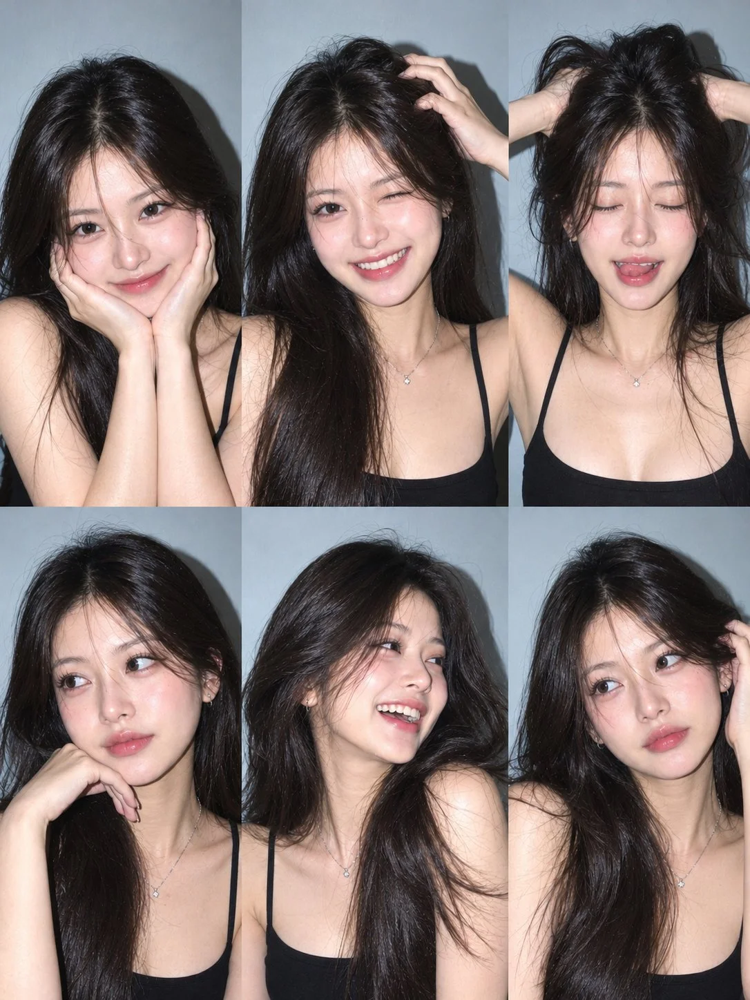

# 3×2 Six-Photo Collage from a Client Photo

**中文标题：** 客户照→3×2 六宫格人像拼贴  
**ID:** `gi25-x-975` · **Mode:** `edit`  
**Categories:** `character-consistency`, `edit-change-preserve`  
**Tags:** `x-twitter`, `community`, `gpt-image-2.5`, `x-direct`, `en`



### 3×2 Six-Photo Collage from a Client Photo

```text
Ultra-realistic 6-photo collage (3×2 grid) of the same person using client photo for identity only (exact face, facial features, eye color, natural hair color/length/volume/texture). Plain light grey-blue wall background, black thin-strap camisole, minimal jewelry, Canon PowerShot G7X Mark III strong direct flash, hard shadows, sharp focus, natural skin texture, slight film grain.

Instagram photo dump aesthetic. Six unique expressions/poses: (1) soft smile, hands on cheeks, (2) wink, big smile, hand in hair, (3) eyes closed, tongue slightly out, both hands lifting hair, (4) confident side glance, hand under chin, (5) laughing, looking away, hair flipped, (6) dreamy look, hand touching hair. Different hair positions in every frame. No AI look, no distorted hands, no extra fingers. --ar 3:4
```

- **Recommended model:** `gpt-image-2.5-sunburst`
- **Settings:** _(defaults)_
- **Source:** [community](https://x.com/MissDelulu9/status/2113461687902994578) — @MissDelulu9
- **License note:** Original public X post; quoted with attribution — remix with attribution
- **Notes:** Collected directly from X; original post https://x.com/MissDelulu9/status/2113461687902994578; post text names GPT Image 2.5; discovered via Bin0754/gpt-image-gallery index, prompt re-verified against the original X post via api.fxtwitter.com; verified=True
- **Preview:** `previews/gi25-x-975.webp`
