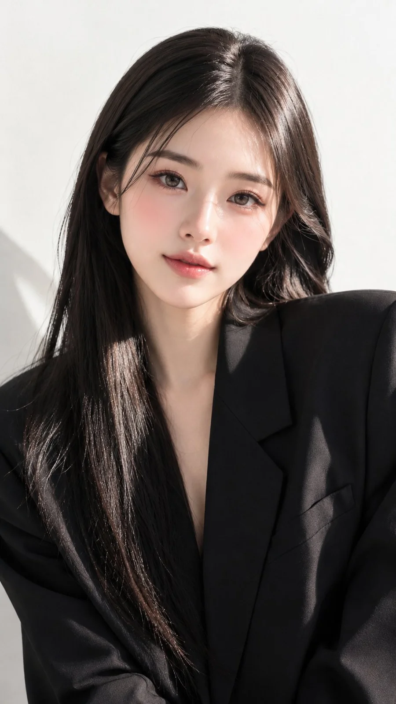

# Chest-Up Editorial Portrait from a Reference Girl

**中文标题：** 参考人物→胸像时尚大片  
**ID:** `gi25-x-991` · **Mode:** `edit`  
**Categories:** `character-consistency`, `edit-change-preserve`  
**Tags:** `x-twitter`, `community`, `gpt-image-2.5`, `x-direct`, `en`



### Chest-Up Editorial Portrait from a Reference Girl

```text
Use the girl from the reference image and preserve her face, identity, proportions, and overall appearance exactly. Ultra-realistic 9:16 chest-up editorial portrait. She sits with a slight head tilt, looking directly at the camera with a calm, confident expression. Long straight glossy hair with a clean center part.

Wearing a structured oversized black blazer with broad shoulders. Natural luxury makeup with luminous skin, soft brown eyeshadow, subtle eyeliner, defined lashes, and nude glossy lips. Clean white minimalist background with soft side sunlight creating elegant shadows. Shot on a Sony A7R IV, 85mm f/1.4, shallow depth of field, cinematic lighting, realistic skin texture, 8K RAW, premium fashion editorial, no facial changes, no distortion, no plastic skin, no text, logo, or watermark.
```

- **Recommended model:** `gpt-image-2.5-sunburst`
- **Settings:** _(defaults)_
- **Source:** [community](https://x.com/MissDelulu9/status/2114321139959001218) — @MissDelulu9
- **License note:** Original public X post; quoted with attribution — remix with attribution
- **Notes:** Collected directly from X; original post https://x.com/MissDelulu9/status/2114321139959001218; post text names GPT Image 2.5; discovered via Bin0754/gpt-image-gallery index, prompt re-verified against the original X post via api.fxtwitter.com; verified=True
- **Preview:** `previews/gi25-x-991.webp`
