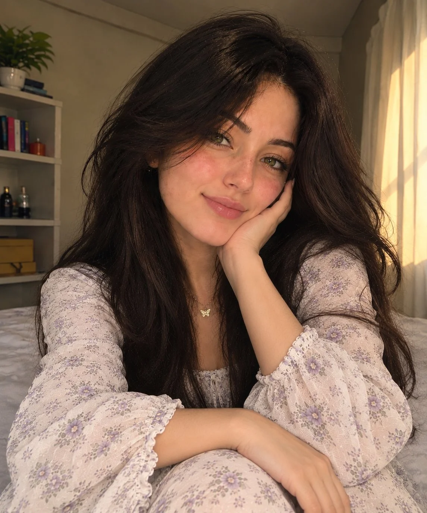

# Ethereal Bloom Portrait from Two References

**中文标题：** 双参考图→空灵花境人像  
**ID:** `gi25-x-996` · **Mode:** `edit`  
**Categories:** `character-consistency`, `edit-change-preserve`  
**Tags:** `x-twitter`, `community`, `gpt-image-2.5`, `x-direct`, `en`



### Ethereal Bloom Portrait from Two References

```text
Create an ultra-photorealistic, exquisitely detailed portrait inspired by the two uploaded reference images. Use my original face reference as the primary identity source, preserving my recognizable facial features, natural face shape, hazel-green eyes, delicate freckles, natural eyebrows, nose, lips, skin tone, and long, voluminous dark brown hair.

POSE & HAND PLACEMENT:
Create a charming, candid bedroom selfie with a completely natural and elegant pose. I am sitting comfortably on a bed, leaning slightly toward the camera with my head tilted gently to one side and a soft, adorable smile. One hand rests delicately against my cheek, with relaxed fingers, while my other arm rests naturally across my lap, clearly visible in the frame. Both hands must be fully visible, anatomically correct, and beautifully positioned, with realistic fingers and natural proportions. My expression should feel warm, playful, serene, and effortlessly photogenic.

OUTFIT & MODEST ELEGANCE:
Dress me in a luxurious off-white floral outfit featuring delicate lavender and muted sage-green botanical prints. The blouse has a modest, fully covered neckline, elegant long puff sleeves, fine embroidered details, delicate ruffled cuffs, and premium lightweight fabric. Pair it with matching high-waisted, full-length trousers or a graceful flowing skirt that keeps the entire outfit modest and coordinated. No exposed cleavage, no transparent fabric revealing skin, no bare midriff, and no revealing cuts. The outfit should look refined, feminine, comfortable, and exceptionally beautiful.

Add a tiny gold butterfly pendant necklace and subtle, elegant accessories. Keep the styling sophisticated rather than excessive.

HAIR & MAKEUP:
Long, thick, naturally tousled dark brown hair cascading over both shoulders, with soft face-framing strands. Minimal fresh makeup, naturally rosy cheeks, subtle eyeliner, softly defined lashes, and a delicate pink lip gloss. Preserve realistic skin texture, visible freckles, and natural facial details without excessive smoothing.

SETTING & ATMOSPHERE:
A cozy, aesthetically styled bedroom with soft neutral bedding, a bookshelf filled with books, a small green indoor plant, understated decorative objects, and warm beige curtains. Golden-hour sunlight filters through the curtains, creating delicate highlights in my hair and gentle shadows across the room. The environment should feel authentic, peaceful, intimate, and naturally luxurious.

CAMERA & PHOTOGRAPHIC REALISM:
Premium smartphone portrait photography, natural selfie perspective, realistic proportions, detailed individual hair strands, lifelike eyes, authentic skin pores, accurate hands, finely rendered fabric textures, balanced exposure, and softly blurred background details. Use warm cinematic color grading with natural golden highlights and gentle tonal depth.

UNIQUE AESTHETIC:
Blend ethereal sophistication, botanical romanticism, candid intimacy, and luminous realism into one cohesive visual identity. The final photograph should resemble a genuine, beautifully captured personal portrait rather than a synthetic or heavily retouched image.

STRICT GENERATION REQUIREMENTS:

- Generate one single portrait image, not a collage.
- Preserve my identity using my uploaded face reference.
- Use both provided images for pose and styling inspiration.
- Keep both hands visible in a natural, graceful position.
- Maintain a modest, fully covered outfit with no revealing areas.
- Keep the floral outfit and warm bedroom aesthetic harmonious.
- Avoid distorted fingers, extra hands, artificial skin, exaggerated facial features, excessive makeup, and unrealistic body proportions.
- Prioritize photorealism, elegance, and natural beauty.
```

- **Recommended model:** `gpt-image-2.5-sunburst`
- **Settings:** _(defaults)_
- **Source:** [community](https://x.com/AIwithWania/status/2113987071803294097) — @AIwithWania
- **License note:** Original public X post; quoted with attribution — remix with attribution
- **Notes:** Collected directly from X; original post https://x.com/AIwithWania/status/2113987071803294097; post text names GPT Image 2.5; discovered via Bin0754/gpt-image-gallery index, prompt re-verified against the original X post via api.fxtwitter.com; verified=True
- **Preview:** `previews/gi25-x-996.webp`
