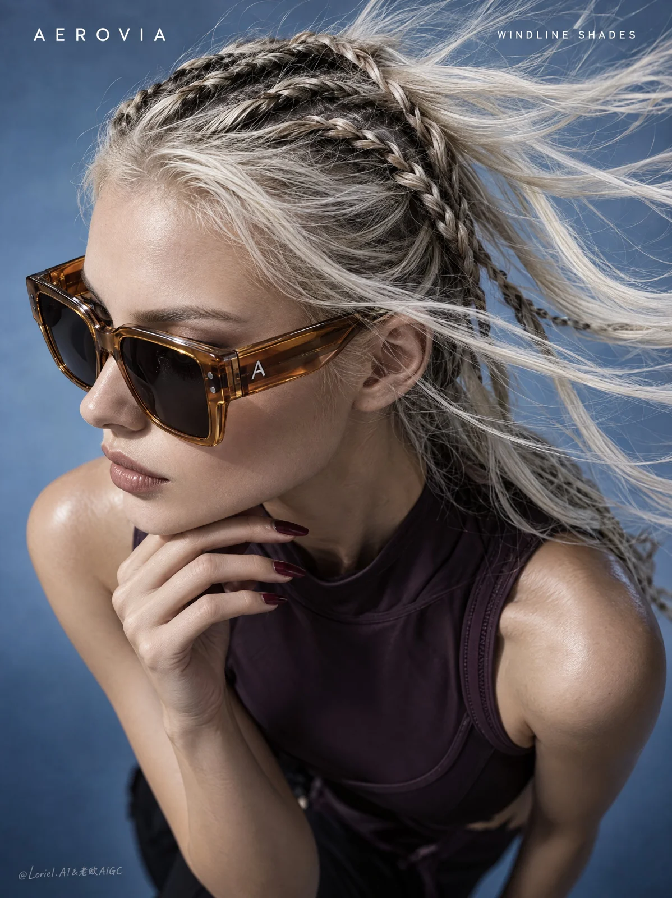

# Wind-Swept Luxury Eyewear Poster

**中文标题：** 风动发丝奢华眼镜海报  
**ID:** `gi25-x-1051` · **Mode:** `generate`  
**Categories:** `ecommerce`, `poster-typography`  
**Tags:** `x-twitter`, `community`, `gpt-image-2.5`, `x-direct`, `en`



### Wind-Swept Luxury Eyewear Poster

```text
A full-bleed vertical luxury eyewear poster for the original overseas brand "AEROVIA", combining wind-driven profile tension, precise eyewear-and-hair detail, and a reduced curatorial layout. The hero product is the "WINDLINE SHADES": oversized translucent amber sunglasses shown in high-fashion studio photography from an extreme high overhead three-quarter angle.

Show an adult female model, clearly over 20, in a left-facing profile with head slightly lowered, cropped from head and flying hair to upper torso. The face, sunglasses, and hand form a compact diagonal from upper left to lower center. One hand rests under the chin with elongated fingers and deep burgundy nails, staying below the jawline and away from the lenses. The sunglasses must be the sharpest element: oversized square frames with warm translucent amber acetate rims, thick sculpted temples, dark smoke lenses, black hinge details, and a tiny original silver "A" mark on the side arm. Keep rim thickness, bridge form, hinge pins, temple connection, lens reflections, and face contact structurally believable.

Hair is platinum blonde in tight dark-and-blonde braids wrapping the scalp, with loose wind-blown strands sweeping toward the upper right as the main motion cue. A sleeveless dark plum technical top remains secondary and acts only as a grounding mass. Use a minimal cool blue-gray gradient studio background with no props or scenery. Depth comes from the overhead angle, floating hair strands, hand-to-face overlap, the sunglass silhouette, and soft falloff under the shoulders.

Lighting is hard-soft studio light from the upper left, creating highlights on the amber acetate, cheekbone, platinum strands, burgundy nails, and shoulder, with cool fill preserving shadow detail. Color hierarchy: blue-gray background as the dominant field, amber sunglasses as the hero accent, platinum hair as motion highlight, dark plum top as the grounding tone, burgundy nails as a small secondary accent.

Keep highest detail on the eyewear and hair: glossy amber acetate, smoke lens reflections, hinge pins, temple edges, bridge geometry, braided texture, loose strands, and clean hand contact near the jaw. Skin stays realistic with natural editorial texture. Hair edges remain fine and separated.

Exact visible text only:
Top-left: "AEROVIA"
Top-right: "WINDLINE SHADES"
Typography: small white uppercase sans serif with wide spacing, placed in the upper corners away from the face, hair, hand, and sunglasses.

Negative constraints: no distorted profile, broken sunglass geometry, missing temples, extra hands, distorted fingers, impossible neck angle, or hair covering the eyewear; no plastic skin, muddy amber acetate, dead black lenses, smeared hair, flat light, or dirty background; no copied real logos, misspelled "AEROVIA", extra text, gibberish marks, or typography over the face or sunglasses; no street background, excessive jewelry, sci-fi interface, painterly drift, collage artifacts, or low-quality eyewear edges.
```

- **Recommended model:** `gpt-image-2.5-sunburst`
- **Settings:** _(defaults)_
- **Source:** [community](https://x.com/ou_zhen599/status/2114043771960852718) — @ou_zhen599
- **License note:** Original public X post; quoted with attribution — remix with attribution
- **Notes:** Collected directly from X; original post https://x.com/ou_zhen599/status/2114043771960852718; post text names GPT Image 2.5; discovered via Bin0754/gpt-image-gallery index, prompt re-verified against the original X post via api.fxtwitter.com; verified=True; original post compares GPT Image 2.5 (left) with Nano Banana 2.1 (right) on the same prompt; the brand is fictional
- **Preview:** `previews/gi25-x-1051.webp`
