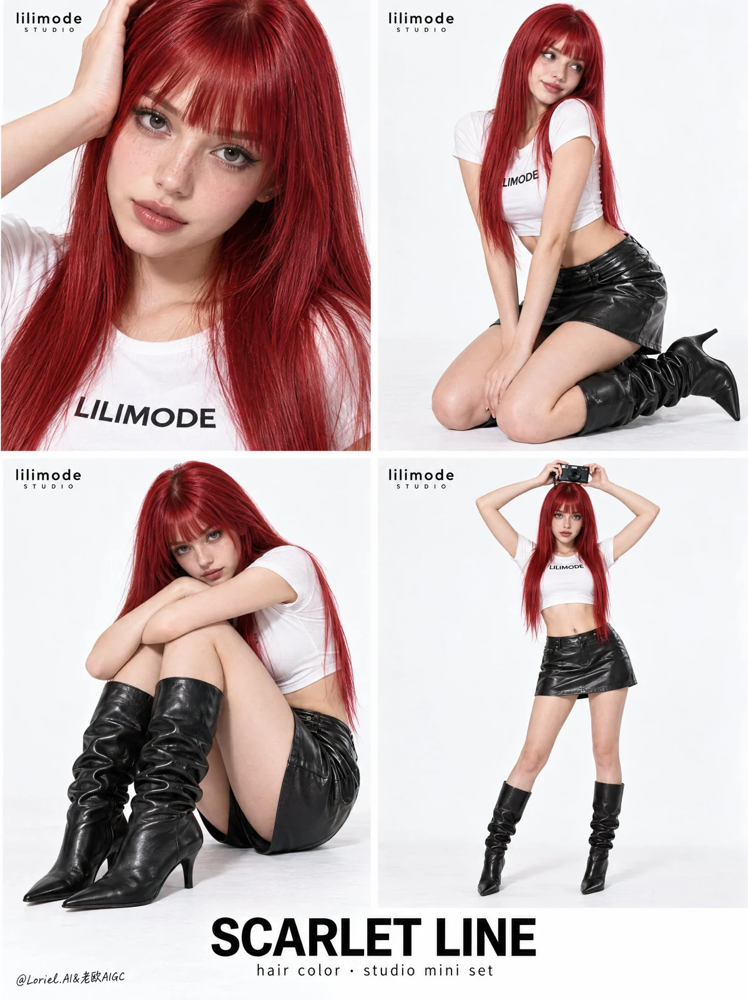

# Scarlet Hair Color 2×2 Studio Lookbook Poster

**中文标题：** 绯红发色 2×2 影棚 Lookbook 海报  
**ID:** `gi25-x-1052` · **Mode:** `generate`  
**Categories:** `ecommerce`, `poster-typography`  
**Tags:** `x-twitter`, `community`, `gpt-image-2.5`, `x-direct`, `en`



### Scarlet Hair Color 2×2 Studio Lookbook Poster

```text
A full-bleed vertical beauty fashion poster for the original overseas studio brand "LILIMODE", designed as a clean high-key 2x2 studio lookbook. The hero product is the "SCARLET LINE HAIR COLOR + STUDIO MINI SET": the same clearly adult Western female model, around 20, with vivid scarlet-red straight hair, blunt bangs, a white cropped "LILIMODE" tee, black leather mini skirt, and black slouch knee boots across all four panels.

Use four clean rectangular panels with narrow white spacing on a pure white seamless background. Upper-left: extreme beauty close-up, face tilted gently, one hand near the hairline, red hair filling the right side as the main product texture. Upper-right: kneeling three-quarter fashion pose with torso and skirt visible, boots forming a strong black silhouette beside the legs. Lower-left: low seated crouch with relaxed arms over knees, boots and skirt structure clearly readable. Lower-right: full-body standing pose holding a compact black camera above the head, long straight scarlet hair falling down both sides. The four panels must feel like one continuous editorial studio session.

Keep the red hair as the strongest identity anchor in every frame: glossy smooth strands, even scarlet saturation, long vertical flow. The compact camera appears only in the lower-right panel and stays secondary. Expressions vary subtly: gentle direct gaze in the close-up, shy side-leaning gaze in the kneeling shot, quiet playful intensity in the crouch, composed camera-facing look in the standing pose. Body language stays controlled and fashion-forward, emphasizing hair length, hair color, leather texture, and boot shape.

Use soft high-key studio lighting from the front upper left with gentle fill, very soft floor contact shadows only where needed, and clear separation between red hair, black leather, and the white background. Color hierarchy: white studio field and tee as the dominant base, scarlet-red hair as the main product color, black skirt and boots as the graphic anchor, natural skin tone as warmth. Preserve detail in hair strands, glossy sheen, tee fabric and printed logo, leather grain, boot folds, pointed toes, heel edges, and realistic skin texture.

Exact visible text only: small "LILIMODE" near the top-left of each panel, tiny "STUDIO" beneath, tee text "LILIMODE", bold bottom-center title "SCARLET LINE", and product line "hair color · studio mini set". Keep typography sparse, crisp, and away from the face, hairline, and boots.

Negative constraints: no underage appearance, no childlike styling, no extra models, no identity drift, no mismatched hair color or outfit pieces, no distorted limbs or broken hands, no chaotic panel layout, no dull or muddy red hair, no plastic skin, no crushed black leather, no dirty floor, no harsh shadows, no misspelled "LILIMODE", no extra text, no typography over face, hair, or boots, no street background, no excessive accessories, no collage artifacts, no painterly drift, no low-quality hair edges.
```

- **Recommended model:** `gpt-image-2.5-sunburst`
- **Settings:** _(defaults)_
- **Source:** [community](https://x.com/ou_zhen599/status/2114039058381115815) — @ou_zhen599
- **License note:** Original public X post; quoted with attribution — remix with attribution
- **Notes:** Collected directly from X; original post https://x.com/ou_zhen599/status/2114039058381115815; post text names GPT Image 2.5; discovered via Bin0754/gpt-image-gallery index, prompt re-verified against the original X post via api.fxtwitter.com; verified=True; original post compares GPT Image 2.5 (left) with Nano Banana 2.1 (right) on the same prompt; the brand is fictional
- **Preview:** `previews/gi25-x-1052.webp`
