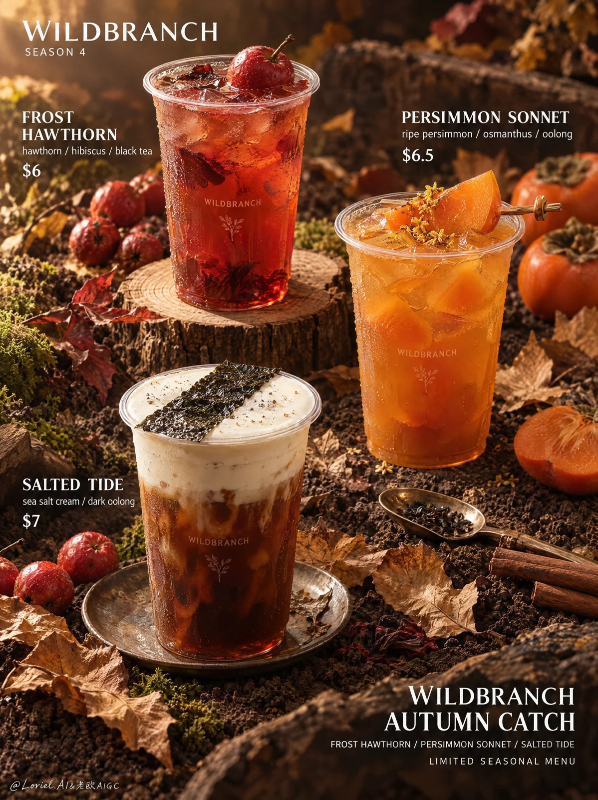

# Late-Autumn Tea & Fruit Beverage Campaign Poster

**中文标题：** 深秋水果茶饮广告海报  
**ID:** `gi25-x-1053` · **Mode:** `generate`  
**Categories:** `ecommerce`, `poster-typography`  
**Tags:** `x-twitter`, `community`, `gpt-image-2.5`, `x-direct`, `en`



### Late-Autumn Tea & Fruit Beverage Campaign Poster

```text
A vertical premium seasonal beverage campaign poster for an original contemporary tea-and-fruit brand, designed as a warm late-autumn still-life ad where realistic drinks, orchard materials, and editorial typography merge into one upscale commercial image. The visual language is earthy, tactile, and quietly luxurious: soft atmospheric depth, believable drink rendering, a low-key amber-brown palette, and typography integrated into the product field. The mood is nostalgic, harvest-rich, and refined, never trendy or futuristic.

All visible text in English only.
Top left logo:
“WILDBRANCH”
Directly below:
“SEASON 4”

Near the upper-left drink:
“FROST HAWTHORN”
“hawthorn / hibiscus / black tea”
“$6”

Near the upper-right drink:
“PERSIMMON SONNET”
“ripe persimmon / osmanthus / oolong”
“$6.5”

Near the lower-left drink:
“SALTED TIDE”
“sea salt cream / dark oolong”
“$7”

Bottom-right campaign block:
“WILDBRANCH”
“AUTUMN CATCH”
“FROST HAWTHORN / PERSIMMON SONNET / SALTED TIDE”
“LIMITED SEASONAL MENU”

No extra slogans, QR codes, certifications, or random copy.

Vertical full-bleed poster. Three drinks form a stable triangular composition on an autumn ground: one cup in the upper-left on a cut wood slice, one in the upper-right slightly lower and closer, and one milk-cap tea in the lower-left foreground on a small plate. Text clusters sit near each drink with clear breathing room and consistent hierarchy. The top-left logo anchors the page; the bottom-right campaign block balances it. The drinks must remain the strongest focus.

The campaign presents three autumn drinks as edible fragments of orchard, leaf-litter, and sea wind. Each drink must feel physically believable in a transparent takeaway cup with subtle condensation, accurate opacity, and readable layering. The upper-left drink is a translucent red-amber hawthorn tea topped with one glossy hawthorn fruit. The upper-right drink is a dense orange-gold persimmon tea topped with a skewered soft persimmon wedge. The lower-left drink is a dark tea base topped with thick off-white salted milk foam and a diagonal sheet of dark seaweed across the foam. Cup printing should be minimal and secondary.

The products sit in a curated autumn terrain of dark soil, dried curled leaves, mossy clumps, scattered small red fruits, one or two cinnamon sticks, a shallow metal spoon, and a few cut wood discs. Every prop supports flavor storytelling and material contrast. The soil acts as a natural display stage, not a messy outdoor ground.

Use soft warm directional light from upper left with gentle falloff. Create amber highlights on cup rims, glossy fruit skins, persimmon flesh, and wet drink surfaces, while keeping soil and dried leaves in rich textured shadow. Palette: burnt umber, dark soil brown, dried leaf tan, hawthorn red, persimmon orange, smoked tea brown, creamy foam white, and small moss-green accents. Preserve shadow detail and avoid dead black collapse.

The drinks must read as real beverages: accurate transparency, viscosity, foam thickness, fruit weight, and liquid meniscus. Plastic cups should feel clean and slightly reflective, with realistic rim thickness and subtle printed brand text. Fruits should show believable skin texture and moisture. Leaves should look dry and brittle. Soil should feel loose, granular, dark, and clean. Wood slices should show visible rings and dry cut edges. Metal spoon and plate should have soft low-luster reflections.

Typography must feel designed into the image. Flavor titles are the dominant text blocks near each cup, set in bold clean white type with elegant spacing and high contrast. Subtitles sit beneath in smaller refined sans-serif. Prices are compact and separated clearly. The top-left logo and bottom-right block should align with the poster grid and negative space. All text must be sharp, correctly spelled, and fully readable.

The image should feel like a premium seasonal menu poster with selective depth control: cup surfaces, garnish elements, and nearby text stay crisp, while distant leaves and background props soften gently. The eye path moves from logo to upper-left drink, to upper-right drink, down to the lower-left milk foam drink, and finally to the campaign block.

Avoid chaotic props, weak cup hierarchy, centered symmetry, blocked text zones, floating garnishes, cups merging into the background, plastic-looking fruit, fake CGI gloss, muddy drinks, dead black soil, chrome-like metal highlights, flat lighting, overexposed foam, gibberish text, misspellings, random logos, warped typography, futuristic elements, neon colors, oversaturated orange, HDR sharpness, messy cafe styling, visual clutter, impossible liquid layering, broken cup rims, distorted fruit proportions, or inconsistent cup size and perspective.
```

- **Recommended model:** `gpt-image-2.5-sunburst`
- **Settings:** _(defaults)_
- **Source:** [community](https://x.com/ou_zhen599/status/2112845486734651837) — @ou_zhen599
- **License note:** Original public X post; quoted with attribution — remix with attribution
- **Notes:** Collected directly from X; original post https://x.com/ou_zhen599/status/2112845486734651837; post text names GPT Image 2.5; discovered via Bin0754/gpt-image-gallery index, prompt re-verified against the original X post via api.fxtwitter.com; verified=True; original post compares GPT Image 2.5 (left) with Nano Banana 2.1 (right) on the same prompt; the brand is fictional
- **Preview:** `previews/gi25-x-1053.webp`
