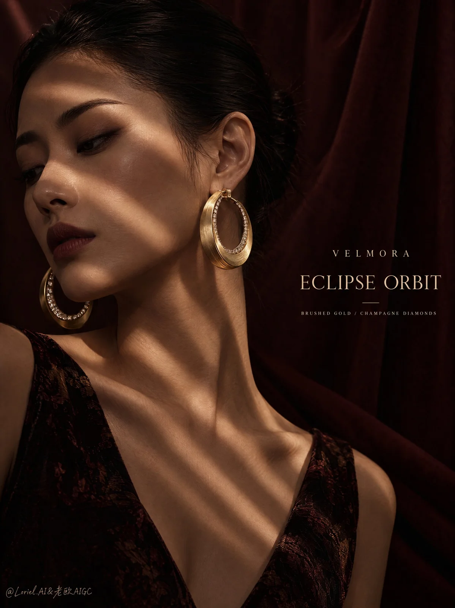

# Dark Editorial Luxury Jewelry Poster

**中文标题：** 暗调编辑风奢华珠宝海报  
**ID:** `gi25-x-1061` · **Mode:** `generate`  
**Categories:** `ecommerce`, `poster-typography`  
**Tags:** `x-twitter`, `community`, `gpt-image-2.5`, `x-direct`, `en`



### Dark Editorial Luxury Jewelry Poster

```text
A vertical luxury jewelry advertising poster for an original overseas maison, rendered in a dark editorial fashion-photography language with low-key cinematic lighting, warm bronze-and-oxblood grading, velvety shadow density, and a collectible luxury print finish. The image should preserve the core structure: a calm side-facing female portrait, narrow bands of directional light cutting through darkness, rich drapery depth, and restrained high-fashion intimacy.

Create the jewelry maison “VELMORA”.
Hero product: a pair of sculptural high-jewelry hoop earrings named “ECLIPSE ORBIT”.
The earrings are the absolute focal point: large circular hoops in brushed antique gold, slightly heavier at the lower curve, with a subtle inner rim of pavé champagne diamonds and a refined hinge at the lobe. The near earring should feel slightly thicker and more materially weighted, so the circular silhouette reads immediately as the first memory of the image. Both earrings must remain fully believable as real premium jewelry.

The campaign visualizes the earrings as luminous rings cutting through shadow. The model serves only as the atmospheric bearer of the object. Slatted light across face, neck, and shoulder exists to direct the eye toward the gold circles and make the earrings feel like concentrated architecture of light inside darkness. The concept remains tightly edited: shadow, skin, orbit, gold.

Vertical full-bleed composition. Close portrait from upper torso to above the head, the woman placed slightly left of center in a soft three-quarter side profile. The right side of the frame is dominated by simplified deep wine-brown drapery, darker and cleaner than before, creating richer negative space and stronger product separation. Both earrings must be clearly visible, with the near earring dominant and the far earring secondary but legible. Typography sits discreetly in the dark breathing room.

One adult East Asian woman only, with slicked-back hair, elegant long neck, calm lowered gaze, and restrained editorial expression. Makeup is controlled and luxurious: matte skin, softly defined eyes, deep muted berry-brown lip. She wears a dark sleeveless garment with only the faintest warm-toned pattern trace near the shoulder, reduced so wardrobe never competes with the jewelry. No necklace, no extra jewelry, no unnecessary accessories.

Use a narrow directional key light cast through slatted shadow, crossing the face, shoulder, and upper body diagonally. The warm light must articulate the earrings with stronger bronze-gold edge separation while preserving deep but transparent shadow. Palette: 60% deep oxblood, espresso brown, and controlled shadow-black; 30% warm skin beige and muted copper light; 10% antique gold and champagne sparkle. The garment and backdrop should both sit darker and quieter than before, leaving the earrings and light bands as the dominant contrast system.

Skin remains natural and refined, with subtle pore-level realism and believable shadow falloff, never over-retouched. The gold hoops must show convincing brushed-metal grain, softened highlight rolloff, faint warm environmental reflections, and very restrained diamond scintillation only along the inner edge. The near hoop should feel slightly more substantial in thickness and edge weight. The drapery should read as dense matte luxury fabric with low-luster folds and deep wine-brown richness. Hair stays sleek and physically believable. The whole image must read as premium photographic capture, not CGI or illustration.

All visible text in English only.
Main brand line in small elegant serif:
“VELMORA”
Product title beneath in larger refined serif:
“ECLIPSE ORBIT”
Optional micro descriptor in very small uppercase:
“BRUSHED GOLD / CHAMPAGNE DIAMONDS”
Typography must sit in the dark negative space, sharply readable, widely spaced, and never touch the earrings, jawline, or main light stripe. No extra slogan, seals, campaign paragraph, or decorative text.

The near earring is the first read. The face is the second. The far earring is the third. The striped light is the guide, not the subject. The simplified backdrop and muted garment exist only to stabilize the frame and intensify the jewelry silhouette. The image must read unambiguously as a jewelry campaign rather than a beauty portrait.

The emotional register is intimate, nocturnal, poised, and aristocratic. The poster should suggest that VELMORA creates jewelry that behaves like controlled light in darkness: sculptural, sensual, and exact. The viewer should remember three things in order: the circular gold form, the slatted light, and the calm face carrying it.

Avoid portrait-first hierarchy, tiny unreadable earrings, hair covering the hoops, symmetrical flat posing, cluttered styling, extra jewelry, chrome-like gold, cheap yellow metal, plastic skin, glossy makeup, dead black shadow blocks, blown-out stripes, fake glitter, gibberish text, oversized brand text, warped serif letters, futuristic cues, neon color, overprocessed retouching, HDR sharpness, greasy skin sheen, noisy backgrounds, AI artifacts, distorted ears, broken jawline, malformed neck, incorrect earring attachment, extra limbs, or warped shoulders.
```

- **Recommended model:** `gpt-image-2.5-sunburst`
- **Settings:** _(defaults)_
- **Source:** [community](https://x.com/ou_zhen599/status/2112923955216691373) — @ou_zhen599
- **License note:** Original public X post; quoted with attribution — remix with attribution
- **Notes:** Collected directly from X; original post https://x.com/ou_zhen599/status/2112923955216691373; post text names GPT Image 2.5; discovered via Bin0754/gpt-image-gallery index, prompt re-verified against the original X post via api.fxtwitter.com; verified=True; original post compares GPT Image 2.5 (left) with Nano Banana 2.1 (right) on the same prompt; the brand is fictional
- **Preview:** `previews/gi25-x-1061.webp`
