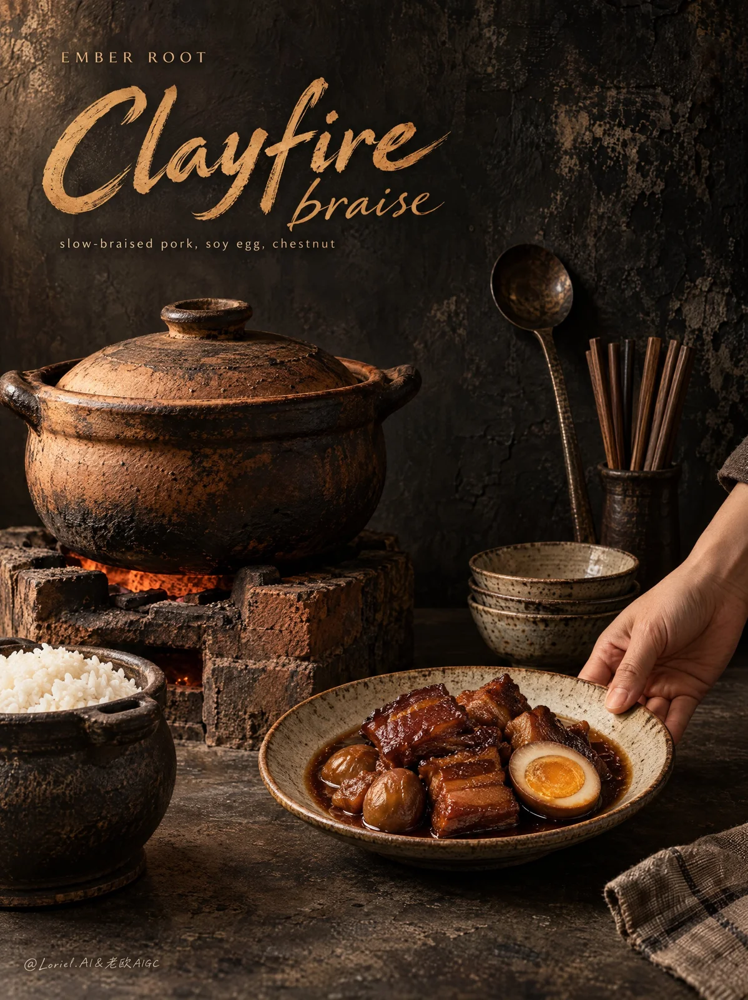

# Vintage Heritage Kitchen Food Poster

**中文标题：** 复古传承厨房美食海报  
**ID:** `gi25-x-1062` · **Mode:** `generate`  
**Categories:** `ecommerce`, `poster-typography`  
**Tags:** `x-twitter`, `community`, `gpt-image-2.5`, `x-direct`, `en`



### Vintage Heritage Kitchen Food Poster

```text
A premium vintage food advertising poster for an original overseas heritage kitchen brand, built as an old-world editorial still life fused with elegant poster typography. The image should feel antique, collected, and luxurious while preserving the rustic honesty of the dish: realistic food and utensils, painterly low-key atmosphere, subtle analog richness, aged surface depth, restrained contrast, and a quiet museum-quality finish. The mood is heritage, slow fire, dark warmth, and cultivated taste.

All visible text in English only:
Top left small refined uppercase wordmark: “EMBER ROOT”
Large warm ochre hand-painted script title: “Clayfire”
Smaller italic continuation: “braise”
Supporting line beneath in small elegant sans-serif: “slow-braised pork, soy egg, chestnut”
No extra slogans, badges, certifications, or copy.

Vertical full-bleed poster. Preserve a large field of dark breathing space in the upper half for typography. The lower half holds the product world: an aged clay pot on a rough brick stove slightly left of center, a plated serving in the lower-right foreground, and a smaller rice pot in the lower-left foreground. The visual path should descend from the warm title to the clay pot, then to the serving hand and plated dish. Keep the layout calm, sparse, and expensive.

The hero product is a slow clay-braised pork dish from EMBER ROOT, presented as the essence of ember heat, time, and reduced sauce. The clay pot is the source vessel; the plated serving is the hero close-up. On the plate: lacquered braised pork pieces, one halved soy-cured egg with a dense golden yolk, whole chestnuts, and a shallow pool of glossy deep amber braising liquid. The food must feel rich, slow-cooked, deeply infused, and fully edible.

An adult hand enters from the right edge, gently setting or adjusting the plate. Only the hand and partial forearm are visible. The gesture should feel natural, careful, and service-oriented, adding warmth, scale, and immediacy.

Keep only essential props: a bundle of chopsticks and an aged metal ladle in the mid-right background, a small stack of ceramic bowls near the hand, and the rice pot in the lower-left foreground. No decorative clutter, no scattered garnish styling, no unnecessary ingredients.

The backdrop is a deep charcoal-black aged plaster wall with matte wear, mineral bloom, and subtle patina. The tabletop is dark stone or sealed concrete with soft low reflections and restrained texture. The setting should feel like a preserved heritage kitchen stripped to only meaningful elements.

Use soft directional warm light from upper left, like late tungsten mixed with faint daylight residue. Let it gently strike the clay lid, plate rim, egg yolk, sauce surface, hand, and brick edges, while the wall remains dark and atmospheric with visible texture. Palette: charcoal black, soot brown, fired clay orange, muted brick red, old brass, warm ochre lettering, beige ceramic, dark soy brown, and egg-gold. Preserve dark detail and tonal separation; avoid dead black collapse. The contrast should feel velvety, nostalgic, and high-end.

The clay pot should show porous earthenware grain, smoke-darkened rims, firing irregularities, and believable age. The brick stove should read as dry, chalky, chipped, and structural. Food must be highly convincing: pork with dense braised surfaces and slight fiber at torn edges, egg white smooth and firm, yolk matte-golden and softly set, chestnuts compact and satin-dry, sauce reduced and reflective without looking artificial. Ceramic glaze should show subtle pooling and aged refinement. Metal tools should appear softly worn, not shiny. The hand should have natural skin tone, realistic joints, clean nails, and credible contact shadows.

Typography must feel designed into the poster, not added later. “EMBER ROOT” is small, precise, and quiet. “Clayfire” is the main gesture in warm aged ochre, with hand-painted flow and archival sign-painter character. “braise” should continue the motion lightly. The supporting line must remain crisp, small, and clear. All text stays in the upper-left dark field and never overlaps the product silhouette.

Give the whole image a subtle old editorial print sensibility: gentle low-saturation warmth, faint archival depth, rich shadow transparency, restrained patina, and handcrafted permanence. The scene should feel timeless, expensive, and nostalgic without becoming dusty or dirty.

Avoid overcrowded props, weak hierarchy between pot and plated dish, empty black areas with no wall texture, broken contact shadows, plastic food surfaces, fake CGI gloss, muddy sauce, chrome-like reflections, dead black blocks, random dirt, flat lighting, gibberish text, extra labels, warped lettering, futuristic elements, neon color, excessive steam, hyper-sharpened HDR, greasy chaos, visual clutter, and malformed hand anatomy.
```

- **Recommended model:** `gpt-image-2.5-sunburst`
- **Settings:** _(defaults)_
- **Source:** [community](https://x.com/ou_zhen599/status/2112837995770593738) — @ou_zhen599
- **License note:** Original public X post; quoted with attribution — remix with attribution
- **Notes:** Collected directly from X; original post https://x.com/ou_zhen599/status/2112837995770593738; post text names GPT Image 2.5; discovered via Bin0754/gpt-image-gallery index, prompt re-verified against the original X post via api.fxtwitter.com; verified=True; original post compares GPT Image 2.5 (left) with Nano Banana 2.1 (right) on the same prompt; the brand is fictional
- **Preview:** `previews/gi25-x-1062.webp`
