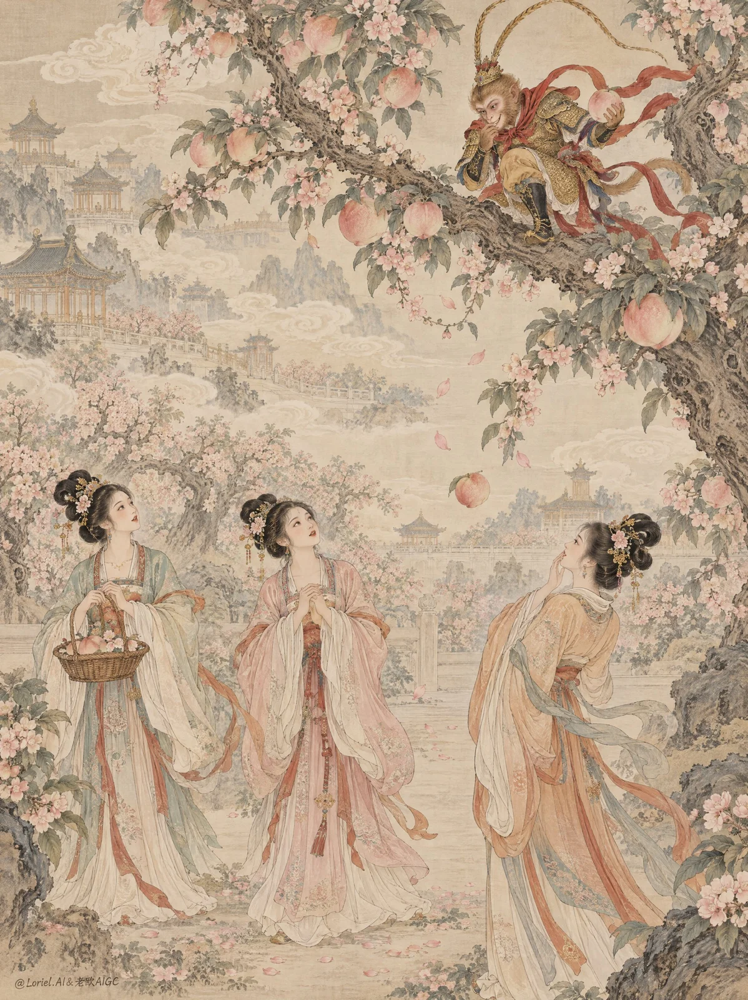

# Product-First Couture Cosmetics Beauty Poster

**中文标题：** 产品优先高定彩妆美妆海报  
**ID:** `gi25-x-1063` · **Mode:** `generate`  
**Categories:** `ecommerce`, `poster-typography`  
**Tags:** `x-twitter`, `community`, `gpt-image-2.5`, `x-direct`, `en`



### Product-First Couture Cosmetics Beauty Poster

```text
A Cannes Lions caliber luxury beauty poster for the fictional couture cosmetics house NOIRA, built as a product-first editorial beauty image. Preserve the exact visual architecture and light hierarchy: a full-bleed vertical close-up against a stark pale white background, the upper face buried in deep shadow, a hard shadow band cutting across the eyes, the head slightly lifted, and glossy red lips as the single most saturated and dominant focal point. The lipstick must feel like the source of the attitude, tension, and entire visual narrative.

Tight full-bleed vertical crop from just above the head to below the collarbones, centered and confrontational, with no border or margin. The model faces frontally with chin raised, neck elongated, shoulders bare, and collarbones sharply modeled by hard light. The mouth sits just above center as the emotional and commercial anchor. Preserve the severe contrast: the upper face remains nearly unreadable except for faint structural cues, while the lips, teeth, lower cheeks, throat, clavicles, and shoulder highlights are rendered with precision. No props, no product pack, no competing objects.

The hero product is a high-lacquer couture lipstick finish in deep blood-crimson to dark wine red, with dense pigment, mirror-like wet gloss, crisp lip edges, and dimensional mouth volume. The lips must feel alive and hyper-real, with micro texture visible beneath the gloss and highlights controlled like polished enamel. Teeth should appear bright, natural, and cleanly aligned through a fierce almost-biting expression. The lipstick must read as a luxury material event, not simple makeup.

The woman holds a severe frontal beauty posture, head subtly tilted back to expose the throat and intensify the jaw-to-neck shadow falloff. Bare shoulders remain asymmetrically alive enough to avoid mannequin stiffness, acting only as a sculptural pedestal for the lips and clavicle highlights. No hands, jewelry, or visible clothing detail.

The setting is fully abstract and studio-controlled. The background remains a clean pale white field with almost no texture. Depth comes only from the shadow mask over the upper face, the luminous lacquered lips, and the sharp specular highlights across the throat, collarbones, and shoulders. The image must feel like a fashion-beauty manifesto where product finish and light geometry replace scenery.

Preserve the tonal hierarchy exactly. Use a disciplined palette: 55% deep black and espresso shadow across the upper face and side contours, 25% warm bronze and coppered skin luminosity, 15% stark pale-white background, and 5% saturated lacquer-crimson lip color. Build the image with a hard narrow frontal-above key light that creates the exact shadow band over the eyes while allowing the lips, lower face, neck, clavicles, and shoulder caps to glow with sharp specular refinement. The lips must remain the richest color concentration and emotional apex. No muddy midtones, no pink lipstick drift, no flattened skin.

Render as hyper-real luxury beauty photography with natural skin pores, controlled glossy highlights on clavicles and shoulders, subtle peach-fuzz realism, and immaculate lip rendering. The lipstick finish must show wet gloss, dense color depth, dimensional volume, and clean reflection bands. Skin must feel alive and premium, never waxy or over-smoothed. Teeth must stay natural and believable. The final image should feel like a flagship global cosmetics print campaign: bold, dangerous, sensual, and technically flawless.

Place a minimal editorial wordmark “NOIRA” near the upper-left or upper-center in small refined black or deep charcoal lettering. If needed, add a restrained headline in the lower negative space: “Color That Bares Its Teeth.” Add the smaller subline: “Lacquer Lip Couture.” Typography must be sparse, elegant, and fully subordinate to the mouth and shoulder highlights.

Full-bleed luxury beauty poster, product-dominant, exact light hierarchy preserved, hyper-real, editorial, no border, no empty margin, no extra accessories, no props, no packaging in frame, no muddy shadows, no plastic lips, no distorted teeth, no waxy skin, no gibberish text, no style drift, no topology collapse.
```

- **Recommended model:** `gpt-image-2.5-sunburst`
- **Settings:** _(defaults)_
- **Source:** [community](https://x.com/ou_zhen599/status/2112832478201192674) — @ou_zhen599
- **License note:** Original public X post; quoted with attribution — remix with attribution
- **Notes:** Collected directly from X; original post https://x.com/ou_zhen599/status/2112832478201192674; post text names GPT Image 2.5; discovered via Bin0754/gpt-image-gallery index, prompt re-verified against the original X post via api.fxtwitter.com; verified=True; the brand is fictional
- **Preview:** `previews/gi25-x-1063.webp`
