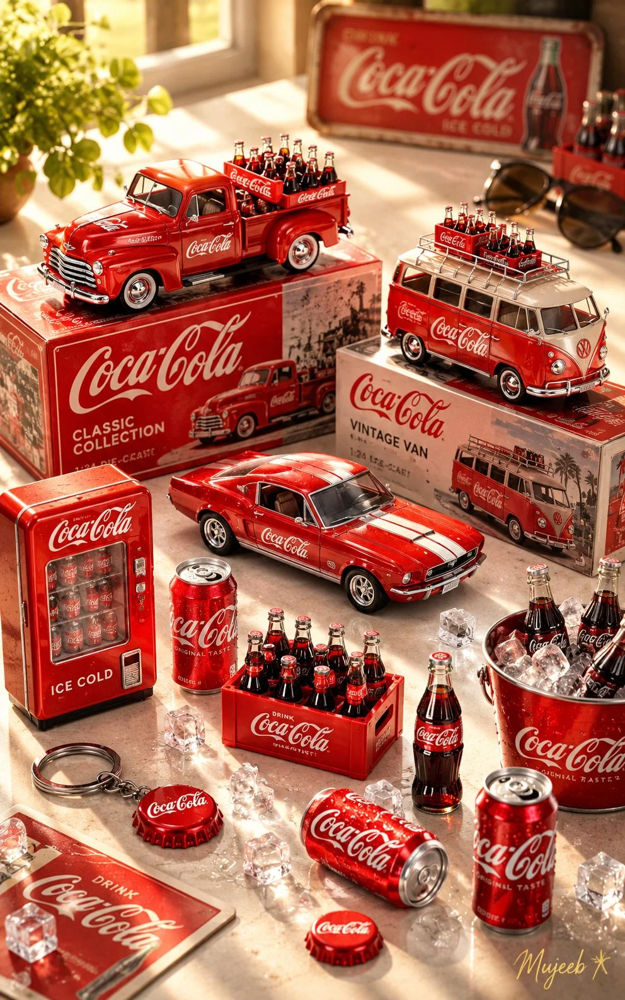

# Collectible Miniature Figures Commercial Product Photo from a Reference

**中文标题：** 参考图→收藏级微缩人偶商业产品摄影  
**ID:** `gi25-x-1073` · **Mode:** `edit`  
**Categories:** `ecommerce`, `edit-change-preserve`  
**Tags:** `x-twitter`, `community`, `gpt-image-2.5`, `x-direct`, `en`



### Collectible Miniature Figures Commercial Product Photo from a Reference

```text
Using ChatGPT’s creative capabilities and the provided reference image, create a high-resolution, exquisitely detailed commercial product photograph blended with a warm, sunlit lifestyle photography aesthetic.

SUBJECT / THEME: [PRODUCT OR COLLECTION THEME]

Create a beautifully arranged display of miniature collectibles, die-cast models, and matching accessories inspired by the selected theme. Adapt the colors, products, branding, and surrounding props to match the subject while maintaining a cohesive, premium collectible-display aesthetic.

SCENE & COMPOSITION:

Use a high-angle, top-down perspective combined with macro photography. The scene takes place on a clean, bright white tabletop, illuminated by warm sunlight streaming diagonally across the surface, creating soft shadows, natural highlights, and a cozy, nostalgic atmosphere.

Arrange the main collectible models and accessories in a carefully layered composition:

- Back row: Place two prominent collectible models on top of beautifully designed display boxes or premium packaging, showcasing their distinctive shapes, colors, and intricate details.
- Front row: Arrange additional miniature models in different angles and configurations, highlighting their craftsmanship, accessories, and realistic construction.
- Surrounding details: Scatter small, theme-related accessories naturally across the foreground, including miniature containers, bottles, packaging, decorative objects, or other relevant collectibles.
- Background accents: Place a few playful, complementary props in the upper-right background, slightly out of focus to create depth and a natural photographic composition.

MATERIALS & REALISM:

Emphasize exceptionally realistic materials, glossy painted surfaces, finely rendered metal, transparent glass or plastic, detailed packaging, and authentic miniature craftsmanship. Capture the way warm sunlight reflects off polished surfaces, producing delicate highlights, subtle lens glow, and rich, natural tonal variations.

PHOTOGRAPHIC STYLE:

Premium commercial product photography, photorealistic macro detail, warm vintage-inspired lifestyle aesthetics, soft natural sunlight, realistic shadows, shallow depth of field, carefully balanced composition, crisp textures, and professional editorial quality. The final image should feel like a real photograph of a thoughtfully curated collectible collection rather than a digital render.

SIGNATURE & FORMAT:

Add a tasteful, luminous golden signature watermark reading “[SIGNATURE OR BRAND NAME] ✻” in the bottom-right corner, accompanied by a delicate four-point starburst motif.

ASPECT RATIO: 10:16 vertical portrait.
QUALITY: High resolution, exceptionally detailed, photorealistic, premium commercial finish.

Use the provided reference image to guide the composition and visual arrangement. Adapt the entire scene to the selected theme while preserving the same warm lighting, miniature-display aesthetic, realistic materials, and sophisticated photographic quality.
```

- **Recommended model:** `gpt-image-2.5-sunburst`
- **Settings:** _(defaults)_
- **Source:** [community](https://x.com/Goodmanprotocol/status/2114608948531933410) — @Goodmanprotocol
- **License note:** Original public X post; quoted with attribution — remix with attribution
- **Notes:** Collected directly from X; original post https://x.com/Goodmanprotocol/status/2114608948531933410; post text names GPT Image 2.5; discovered via Bin0754/gpt-image-gallery index, prompt re-verified against the original X post via api.fxtwitter.com; verified=True
- **Preview:** `previews/gi25-x-1073.webp`
