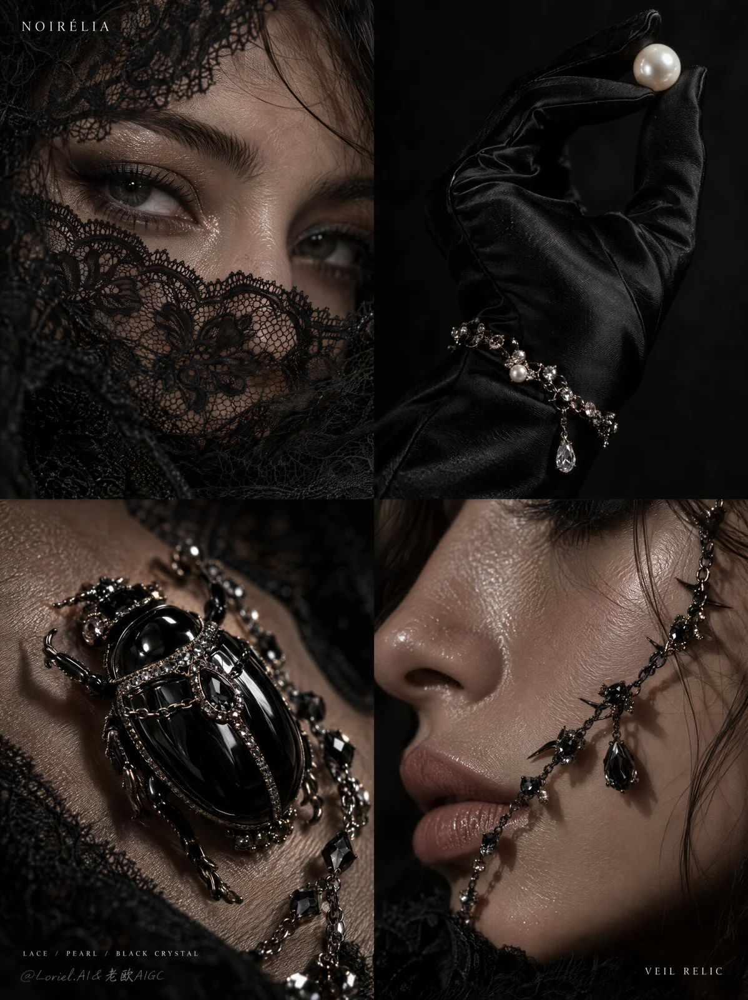

# Dark Luxury Jewelry Campaign 4-Panel Key Visual

**中文标题：** 暗黑奢华珠宝四格广告主视觉  
**ID:** `gi25-x-1109` · **Mode:** `generate`  
**Categories:** `ecommerce`, `poster-typography`  
**Tags:** `x-twitter`, `community`, `gpt-image-2.5`, `x-direct`, `en`



### Dark Luxury Jewelry Campaign 4-Panel Key Visual

```text
Create a premium overseas luxury jewelry campaign poster for original brand NOIRÉLIA, centered on THE VEIL RELIC COLLECTION. The image is a full-bleed vertical 2x2 editorial macro collage with dark beauty photography, black negative space, tactile lace, wet skin highlights, black satin glove texture, pearl-crystal jewelry, and a glossy black scarab brooch. The concept is quiet dark ornament: beauty hidden in shadow through intimate fragments of face, hand, skin, lace, pearl, and black crystal.

Divide the poster into four equal rectangular panels with clean internal seams and no outer decorative border. Use extreme macro close-up framing in every panel. Upper-left: a 20+ adult model’s eyes and upper face partly veiled by black lace. Upper-right: a black satin-gloved hand holding one pearl between the fingers, with a fine crystal bracelet at the wrist. Lower-left: a glossy black scarab-shaped brooch resting on textured skin or matte black fabric, wrapped with a fine crystal chain. Lower-right: a macro profile of lips, nose, and cheek with a black crystal thorn face chain crossing the skin.

Keep one restrained dark editorial rhythm across all panels: black backgrounds, tight cropping, high tactile detail, and selective highlights. Remove any large central headline. Let the middle seam stay clean so the four macro images breathe. Tiny brand text appears only in one or two corners, never spanning across the image. The eye, pearl, scarab brooch, and face chain create four quiet focal points without typographic interruption.

The hero products are NOIRÉLIA’s luxury accessories: black lace veil mask, pearl-crystal bracelet, glossy black scarab brooch, and black crystal thorn face chain. Each object must feel physically credible and commercially manufacturable: visible lace fibers, sharp crystal facets, softly reflective pearl surface, glossy sculptural black enamel scarab shell, and tiny precise metal settings. Brand identity comes from material consistency and minimal corner text, not a large slogan.

Use only 20+ adult models with mature non-childlike facial features. Skin is realistic, with natural pores, soft highlights, and believable anatomy. Expressions are restrained and editorial: calm eyes, relaxed lips, no exaggerated seduction, no open-mouth pose. Hands must have correct anatomy, natural knuckles, clean nails, and believable finger pressure around the pearl.

The lace crosses the eyes without hiding the gaze. The satin glove creates a matte-dark field around the single pearl. The scarab brooch sits diagonally, with the crystal chain draped across its shell and body. The face chain follows cheek and lip contours, catching tiny highlights without cutting unnaturally into the skin. No large text should interrupt seams or cover jewelry.

Backgrounds are deep black, charcoal grey, and muted shadow with no room details. Depth comes from macro focus, skin texture, lace layers, satin folds, jewelry reflections, and shallow falloff into darkness. Keep the collage minimal: no extra flowers, no insects other than the brooch, no cluttered fashion props, no decorative frame, no social handles.

Use narrow directional soft light from upper left and very small specular jewelry highlights. Palette: 75% black and charcoal, 12% skin bronze and muted warm highlights, 8% pearl white and crystal sparkle, 5% silver-black metal glints. The pearl and crystal points provide contrast; black lace, satin glove, and enamel carry the dark brand identity. Shadows stay detailed, never dead black over jewelry or facial features.

Render as high-end macro editorial photography. Lace shows fine mesh, frayed threads, and scalloped edges. Satin glove shows soft folded sheen, not plastic shine. Skin is luminous and real, never plastic. Pearl is softly reflective; crystals are sharp and faceted; black enamel scarab has curved glossy reflections and tiny carved leg details. Any typography is tiny, crisp, perfectly spaced, and not distressed.

Use only English text, extremely minimal. No large central headline. Upper-left corner, tiny thin uppercase:
“NOIRÉLIA”
Lower-right corner, tiny thin uppercase:
“VEIL RELIC”
Optional bottom-left micro category line:
“LACE / PEARL / BLACK CRYSTAL”
Do not add social handles, slogans, artist names, fake awards, prices, certifications, random small print, copied phrases, real brand marks, real product names, or real person names.

Output: full-bleed vertical 2x2 luxury campaign collage with clean panel seams. Preserve the four-panel macro structure, black lace beauty language, satin glove and single pearl, scarab jewelry motif, tactile skin and jewelry detail, refined dark luxury mood, and strict minimal text discipline. Avoid collapsed grid structure, uneven panels, large central headline, text covering jewelry, extra faces, full-body fashion pose, cluttered props, random insects, broken hand anatomy, distorted eyes or lips, plastic skin, muddy lace, fake pearls, blurry crystals, excessive glitter, cyberpunk neon, cartoon gothic styling, chaotic collage overload, low-resolution macro texture, or cheap costume jewelry look.
```

- **Recommended model:** `gpt-image-2.5-sunburst`
- **Settings:** _(defaults)_
- **Source:** [community](https://x.com/ou_zhen599/status/2114788899461689844) — @ou_zhen599
- **License note:** Original public X post; quoted with attribution — remix with attribution
- **Notes:** Collected directly from X; original post https://x.com/ou_zhen599/status/2114788899461689844; post text names GPT Image 2.5; discovered via X search, prompt re-verified against the original X post via api.fxtwitter.com; verified=True; comparison post; left image is GPT Image 2.5; the brand in the prompt is fictional
- **Preview:** `previews/gi25-x-1109.webp`
