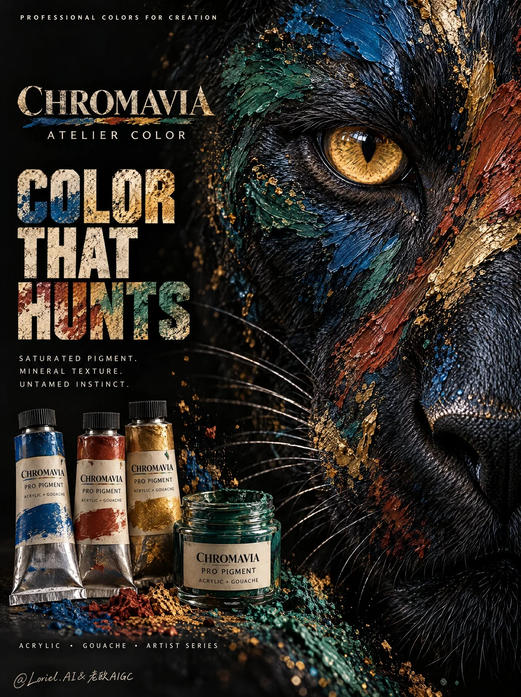

# Impasto Paint Feather Advertising Poster

**中文标题：** 厚涂颜料羽毛广告海报  
**ID:** `gi25-x-1110` · **Mode:** `generate`  
**Categories:** `ecommerce`, `poster-typography`  
**Tags:** `x-twitter`, `community`, `gpt-image-2.5`, `x-direct`, `en`



### Impasto Paint Feather Advertising Poster

```text
Create a premium overseas advertising poster for original professional artist paint brand CHROMAVIA ATELIER, centered on high-pigment acrylic and gouache colors. The image is a dark, dramatic commercial poster where the right half of a raptor head emerges from deep black shadow, its feathers transformed into thick impasto paint strokes in peacock blue, ochre red, powdered gold, oxidized green, and wet mineral pigment droplets. The concept is color with precision: professional paint so saturated and tactile that it feels sharp, alive, and instinctive.

Use a vertical full-bleed poster with an extreme close-up composition. The raptor face occupies the right two-thirds of the frame, cropped to show one intense golden eye, hooked beak edge, feather planes, and raised painted texture. The left third remains mostly black negative space for brand identity and typography. The viewpoint is intimate and frontal, with the raptor eye slightly above center, creating a direct predatory gaze.

The right side is dense with feather texture, raised pigment, and eye detail; the left side is clean black editorial space. The golden raptor eye is the brightest focal point, surrounded by peacock-blue and oxidized-green feather strokes following real feather direction. Ochre-red and powdered-gold pigment ridges cut diagonally through the cheek and beak, creating strong material rhythm. Three paint tubes and one open pigment jar sit subtly near the bottom-left edge, secondary but visible, linking the living color effect to real art materials.

The hero product is a professional paint line: three realistic metal paint tubes and one small glass pigment jar labeled exactly “CHROMAVIA”, “PRO PIGMENT”, “ACRYLIC + GOUACHE”. The tubes use matte black caps, warm ivory labels, and mineral color bands matching the raptor pigments: peacock blue, ochre red, powdered gold, oxidized green. Packaging must feel physically credible: crimped metal tube ends, curved printed labels, cap ridges, wet paint residue around the open jar rim, and readable typography. The raptor head remains anatomically realistic, with thick paint applied across the feather surface rather than replacing the bird structure.

The painted raptor face dominates from darkness on the right. The product tubes rest in the lower-left foreground, partially lit by a narrow warm highlight, never competing with the eye. Tiny pigment specks and short dragged brush marks bridge the products and raptor face, implying the paint as the source of the living texture. Typography stays in the left negative space and never covers the eye, beak, or main paint strokes.

The background is deep black with faint pigment dust, subtle canvas-like grain, and sparse mineral-colored flecks near the center. No studio table scene, artist hand, brush clutter, decorative border, or wildlife environment. Depth comes from the sharp raptor eye, raised paint ridges, foreground paint products, and soft falloff into black.

Lighting is narrow and cinematic: a soft key from the upper right catches the golden eye, wet pigment ridges, hooked beak edge, and feather texture. A low warm side glint reveals the paint tubes at bottom-left. Palette: 60% deep black and charcoal, 20% peacock blue and ochre red pigment, 10% golden amber eye and powdered gold paint, 10% oxidized green and warm ivory typography. Shadows remain rich but detailed, never hiding the product, eye, or beak edge.

Rendering must feel tactile and premium. The raptor eye is sharp, glossy, and organic, with clear golden iris, dark round pupil, and crisp wet highlight. Painted feathers show heavy impasto: raised ridges, dragged bristle marks, wet gloss, mineral granules, small splatters, and directional strokes following feather planes. The beak edge has realistic keratin texture with blue-black shadow detail. Product tubes are crisp and realistic, with readable labels and correct metal reflections. Typography has worn pigment texture and subtle paint-scrape edges while remaining clear.

Use only English text. Upper-left small line:
“PROFESSIONAL COLORS FOR CREATION”
Brand lockup in the left-middle:
“CHROMAVIA”
“ATELIER COLOR”
Main headline at lower-left:
“COLOR
THAT
STRIKES”
Supporting copy:
“SATURATED PIGMENT.
MINERAL TEXTURE.
UNTAMED PRECISION.”
Bottom product category line:
“ACRYLIC • GOUACHE • ARTIST SERIES”
On product packaging, write exactly:
“CHROMAVIA”
“PRO PIGMENT”
“ACRYLIC + GOUACHE”
Do not add prices, fake awards, certifications, random numbers, real brand marks, real product names, real person names, copied slogans, or pseudo-text.

Output: full-bleed vertical commercial poster, no border, no black frame. Preserve dramatic black negative space, right-side cropped raptor face, single golden eye, thick wet mineral paint texture, bold left-side typography, and physical art-paint product proof. The poster must feel like a professional pigment advertisement, not a wildlife photo, fantasy monster illustration, or generic art supply catalog. Avoid full bird body, centered symmetrical face, cluttered art table, product hidden in darkness, text covering the eye, unreadable tubes, distorted beak or feather planes, flat digital color, dry chalky paint, plastic tubes, muddy pigments, excessive splatter, cartoon bird style, neon cyberpunk drift, chaotic collage overload, or low-resolution pigment texture.
```

- **Recommended model:** `gpt-image-2.5-sunburst`
- **Settings:** _(defaults)_
- **Source:** [community](https://x.com/ou_zhen599/status/2114754971480809882) — @ou_zhen599
- **License note:** Original public X post; quoted with attribution — remix with attribution
- **Notes:** Collected directly from X; original post https://x.com/ou_zhen599/status/2114754971480809882; post text names GPT Image 2.5; discovered via X search, prompt re-verified against the original X post via api.fxtwitter.com; verified=True; the brand in the prompt is fictional
- **Preview:** `previews/gi25-x-1110.webp`
