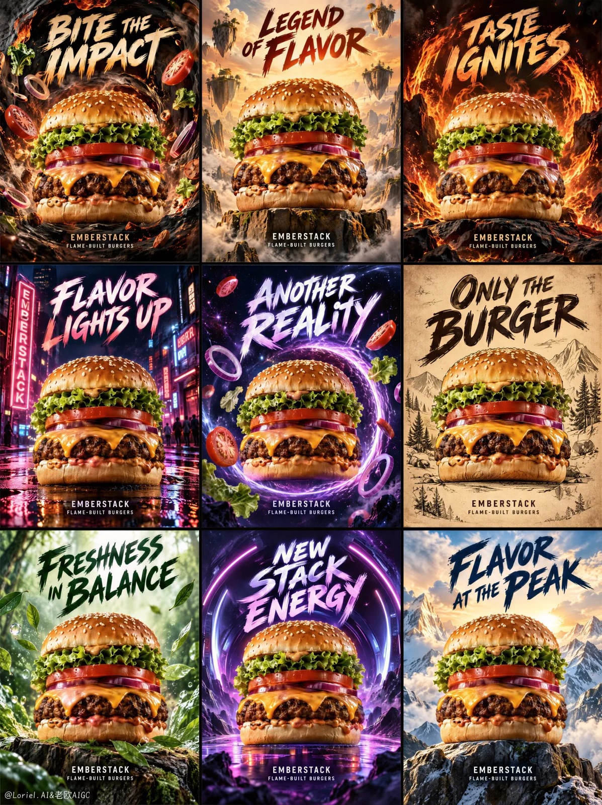

# 3×3 Burger Campaign Key Visual Grid

**中文标题：** 3×3 汉堡广告主视觉九宫格  
**ID:** `gi25-x-1111` · **Mode:** `generate`  
**Categories:** `ecommerce`, `poster-typography`  
**Tags:** `x-twitter`, `community`, `gpt-image-2.5`, `x-direct`, `en`



### 3×3 Burger Campaign Key Visual Grid

```text
Create a premium overseas burger campaign key visual for original fast-casual brand EMBERSTACK, designed as one full-bleed vertical 3x3 grid of nine distinct poster tiles. Each tile features the same monumental realistic cheeseburger as the hero product, while expressing a different advertising language and atmosphere. The full image must read as one unified campaign system: consistent product identity, bold hand-painted typography, cinematic food lighting, strong appetite texture, controlled fantasy worlds, and clear commercial hierarchy.

Use a clean 3x3 grid with nine evenly aligned vertical poster panels, thin dark internal gutters, and no outer decorative border. Every tile uses frontal hero-product framing, with the burger centered or slightly lower-centered and large enough to dominate. Keep the burger structure readable in every panel: glossy toasted sesame bun, crisp lettuce, thick tomato, melted cheddar, char-grilled beef patty, red onion, smoky sauce, and soft bottom bun. The burger must remain consistent across all nine posters, like one product photographed through different campaign worlds.

Organize the grid as a color-and-era campaign system. Top row: fire and impact language with charcoal black, roasted gold, ember orange, and heavy brush headlines. Middle row: night, neon, and cosmic street energy with deep blue-black, magenta-purple, electric red, and stronger glow contrast. Bottom row: freshness, vintage craft, and summit scale with forest green, parchment cream, mountain sky gold, and cleaner editorial spacing. Across all panels, backgrounds, typography, ingredients, and motion graphics must point back toward the burger.

Panel system:
Top-left: smoky flavor vortex, rough brush headline, flying ingredients pulled inward.
Top-center: epic sky and floating ingredient cliffs, heroic centered burger, blockbuster poster energy.
Top-right: fire-ring impact, darker heat, flame arcs behind the burger.
Middle-left: night street neon scene, magenta-red signage glow, wet pavement reflections.
Middle-center: cosmic taste portal, orbiting onion rings and tomato fragments.
Middle-right: vintage parchment print poster, engraved-style treatment while still appetizing.
Bottom-left: forest freshness, herbs and green leaves spiraling around the burger.
Bottom-center: new-generation purple energy tunnel, bold youthful brush lettering.
Bottom-right: mountain summit burger, bright sky, heroic altitude, clean golden rim light.

Each tile uses a different world, but all visual pressure returns to the burger. Flying ingredients, smoke rings, flame arcs, neon streaks, cosmic fragments, forest leaves, parchment grain, and mountain wind frame the product without hiding cheese, patty, tomato, or core food layers. Typography belongs to each poster surface as graphic design, while food fragments and environmental elements follow realistic depth. Avoid restaurant interiors, table clutter, plates, menus, people, mascots, and real brand references.

Use strong cinematic food lighting in every tile. The burger receives warm appetite-focused key light on bun, cheese, patty, and sauce, while cooler or darker backgrounds create separation. Top row uses fire-orange and roasted-gold highlights; middle row uses neon and cosmic rim light; bottom row uses forest, parchment, and mountain daylight. Shadows stay rich but readable, never dead black over the food. Burgers are the sharpest, most realistic elements: crisp sesame seeds, glossy sauce, melted cheese edges, charred patty texture, fresh lettuce folds, tomato moisture, onion translucency, and believable bun pores.

Use only English text. Each tile contains one large rough hand-painted headline with thick pressure variation, uneven handmade edges, and professional readability. Use these exact headline phrases:
Top-left: “BITE THE IMPACT”
Top-center: “LEGEND OF FLAVOR”
Top-right: “TASTE IGNITES”
Middle-left: “FLAVOR LIGHTS UP”
Middle-center: “ANOTHER REALITY”
Middle-right: “ONLY THE BURGER”
Bottom-left: “FRESHNESS IN BALANCE”
Bottom-center: “NEW STACK ENERGY”
Bottom-right: “FLAVOR AT THE PEAK”

Include small brand lines only in selected panels:
“EMBERSTACK”
“FLAME-BUILT BURGERS”
Do not add prices, fake awards, certifications, nutrition claims, ingredient percentages, QR codes, random tiny print, real brand marks, real product names, real person names, or extra slogans.

Output: full-bleed vertical 3x3 campaign grid, no outer border, no decorative frame beyond thin internal gutters. Preserve the unified EMBERSTACK campaign system, consistent hero burger identity, grouped color rhythm, mixed advertising-era languages, bold hand-painted headline system, dramatic food fantasy worlds, and clean commercial burger hierarchy. Avoid collapsed grid structure, uneven panels, missing tiles, warped burger layers, product hidden by typography, duplicate hero burgers inside one tile, chaotic ingredient piles, plastic cheese, dry patty, muddy sauce, overexposed flames, uncontrolled smoke, misspelled headlines, pseudo-text, cartoon mascot style, generic fast-food menu layout, chaotic collage overload, low-resolution food texture, dirty grunge covering the product, or unrelated foods replacing the burger.
```

- **Recommended model:** `gpt-image-2.5-sunburst`
- **Settings:** _(defaults)_
- **Source:** [community](https://x.com/ou_zhen599/status/2114736657610277087) — @ou_zhen599
- **License note:** Original public X post; quoted with attribution — remix with attribution
- **Notes:** Collected directly from X; original post https://x.com/ou_zhen599/status/2114736657610277087; post text names GPT Image 2.5; discovered via X search, prompt re-verified against the original X post via api.fxtwitter.com; verified=True; the brand in the prompt is fictional
- **Preview:** `previews/gi25-x-1111.webp`
