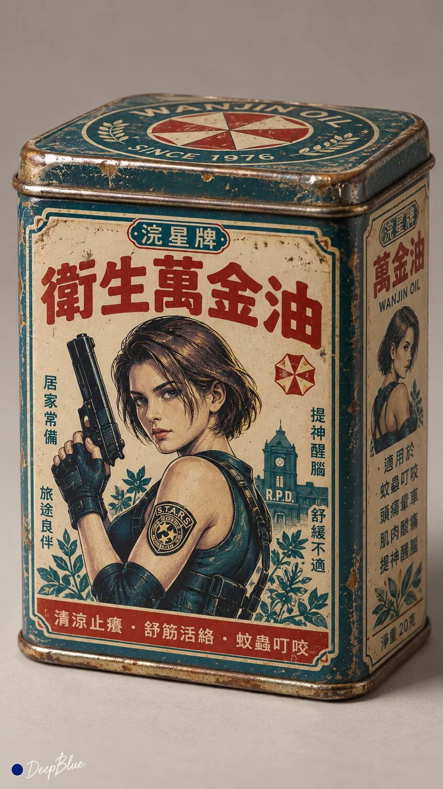

# 1970s Chinese Retro Packaging × Anime Heroine Collab (n=10)

**中文标题：** 70年代复古包装×动漫女角色联名（n=10）  
**ID:** `gi25-x-1170` · **Mode:** `generate`  
**Categories:** `ecommerce`, `poster-typography`  
**Tags:** `x-twitter`, `community`, `gpt-image-2.5`, `x-direct`, `zh`



### 1970s Chinese Retro Packaging × Anime Heroine Collab (n=10)

```text
复古商品包装联名档案 × 动漫游戏女性角色 × 中国近代商业美术 × 收藏级产品摄影。

n=10，每张独立生成一张9:16竖版图片，逐张输出，不制作拼图。每张独立抽取一种70年代商品包装；再独立抽取一位具有鲜明视觉识别度的现代动漫或游戏成年角色，进行跨时代联名包装重设计。保留角色的核心识别元素，如发型、服饰轮廓、代表色、道具与气质，但整体统一转译为1970年代中国商业包装语言，营造“熟悉却陌生”的独特感觉，仿佛那个年代真实存在过这款联名商品。

整体采用1970年代商业平面设计与近代商业美术风格，圆润字体、手绘宣传插画、波浪色带、简洁徽章、装饰边框、有限套色印刷与温暖复古配色。不要使用现代海报式画面，而是让角色成为包装主视觉的一部分，角色动作、道具、技能符号与象征元素自然融入主图、底纹与装饰图案中。包装需围绕商品用途与角色属性，原创设计虚构品牌名、产品名、联名字样、宣传语与侧面说明，保证文字简洁、易读、带年代气息。

根据品类选择合理盒型、材质与结构，准确表现纸板厚度、折线、压痕、铁盒卷边、金属接缝、印刷油墨质感与轻微年代磨损。采用收藏品静物摄影方式，单件完整包装置于简洁中性背景，以三分之四视角清楚展示正面与一个侧面，强调真实物件感、平面设计完成度与收藏价值。每张独立变化商品品类、角色气质、配色方案、插画方式、版式结构与包装细节，避免重复套版。

左下署名：深蓝色实心圆点在前，白色手写体「DeepBlue」在后。
```

- **Recommended model:** `gpt-image-2.5-sunburst`
- **Settings:** _(defaults)_
- **Source:** [community](https://x.com/DeepBlueX0/status/2114981442703000027) — @DeepBlueX0
- **License note:** Original public X post; quoted with attribution — remix with attribution
- **Notes:** Collected directly from X; original post https://x.com/DeepBlueX0/status/2114981442703000027; post text names GPT Image 2.5; discovered via Bin0754/gpt-image-gallery index, prompt re-verified against the original X post via api.fxtwitter.com; verified=True
- **Preview:** `previews/gi25-x-1170.webp`
