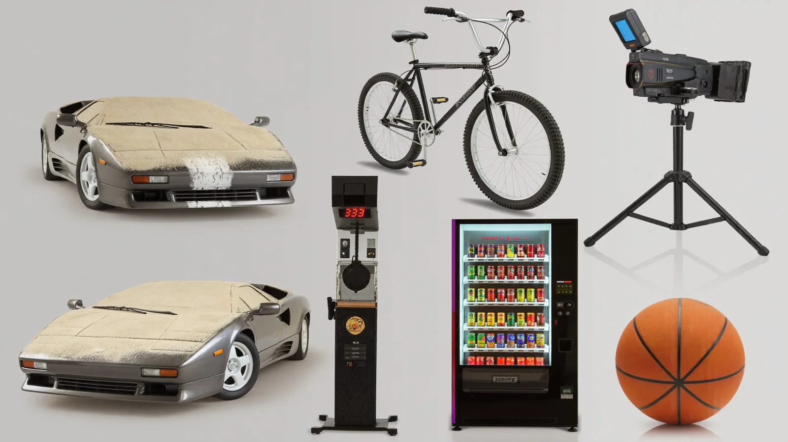

# Six-Object Prop Reference Sheet (Modern Objects in Ancient Egypt)

**中文标题：** 六件道具参考表（古埃及×现代物件）  
**ID:** `gi25-x-1232` · **Mode:** `generate`  
**Categories:** `ecommerce`, `general`  
**Tags:** `x-twitter`, `community`, `gpt-image-2.5`, `x-direct`, `en`



### Six-Object Prop Reference Sheet (Modern Objects in Ancient Egypt)

```text
Product reference sheet on a light grey background, 16:9, photorealistic, six objects in a 3x2 grid, front and three-quarter views:
1. A 1990s wedge-shaped supercar in gunmetal grey, covered in thick desert sand except one clean washed stripe.
2. A black BMX bike.
3. A mid-90s camcorder with a blue flip screen on a black tripod.
4. A black boxing arcade machine with a punch pad and red LED score.
5. A glowing glass-front soda vending machine.
6. An orange basketball.
No logos, no text, no watermark.
```

- **Recommended model:** `gpt-image-2.5-sunburst`
- **Settings:** _(defaults)_
- **Source:** [community](https://x.com/socialwithaayan/status/2116136849072967993) — @socialwithaayan
- **License note:** Original public X post; quoted with attribution — remix with attribution
- **Notes:** Collected directly from X; original post https://x.com/socialwithaayan/status/2116136849072967993; post text names GPT Image 2.5; discovered via Bin0754/gpt-image-gallery index, prompt re-verified against the original X post via api.fxtwitter.com; verified=True; step of a GPT Image 2.5 Sunburst short-film workflow thread
- **Preview:** `previews/gi25-x-1232.webp`
