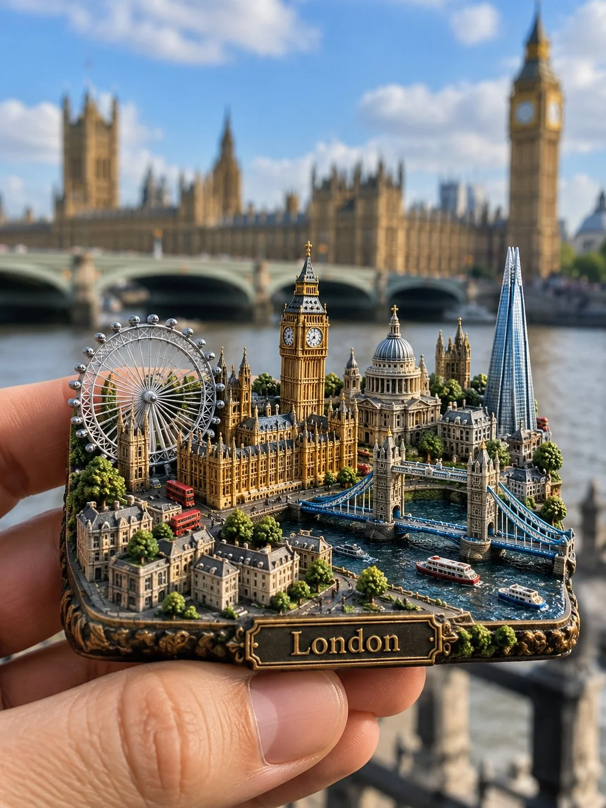

# 3D Miniature City Fridge Magnet Product Photo

**中文标题：** 3D 微缩城市冰箱贴产品图  
**ID:** `gi25-x-1256` · **Mode:** `generate`  
**Categories:** `ecommerce`, `general`  
**Tags:** `x-twitter`, `community`, `gpt-image-2.5`, `x-direct`, `en`



### 3D Miniature City Fridge Magnet Product Photo

```text
ULTRA-REALISTIC 3D MINIATURE CITY FRIDGE MAGNET

Create an ultra-photorealistic product photograph of a premium 3D miniature cityscape refrigerator magnet featuring LONDON. Generate everything entirely from the text description, without requiring any reference image.

The main subject is a compact, thick, rectangular refrigerator magnet with softly rounded edges, featuring an intricately sculpted miniature London city built directly into its surface. Include Big Ben, the Palace of Westminster, Tower Bridge, the London Eye, St Paul's Cathedral, The Shard, the River Thames, historic buildings, tiny streets, bridges, trees and landscaped gardens. Arrange the landmarks together in a dense, beautifully layered architectural composition, preserving their recognizable real-world designs and proportions.

The miniature should have extraordinary physical depth, realistic architectural textures, tiny windows, detailed rooftops, stone facades and elegant antique bronze and golden metallic accents. Add a small engraved metal nameplate reading "London" along the front edge.

A realistic human hand gently holds the magnet close to the camera, showcasing its intricate miniature craftsmanship. In the background, show the actual Big Ben and Westminster architecture, softly blurred but recognizable, creating a beautiful contrast between the real city and its miniature recreation.

Professional travel souvenir photography, natural daylight, realistic shadows, macro-level detail, shallow depth of field, authentic materials, cinematic composition, DSLR photography and exceptional photorealism.

The final result must look like a real, physically manufactured miniature city refrigerator magnet, not an illustration, poster or digitally floating city.

Aspect ratio: 3:4, vertical composition.
```

- **Recommended model:** `gpt-image-2.5-sunburst`
- **Settings:** _(defaults)_
- **Source:** [community](https://x.com/Goodmanprotocol/status/2116542650321187278) — @Goodmanprotocol
- **License note:** Original public X post; quoted with attribution — remix with attribution
- **Notes:** Collected directly from X; original post https://x.com/Goodmanprotocol/status/2116542650321187278; post text names GPT Image 2.5; discovered via Bin0754/gpt-image-gallery index, prompt re-verified against the original X post via api.fxtwitter.com; verified=True
- **Preview:** `previews/gi25-x-1256.webp`
