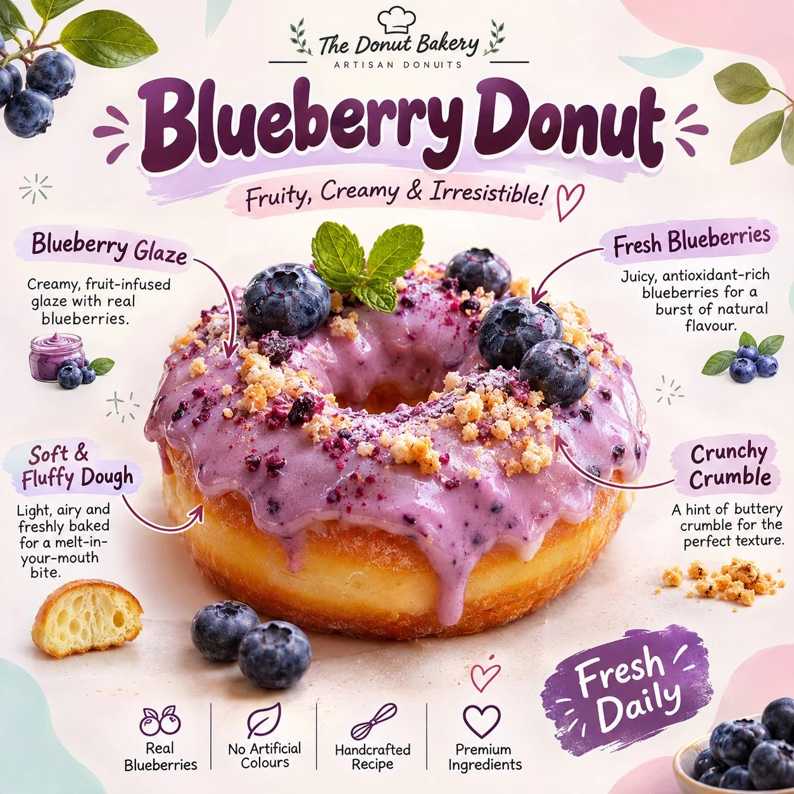

# Pastel Gourmet Donut Infographic Poster Template

**中文标题：** 粉彩甜甜圈信息图海报模板  
**ID:** `gi25-x-1299` · **Mode:** `generate`  
**Categories:** `ecommerce`, `poster-typography`  
**Tags:** `x-twitter`, `community`, `gpt-image-2.5`, `x-direct`, `en`



### Pastel Gourmet Donut Infographic Poster Template

```text
UNIVERSAL PROMPT - PASTEL GOURMET DONUT INFOGRAPHIC POSTER

Create an ultra-realistic, beautifully designed gourmet donut promotional infographic poster featuring [DONUT FLAVOUR / THEME]. Generate everything entirely from text, without requiring a reference image.

1. MAIN SUBJECT

Display one large, freshly baked, appetizing ring donut in the centre, topped with a generous, glossy, flavour-specific icing. Add realistic toppings such as fresh fruits, mint leaves, chocolate chips, sprinkles or other ingredients that complement the selected flavour.

The donut should look incredibly delicious, with detailed golden-brown dough, soft texture, creamy icing, natural highlights and realistic food photography.

2. POSTER DESIGN

Use a clean, playful pastel aesthetic with a warm white background, soft pink, mint green and baby-blue abstract corner shapes. Add delicate botanical illustrations, tiny decorative doodles, stars and subtle hand-drawn elements.

3. TYPOGRAPHY & INFORMATION

At the top, display a large, bold, rounded headline featuring the donut flavour, followed by a short, playful tagline.

Add small handwritten-style annotations around the donut, using elegant curved arrows to identify its ingredients and features. Include details such as:

- Main icing or glaze
- Fresh toppings
- Dough texture
- Special ingredients

Add subtle promotional text such as "Fresh Daily" and a tiny bakery-style branding footer.

4. VISUAL QUALITY

Premium commercial food photography, photorealistic textures, soft natural lighting, vibrant yet balanced pastel colours, beautiful composition, crisp typography, polished editorial infographic design.

FORMAT: 1:1 square poster, high resolution, suitable for Instagram carousel posts.

IMPORTANT: Automatically adapt the ingredients, icing colour, toppings, annotations, headline and tagline to the selected flavour. Ensure all text is correctly spelled, readable and professionally positioned. Each generated poster should have a consistent visual identity while featuring a distinctly different donut flavour.
```

- **Recommended model:** `gpt-image-2.5-sunburst`
- **Settings:** _(defaults)_
- **Source:** [community](https://x.com/Goodmanprotocol/status/2116856596928303163) — @Goodmanprotocol
- **License note:** Original public X post; quoted with attribution — remix with attribution
- **Notes:** Collected directly from X; original post https://x.com/Goodmanprotocol/status/2116856596928303163; post text names GPT Image 2.5; discovered via X search, prompt re-verified against the original X post via api.fxtwitter.com; verified=True
- **Preview:** `previews/gi25-x-1299.webp`
