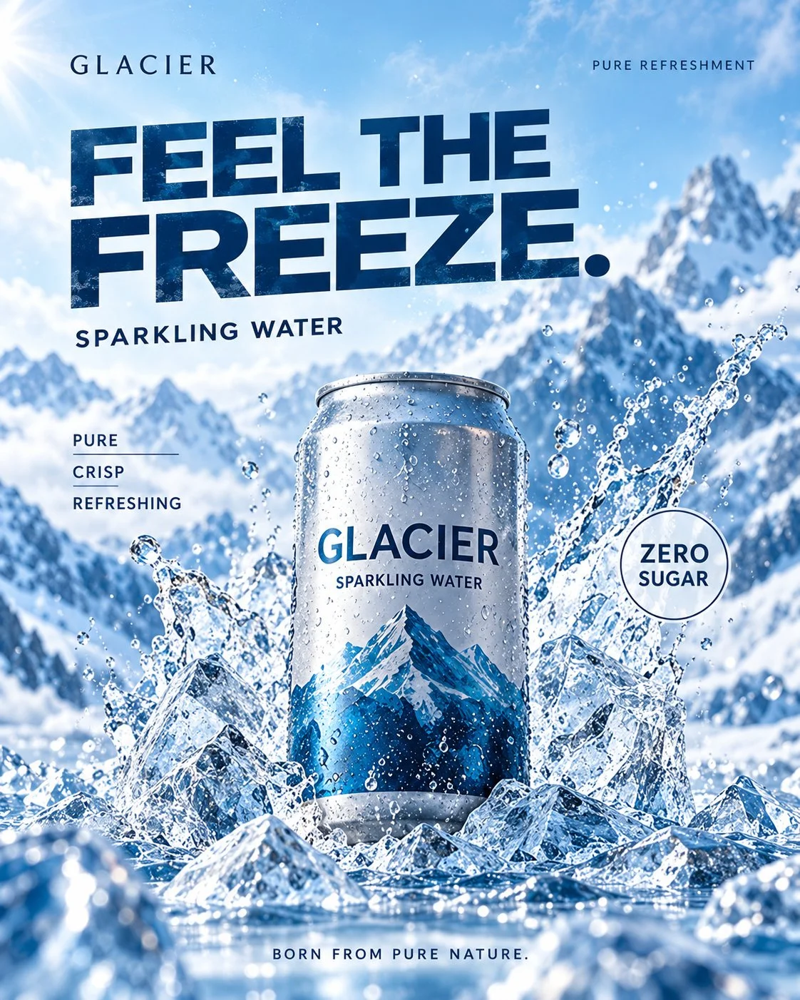

# GLACIER Sparkling Water Ice-Stage Commercial Poster

**中文标题：** GLACIER 冰川气泡水冰台商业海报  
**ID:** `gi25-x-1336` · **Mode:** `generate`  
**Categories:** `ecommerce`, `poster-typography`  
**Tags:** `x-twitter`, `community`, `gpt-image-2.5`, `x-direct`, `zh`



### GLACIER Sparkling Water Ice-Stage Commercial Poster

```text
生成一张具有国际饮料品牌广告水准的创意商业海报，4:5 竖版，超高清，真实产品摄影与现代极简平面设计结合。

品牌名称：GLACIER
产品名称：SPARKLING WATER

【整体视觉风格】

高端清凉饮料商业广告，Arctic Refreshment Advertising Campaign。

主色调为冰川蓝、极地青、银白色和透明冰晶色。

画面明亮、干净、通透，充满冰冷清爽的视觉感受。

采用大胆的现代无衬线字体、强烈的产品视觉中心和克制的商业信息排版。

【核心创意】

画面中央，一罐真实尺寸比例的银蓝色气泡水，直立放置在一块晶莹透明的天然冰台上。

饮料罐正面具有精致的蓝白渐变品牌设计，中央清晰印有：

GLACIER

下方小字：

SPARKLING WATER

罐身为真实铝制易拉罐结构，顶部拥有完整的金属拉环和标准易拉罐开口。

罐体表面覆盖大小不同的真实冷凝水珠，水珠具有精致高光和透明折射效果。

气泡水罐周围环绕着数块高低错落的透明天然冰晶，形成犹如微型冰川的视觉结构。

部分冰晶高于罐身，部分位于两侧，但正面品牌名称完全无遮挡。

冰块具有真实的内部气泡、自然裂纹、边缘融化痕迹和复杂光线折射。

少量融化的冰水沿着冰台自然流动，形成真实湿润的反光表面。

产品与冰块之间存在准确的接触阴影，罐体稳稳立于冰台上，没有悬浮。

【背景与环境】

背景是抽象化的冰川世界，远处可以看到模糊的浅蓝色冰山轮廓。

整个场景具有极地自然环境的纯净感，但保持商业广告摄影的简洁和干净。

柔和的冷白色主光从左上方照射，右侧有少量自然环境反射光。

透明冰晶边缘形成真实明亮的折射高光。

画面中可以有少量悬浮的微小水雾和冷空气凝结效果，但保持真实自然，不出现夸张的魔法光效。

【商业海报排版】

顶部左侧使用小号品牌名称：

GLACIER

右上角使用小号标签：

PURE REFRESHMENT

画面上方采用超大号粗体无衬线字体，分两行排列：

FEEL THE
FREEZE.

文字为深冰蓝色，具有强烈的现代商业设计感。

标题下方放置：

ICE COLD. PURE REFRESHMENT.

画面下方左侧排版：

SPARKLING
WATER

下方使用较小字号：

PURE · CRISP · REFRESHING

右下角设计一个简洁的圆形产品印章：

ZERO SUGAR

底部居中排版广告语：

UNLEASH THE COLD.

【摄影与设计要求】

采用专业高速产品摄影质感，真实铝罐材质、真实冷凝水珠、真实透明冰晶和精致光影。

使用70mm商业产品摄影镜头，产品清晰锐利，背景具有适度景深。

字体具有现代国际饮料广告的专业排版质感，文字与产品形成明确视觉层级。

画面明亮但避免过度曝光，冷蓝色清爽但不过度饱和。

不要出现错误金属拉环、变形易拉罐、多个罐口、不合理的冰块穿模、漂浮罐身、塑料质感和虚假的液体流动。

所有文字必须拼写正确，清晰锐利，不出现无意义字符。

最终效果具有高端饮料品牌正式广告的完成度，清爽、极简、具有强烈视觉冲击力。
```

- **Recommended model:** `gpt-image-2.5-sunburst`
- **Settings:** _(defaults)_
- **Source:** [community](https://x.com/Adam38363368936/status/2117202921796641152) — @Adam38363368936
- **License note:** Original public X post; quoted with attribution — remix with attribution
- **Notes:** Collected directly from X; prompt posted as the author's own reply https://x.com/Adam38363368936/status/2117202921796641152 to https://x.com/Adam38363368936/status/2117202778229813670, which carries the images; GPT Image 2.5 is named in the reply; discovered via X search, prompt re-verified against the original X post via api.fxtwitter.com; verified=True
- **Preview:** `previews/gi25-x-1336.webp`
