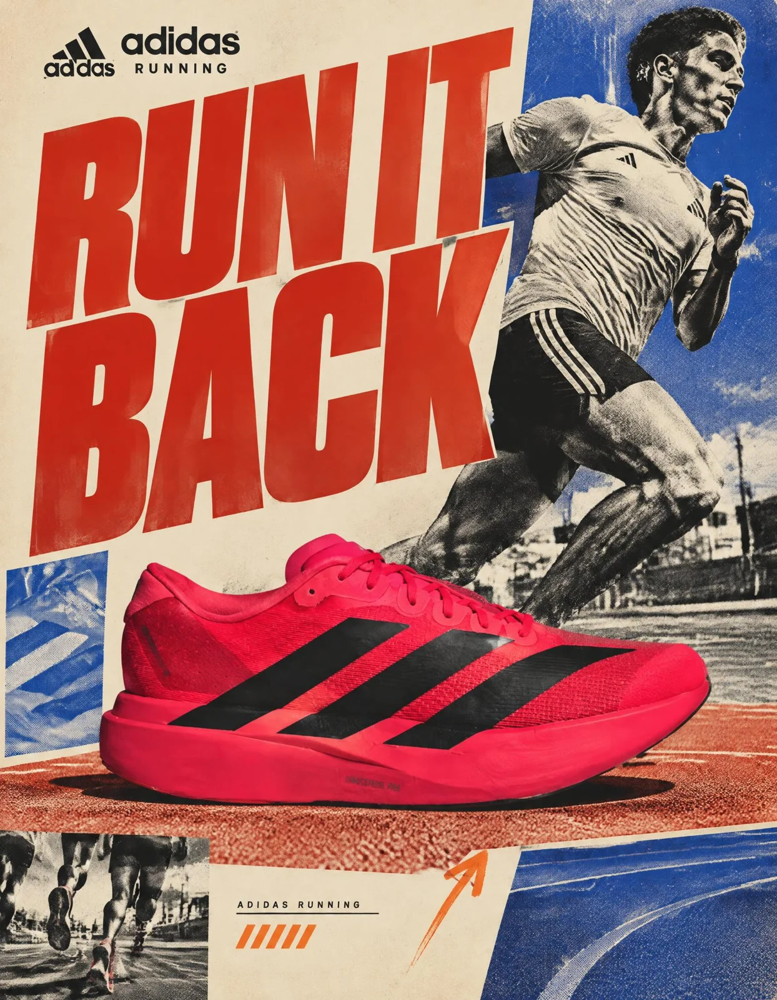

# Retro Editorial Running-Shoe Social Ad (adidas Running Concept)

**中文标题：** 复古编辑风跑鞋社媒广告（adidas Running 概念）  
**ID:** `gi25-x-1342` · **Mode:** `generate`  
**Categories:** `ecommerce`, `poster-typography`  
**Tags:** `x-twitter`, `community`, `gpt-image-2.5`, `x-direct`, `en`



### Retro Editorial Running-Shoe Social Ad (adidas Running Concept)

```text
ADIDAS RUNNING — “RUN IT BACK”

FORMAT: 4:5 vertical | Premium social media advertising | Retro editorial design

CREATIVE DIRECTION

Act as a senior advertising art director and editorial graphic designer developing an original retro-inspired adidas Running campaign. Combine the visual energy of 1990s sports magazines, vintage sneaker advertising, experimental typography, and contemporary commercial art direction.

The result must feel like a thoughtfully designed print campaign rediscovered from an archival sports magazine—not a generic vintage filter applied to a modern poster.

BRAND & PRODUCT LOCK

Hero product: adidas running shoe, using the supplied product reference as the source of truth.

Preserve the actual silhouette, proportions, outsole geometry, upper construction, lacing, materials, colorway, Three Stripes placement, adidas branding, and other identifiable product details. Do not invent a new shoe or redesign existing branding.

VISUAL STYLE SYSTEM

Bold 1990s sports-editorial design with oversized condensed typography, asymmetrical graphic blocks, photographic cutouts, visible print grain, halftone textures, and layered magazine-inspired compositions.

Use intentional imperfections while keeping the advertising polished, legible, and commercially credible.

COMPOSITION & LAYOUT

Create a strong, immediately recognizable hero composition.

The sneaker and/or runner must dominate the visual hierarchy. Use oversized cropped typography as a structural design element, not merely a caption. Introduce contrasting geometric color panels, small editorial annotations, and carefully controlled negative space.

Every element must have a defined role. Avoid arbitrary decoration.

TYPOGRAPHIC SYSTEM

Primary headline: “RUN IT BACK”

Use bold, condensed, high-impact display typography. Allow deliberate cropping and close letter spacing where appropriate. Add restrained secondary copy in small editorial text blocks.

Preserve the exact spelling of supplied copy. Do not generate fake prices, awards, technical claims, or product specifications.

COLOR SYSTEM

Vintage red: #D62820
Cobalt blue: #2448A5
Warm cream: #EDE4D1
Deep black: #171717
Accent orange: #F16A45

Use cream as a paper-inspired base, red for dominant emphasis, cobalt for contrasting graphic blocks, and black for typography and detail. Orange is a restrained accent.

PHOTOGRAPHY & LIGHTING

Use authentic sports-editorial photography, believable athletic anatomy, natural movement, directional light, realistic contact shadows, and tactile material detail.

Add subtle analog film grain and print texture without obscuring the shoe’s construction or branding. Avoid excessive sharpening, synthetic plastic surfaces, and artificial HDR effects.

GRAPHIC DETAILS

Incorporate restrained halftone patterns, small catalog-style annotations, hand-drawn directional marks, cutout photography, and occasional sticker-like graphic shapes.

Keep these elements subordinate to the hero product and headline. Maintain deliberate alignment and visual rhythm.

OUTPUT

4:5 vertical composition for an Instagram feed campaign. High-resolution commercial finish with clear hierarchy, intentional edge cropping, controlled detail, and consistent adidas brand presentation.

EXCLUSIONS & QUALITY CONTROL

No incorrect sneaker silhouette, duplicated Three Stripes, malformed adidas logos, invented product details, distorted anatomy, illegible headline, random text, excessive grunge, cluttered composition, generic 3D-render appearance, or watermarks.

Final quality standard: a distinctive, art-directed sports advertisement with a coherent retro design system, accurate product representation, and professional social-media campaign execution.
```

- **Recommended model:** `gpt-image-2.5-sunburst`
- **Settings:** _(defaults)_
- **Source:** [community](https://x.com/Diplomeme/status/2117236604960158039) — @Diplomeme
- **License note:** Original public X post; quoted with attribution — remix with attribution
- **Notes:** Collected directly from X; original post https://x.com/Diplomeme/status/2117236604960158039; post text names GPT Image 2.5; discovered via X search, prompt re-verified against the original X post via api.fxtwitter.com; verified=True; unofficial concept ad prompt naming a real brand
- **Preview:** `previews/gi25-x-1342.webp`
