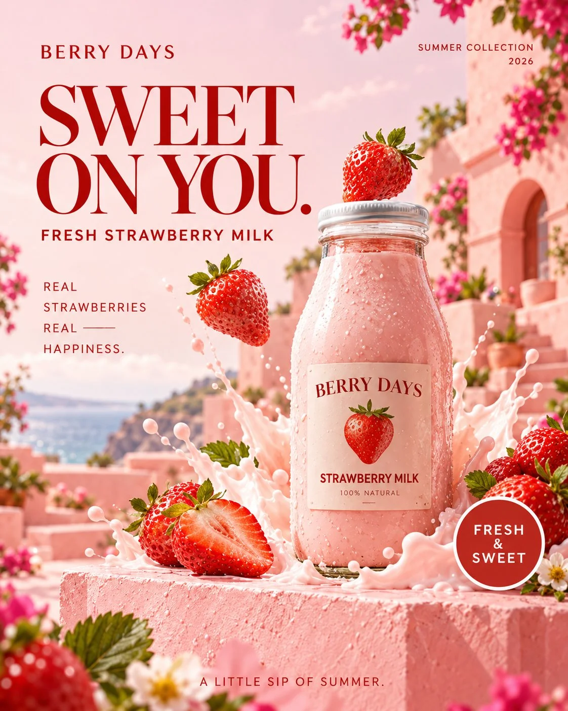

# BERRY DAYS Strawberry Milk Summer Ad Poster

**中文标题：** BERRY DAYS 草莓牛奶夏日广告海报  
**ID:** `gi25-x-1344` · **Mode:** `generate`  
**Categories:** `ecommerce`, `poster-typography`  
**Tags:** `x-twitter`, `community`, `gpt-image-2.5`, `x-direct`, `zh`



### BERRY DAYS Strawberry Milk Summer Ad Poster

```text
生成一张专业饮品品牌的夏日新品商业广告海报，4:5 竖版，超高清，真实商业产品摄影与时尚平面设计相结合。

品牌名称：BERRY DAYS
产品名称：STRAWBERRY MILK

【整体视觉风格】

夏日精品饮品广告，Fresh Summer Beverage Editorial Campaign。

主色调为草莓粉、奶油白、柔和珊瑚红和少量浅绿色。

整体明亮、清新、甜美，但保持高级商业设计感，避免廉价卡通或过度可爱的儿童化风格。

视觉具有精致的日系生活方式美学与现代欧美食品广告设计语言。

【核心产品】

画面中央偏右位置，一瓶透明玻璃草莓牛奶放置在浅粉色哑光亚克力展示台上。

玻璃瓶采用简洁的经典牛奶瓶造型，瓶颈短而自然，瓶身具有真实玻璃厚度和轻微折射。

瓶内装满淡粉色草莓牛奶，液体颜色自然柔和，具有真实的乳白色混合质感，表面不透明，呈均匀细腻的草莓乳饮状态。

玻璃瓶顶部使用完整闭合的白色旋盖，瓶盖结构真实，没有变形或多余零件。

瓶身正面贴着奶油白色简洁品牌标签，标签中央印有：

BERRY DAYS

下方：

STRAWBERRY MILK

配合一个精致的小型红色草莓图案。

玻璃瓶表面有细小而真实的冷凝水珠，体现刚从冰箱取出的清凉感。

【创意视觉】

展示台周围摆放三至五颗真实饱满的鲜红草莓，其中一两颗切开，露出真实的内部果肉纹理。

一颗草莓位于瓶子左侧的半空中，仿佛被轻轻抛起的瞬间。

下方有少量粉色草莓牛奶飞溅，液体形成自然的弧形和大小不同的细微液滴。

飞溅液体体积克制，不遮挡瓶身标签，不出现不符合物理规律的巨大液体漩涡。

右下角放置一片自然弯曲的绿色草莓叶，与粉色背景形成细腻对比。

【场景与背景】

背景为柔和的奶油粉色和浅珊瑚色渐变，远处隐约出现地中海风格的粉色建筑几何轮廓。

夏日午后的阳光从画面左上方照射，在亚克力台面形成真实柔和的产品阴影。

背景具有明亮通透的夏日氛围，适度景深，干净整洁。

整体像一张在阳光充足的专业商业摄影棚中拍摄的真实饮品广告照片。

【商业海报文字排版】

画面顶部左侧放置品牌名称：

BERRY DAYS

右上角放置小型标签：

SUMMER COLLECTION

画面左上方使用大号复古时尚衬线字体：

SWEET
ON YOU.

标题采用草莓红色，具有时尚杂志设计感，笔画精致，行距紧凑。

标题下方使用现代无衬线小字：

FRESH STRAWBERRY MILK

画面底部左侧排版：

REAL STRAWBERRIES
REAL HAPPINESS.

右下角设计一枚简洁的圆形红色印章：

FRESH
& SWEET

底部居中排版广告语：

A LITTLE SIP OF SUMMER.

【设计与摄影要求】

采用高级饮品品牌商业产品摄影标准。

使用50mm产品摄影镜头，真实玻璃折射、自然冷凝水珠、细腻液体质感和真实草莓果肉纹理。

产品清晰锐利，玻璃瓶结构准确，标签文字真实可读。

文字采用精致的复古衬线字体与现代无衬线字体组合。

构图具有明确的视觉中心，主标题醒目，品牌标识清晰，产品主体与文字相互协调。

避免过度饱和、廉价糖果色、塑料质感、卡通效果和夸张 CGI。

禁止玻璃瓶变形、错误瓶盖、液体穿过瓶身、草莓数量异常、草莓内部纹理错误、液体无故悬浮、错误阴影和乱码文字。

最终效果为一张具有夏日活力、产品真实感和完整商业排版的精品饮品广告海报。
```

- **Recommended model:** `gpt-image-2.5-sunburst`
- **Settings:** _(defaults)_
- **Source:** [community](https://x.com/Adam38363368936/status/2117238218957681123) — @Adam38363368936
- **License note:** Original public X post; quoted with attribution — remix with attribution
- **Notes:** Collected directly from X; original post https://x.com/Adam38363368936/status/2117238218957681123; post text names GPT Image 2.5; discovered via X search, prompt re-verified against the original X post via api.fxtwitter.com; verified=True
- **Preview:** `previews/gi25-x-1344.webp`
