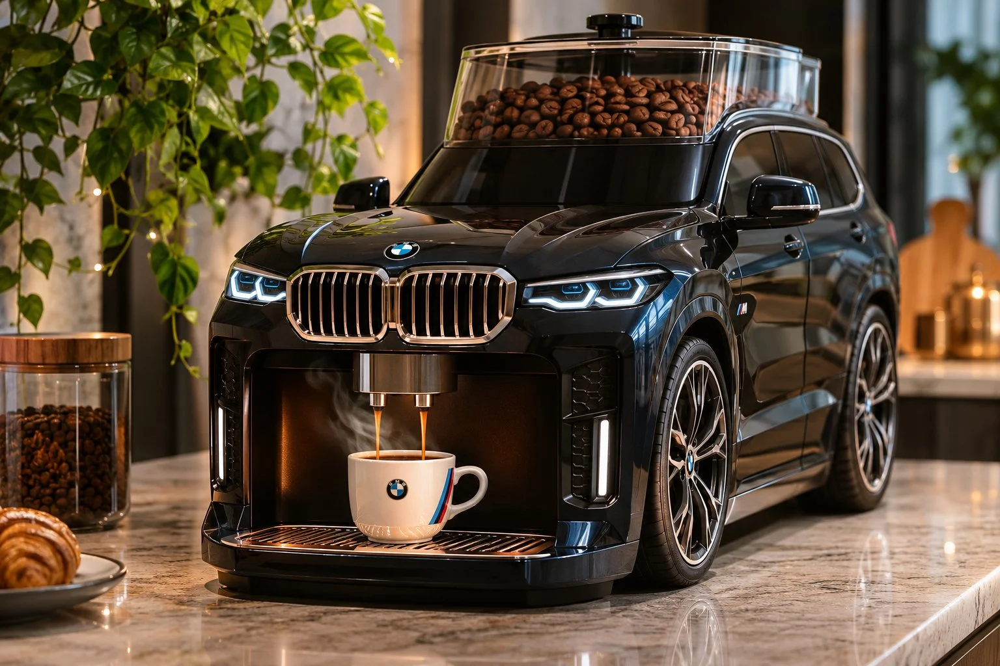

# Luxury Car-Inspired Coffee Machine Product Design

**中文标题：** 豪车造型咖啡机产品设计  
**ID:** `gi25-x-1356` · **Mode:** `generate`  
**Categories:** `ecommerce`, `general`  
**Tags:** `x-twitter`, `community`, `gpt-image-2.5`, `x-direct`, `en`



### Luxury Car-Inspired Coffee Machine Product Design

```text
UNIVERSAL LUXURY AUTOMOTIVE-INSPIRED PRODUCT DESIGN PROMPT

Create an ultra-realistic, premium coffee machine inspired by the design and silhouette of a luxury automobile. The concept should creatively transform the selected vehicle's distinctive exterior styling into a fully integrated, functional-looking countertop coffee maker.

1. AUTOMOTIVE DESIGN

Study the chosen vehicle's defining design elements, including its body shape, proportions, front grille, headlights, wheels, windows, and signature styling. Faithfully translate these features into the coffee machine while maintaining the recognizable identity of the vehicle. The result should look like a professionally engineered miniature automotive-inspired appliance, not simply a toy car.

2. TRANSPARENT COFFEE BEAN COMPARTMENT

Integrate an elegant, crystal-clear glass coffee bean container into the upper section or roof of the vehicle. Fill it with freshly roasted coffee beans, making their texture and rich brown colour clearly visible. Ensure the glass compartment looks naturally incorporated into the overall design.

3. COFFEE DISPENSING SYSTEM

Seamlessly integrate a realistic coffee dispenser into the front section of the vehicle. Show freshly brewed espresso flowing directly into a stylish coffee cup positioned underneath. Include delicate rising steam to create a warm, freshly brewed atmosphere.

4. ENVIRONMENT & COMPOSITION

Place the coffee machine on a sophisticated kitchen countertop. Create a warm, modern kitchen environment with softly blurred green indoor plants, tasteful decorations, and subtle lifestyle details. Keep the product as the central focal point.

5. PHOTOGRAPHY & LIGHTING

Use premium commercial product photography with photorealistic materials, refined reflections, realistic glass transparency, detailed automotive finishes, soft natural lighting, cinematic depth of field, and beautifully controlled shadows.

FINAL CREATIVE DIRECTION

The final image must look like an exclusive luxury designer appliance that combines automotive craftsmanship with modern coffee-making technology. Preserve the selected vehicle's recognizable design language while ensuring every coffee-making component is visually integrated and believable.

QUALITY REQUIREMENTS: Ultra-photorealistic, 8K detail, professional advertising photography, realistic proportions, premium industrial design, sharp product focus, no distorted components, no additional vehicles, no unnecessary text, and no watermark.

Customization: Replace the selected vehicle with any car, SUV, sports car, classic automobile, or other vehicle while adapting its signature design elements to the coffee machine.
```

- **Recommended model:** `gpt-image-2.5-sunburst`
- **Settings:** _(defaults)_
- **Source:** [community](https://x.com/Goodmanprotocol/status/2117318781454467123) — @Goodmanprotocol
- **License note:** Original public X post; quoted with attribution — remix with attribution
- **Notes:** Collected directly from X; original post https://x.com/Goodmanprotocol/status/2117318781454467123; post text names GPT Image 2.5; discovered via X search, prompt re-verified against the original X post via api.fxtwitter.com; verified=True
- **Preview:** `previews/gi25-x-1356.webp`
