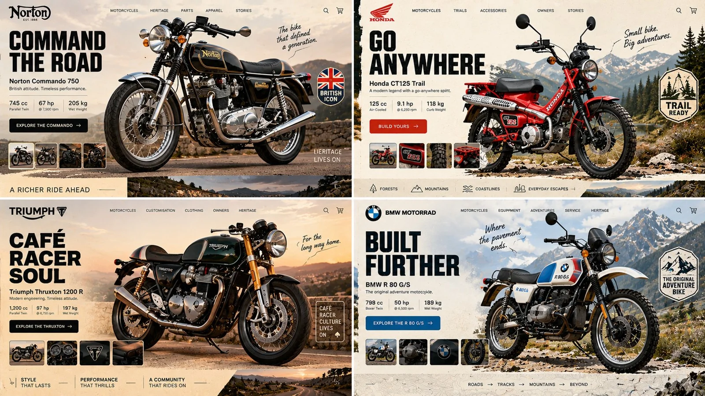

# 2×2 Classic Motorcycle Product Gravity Grid

**中文标题：** 2×2 经典摩托产品引力网格  
**ID:** `gi25-x-807` · **Mode:** `generate`  
**Categories:** `ecommerce`, `ui-mockup`  
**Tags:** `x-twitter`, `community`, `gpt-image-2.5`, `x-direct`, `en`



### 2×2 Classic Motorcycle Product Gravity Grid

```text
16:9, 2x2 grid, do this for an unusual but real classic motorcycles INPUT = [ TOPIC / HERO_OBJECT / BRAND_TEMPERAMENT / VIEWPORT / GRAVITY_LAW ] 

Run HERO_PRODUCT_GRAVITY:

TOPIC_DNA      := infer the category from TOPIC alone — what's sold, who buys it,
                  what its shelf looks like
HERO_DNA       := ONE photographic hero object, cut out, oversized, 30–40% of frame;
                  real material response — specular on foil, matte on paper,
                  subsurface scatter on skin or fruit
BRAND_DNA      := derive the palette FROM the object — 1 dominant, 1 accent pulled
                  from a hue the object actually contains, 1 near-neutral ground
LIGHT_ANCHOR   := decide key light position ONCE (upper-left or upper-right); every
                  shadow — object, cards, pills, floating confetti — falls the same
                  direction at the same angle and softness
GRAVITY_LAW    := the hero is either GROUNDED (contact shadow touching a visible
                  surface plane) or SUSPENDED (ambient occlusion beneath, blur growing
                  with height) — never both, never floating with a hard cast shadow
                  and no plane to cast it onto
DEPTH_ORDER    := ground wash < decorative rays/confetti < hero object < UI chrome.
                  Nav, cart and buttons are ALWAYS in front, never occluded
TYPE_LOGIC     := one display face for the headline (heavy — pick condensed OR wide,
                  not both), one neutral for everything else; headline ≤ 6 words,
                  body renders as legible micro-type, never enlarged gibberish
IMPERFECTION   := exactly one element breaks its bounding box — a badge rotated 4–7°,
                  a sticker overlapping the product silhouette, a stray mark in the gutter
FRAME          := desktop 16:10, 64–80px outer gutter; the bottom edge reveals the top
                  15% of the next section so the page reads as scrollable
MOOD           := appetite, immediacy, one unmistakable action

Render: one screen where the product's own light governs every pixel of interface around it.

Forbidden — objects: stock-photo humans, lorem blocks at display size, a second competing hero
Forbidden — look: conflicting shadow directions, cut-out halo or chewed edges, cast shadows
on flat 2D illustration, palette colors absent from the object, three type families,
nav bar sitting behind the product
```

- **Recommended model:** `gpt-image-2.5-sunburst`
- **Settings:** _(defaults)_
- **Source:** [community](https://x.com/Gdgtify/status/2110001107246203292) — @Gdgtify
- **License note:** Original public X post; quoted with attribution — remix with attribution
- **Notes:** Collected directly from X; original post https://x.com/Gdgtify/status/2110001107246203292; post text names GPT Image 2.5; discovered via Bin0754/gpt-image-gallery index, prompt re-verified against the original X post via api.fxtwitter.com; verified=True
- **Preview:** `previews/gi25-x-807.webp`
