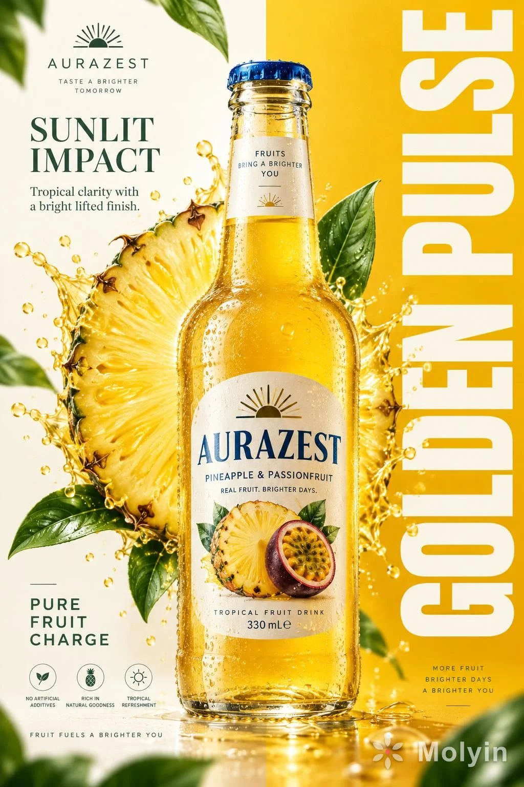

# Overseas Fruit-Drink Commercial Poster

**中文标题：** 海外果饮商业海报  
**ID:** `gi25-x-839` · **Mode:** `generate`  
**Categories:** `ecommerce`, `poster-typography`  
**Tags:** `x-twitter`, `community`, `gpt-image-2.5`, `x-direct`, `en`



### Overseas Fruit-Drink Commercial Poster

```text
Create a premium vertical commercial poster for a fictional overseas fruit drink brand, "AURAZEST". Design it as a Cannes-level beverage ad where a hyper-real glass bottle is the absolute visual hero, fused with disciplined graphic poster design. Use a strict split composition: the left half is a refined warm-ivory information field, the right half a saturated solar-yellow brand field with a giant vertical typographic block. Position the hero bottle exactly across the central dividing line so it bridges both zones and controls the full hierarchy.

The bottle is a chilled elegant glass bottle filled with luminous golden pineapple-passionfruit juice, with thick transparent glass, realistic refraction, a precise blue-metal cap, dense micro-condensation, varied tiny droplets, visible meniscus, crisp label print, and premium manufacturing detail. The front label must read exactly "AURAZEST". It should feel tactile, cold, collectible, and physically believable, carrying the strongest focal weight in the poster.

Behind the bottle, build a large radiant fruit halo combining a pineapple cross-section with a more art-directed geometric fruit-core structure so it feels natural and iconic. The fruit disk sits slightly left of center behind the bottle, partially occluded, with juicy fiber detail, wet rind texture, bright translucency, and controlled splash arcs bursting outward. The splash must feel physically accurate yet graphically composed, with clear directional force, believable viscosity, suspended droplets, and no messy chaos. Add several fresh green leaves around the outer frame as rhythm accents, some softly blurred in the near foreground and some crisp in the midground, always supporting freshness and depth.

Typography must be newly invented and fully art directed. In the top-left, place a minimalist emblem and the brand name "AURAZEST". Beneath it, set the headline "SUNLIT IMPACT", with the smaller line "Tropical clarity with a bright lifted finish." In the lower-left, place a compact benefit lockup: "PURE FRUIT CHARGE". Across the entire right panel, place a massive vertical white typographic block reading "GOLDEN PULSE". Typography should feel integrated into the poster architecture, elegant and precise, with clean spacing, balanced weight, and no collision with the bottle label or fruit core.

Use a tightly controlled palette: 55% pineapple gold and radiant mango-yellow, 20% warm ivory and pale cream, 15% vivid botanical green, 10% deep amber shadow accents and cool blue cap contrast. Light the scene with a clean key from the upper left, luminous transmission through the juice, crisp specular edges on the bottle shoulders, soft reflected bounce from the pale background, and enough contrast to carve volume into the glass, fruit, and splash without muddy blacks or dirty haze. The finish should feel bright, premium, sharp, and globally campaign-ready.

Materials must read with extreme clarity: translucent juice glow, fibrous juicy flesh, glossy wet rind, fresh waxy leaves, sparkling droplets, clean heavy glass, and sharp printed label edges. The poster should combine commercial product realism, fruit freshness, and curatorial graphic discipline in one unified system. Maintain correct bottle proportions, label readability, coherent splash physics, clean perspective, elegant negative space, and powerful retail-ad impact.

Keep one single hero bottle only, product-first hierarchy, clean premium advertising realism, coherent fruit geometry, coherent droplet scale, plausible leaf perspective, and crisp typography. Avoid warped bottle shape, broken glass proportions, unreadable label text, accidental extra bottles, duplicated fruit slices, muddy shadows, dirty texture buildup, chaotic splashes, cheap font treatment, distorted vertical lettering, weak hierarchy, random clutter, off-theme decorative particles, accidental resemblance to existing real beverage brands, or style drift away from high-end commercial poster design.
```

- **Recommended model:** `gpt-image-2.5-sunburst`
- **Settings:** _(defaults)_
- **Source:** [community](https://x.com/molyin_com/status/2110345069115154474) — @molyin_com
- **License note:** Original public X post; quoted with attribution — remix with attribution
- **Notes:** Collected directly from X; prompt posted as the author's reply https://x.com/molyin_com/status/2110345069115154474 to https://x.com/molyin_com/status/2110345002471792983, which carries the images and names GPT Image 2.5; discovered via Bin0754/gpt-image-gallery index, prompt re-verified against the original X post via api.fxtwitter.com; verified=True
- **Preview:** `previews/gi25-x-839.webp`
