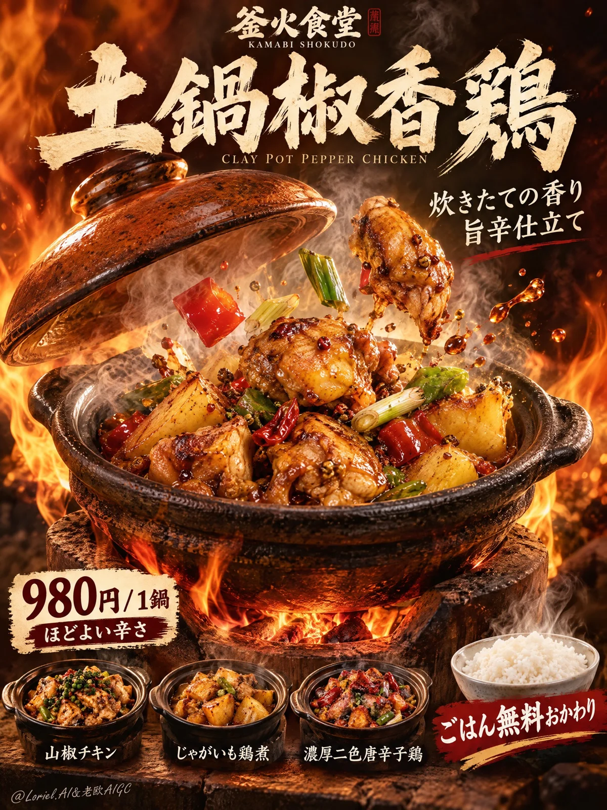

# Japanese Clay-Pot Restaurant Launch Poster

**中文标题：** 日式砂锅餐厅新品海报  
**ID:** `gi25-x-917` · **Mode:** `generate`  
**Categories:** `ecommerce`, `poster-typography`  
**Tags:** `x-twitter`, `community`, `gpt-image-2.5`, `x-direct`, `ja`



### Japanese Clay-Pot Restaurant Launch Poster

```text
A Cannes-level full-bleed Japanese food poster for the fictional clay-pot specialty brand 釜火食堂, designed as a product-first launch campaign for a signature pepper chicken clay pot. Preserve the core logic of a dark fiery vertical restaurant poster with a large headline at the top, a dramatic mid-frame product eruption with a lifted lid, flames wrapping the pot, rising steam, flying ingredients, a price badge in the lower-left, three small menu thumbnails along the bottom, and a bold rice-refill promotion in the lower-right. Japanese text only, no borders, no margins, no empty frame edge; the image must fill the canvas edge to edge. The clay-pot dish remains the absolute visual hero.

Use a vertical full-bleed composition with a deep roasted-brown to ember-black background filling the frame. Keep a strong upper typography zone, a central hero clay pot dominating the middle-lower field, and a compact bottom information band integrated into the layout. The clay lid is suspended diagonally above the pot at the exact moment of opening, creating a strong reveal. Flames rise from behind and curl around the sides, while steam and heat haze lift through the center. Several hero ingredients burst upward with believable spacing and gravity. The food must read first, text second.

The hero dish is a hyper-real Japanese-style spicy pepper chicken clay pot, with lacquered golden-brown chicken chunks, glossy potato cubes, red and green pepper pieces, scallion segments, and rich savory sauce clinging to every surface. The clay pot is matte black-brown ceramic with realistic grain, heat-seasoned texture, thick lip, and subtle soot traces, placed on a traditional clay stove base. The lifted lid is warm orange-brown glazed ceramic with a rounded knob, catching flame light beautifully. The food must feel freshly cooked, fragrant, hot, and fully edible. Chicken should show juicy fibers, caramelized edges, and sauce gloss; potatoes soft and braised; peppers bright and crisp.

The pot is centered slightly below mid-frame and fully commands the image. The lid floats above on a diagonal opening angle. Flames wrap from left rear and lower front but never block the food recognition zone. Use a restrained burst of flying ingredients: one or two chicken pieces, several pepper cubes, a few scallion pieces, and tiny sauce droplets. Steam rises behind and between them with layered transparency. Along the bottom, place three small secondary menu bowls evenly spaced, clearly subordinate. A small white rice bowl sits near the lower-right promotional block.

Keep the setting studio-controlled, not a literal restaurant interior. Foreground is the hero pot, stove, and flying ingredients; midground is flame, steam, and heat haze; background is a full-bleed roasted-brown gradient with ember warmth. The lower strip contains organized menu thumbnails and promotional graphics. Depth should feel cinematic and fragrant, with the hero pot in crisp focus and background warmth softly diffused.

Use a refined 60/20/15/5 palette: 60% deep roasted brown and ember black, 20% flame orange and warm amber glow, 15% natural food reds, greens, and golden browns, and 5% ivory typography and highlight accents. Build a strong warm key from upper-left front to shape the lid, chicken gloss, and potato volume. Add underglow from the flames to illuminate the pot edge and stove surface. Let steam catch side light with soft translucency. Shadows must remain rich, dimensional, and clean, never muddy or dead. The mood should feel hot, aromatic, immediate, and irresistibly craveable.

Render everything with hyper-real premium food photography. Sauce must show viscosity and cling, chicken skin and meat caramelization and tenderness, the ceramic pot and stove tactile heat wear, flame luminous and natural, steam soft and aromatic rather than smoky. Keep the image clean and controlled, with high realism and sharp readable Japanese text.

Typography:
Top center brand mark: "釜火食堂"
Small English line beneath: "KAMABI SHOKUDO"
Large headline across the upper half: "土鍋椒香鶏"
Small English subtitle beneath: "Clay Pot Pepper Chicken"
Supporting Japanese line near center-right: "炊きたての香り　旨辛仕立て"
Lower-left price box: "980円 / 1鍋" and beneath it "ほどよい辛さ"
Bottom thumbnail labels: "山椒チキン", "じゃがいも鶏煮", "濃厚二色唐辛子鶏"
Lower-right rice promotion: "ごはん無料おかわり"
Typography must feel integrated, premium, balanced, with no gibberish and no text covering the hero food.

Full-bleed Japanese food poster, product-dominant, hyper-real, fiery, clean, appetizing, edge-to-edge composition, no borders, no outer margins, no human figure, no cluttered restaurant background, no malformed food pieces, no broken pot geometry, no fake flame, no muddy smoke, no unreadable Japanese, no unrelated ingredients, no dead black patches, no greasy chaos, no style drift, no topology collapse, no low-detail menu thumbnails.
```

- **Recommended model:** `gpt-image-2.5-sunburst`
- **Settings:** _(defaults)_
- **Source:** [community](https://x.com/ou_zhen599/status/2112200465832395025) — @ou_zhen599
- **License note:** Original public X post; quoted with attribution — remix with attribution
- **Notes:** Collected directly from X; original post https://x.com/ou_zhen599/status/2112200465832395025; post text names GPT Image 2.5; discovered via X search, prompt re-verified against the original X post via api.fxtwitter.com; verified=True; original post compares GPT Image 2.5 (left) with Nano Banana 2.1 (right) on the same prompt; the brand is fictional
- **Preview:** `previews/gi25-x-917.webp`
