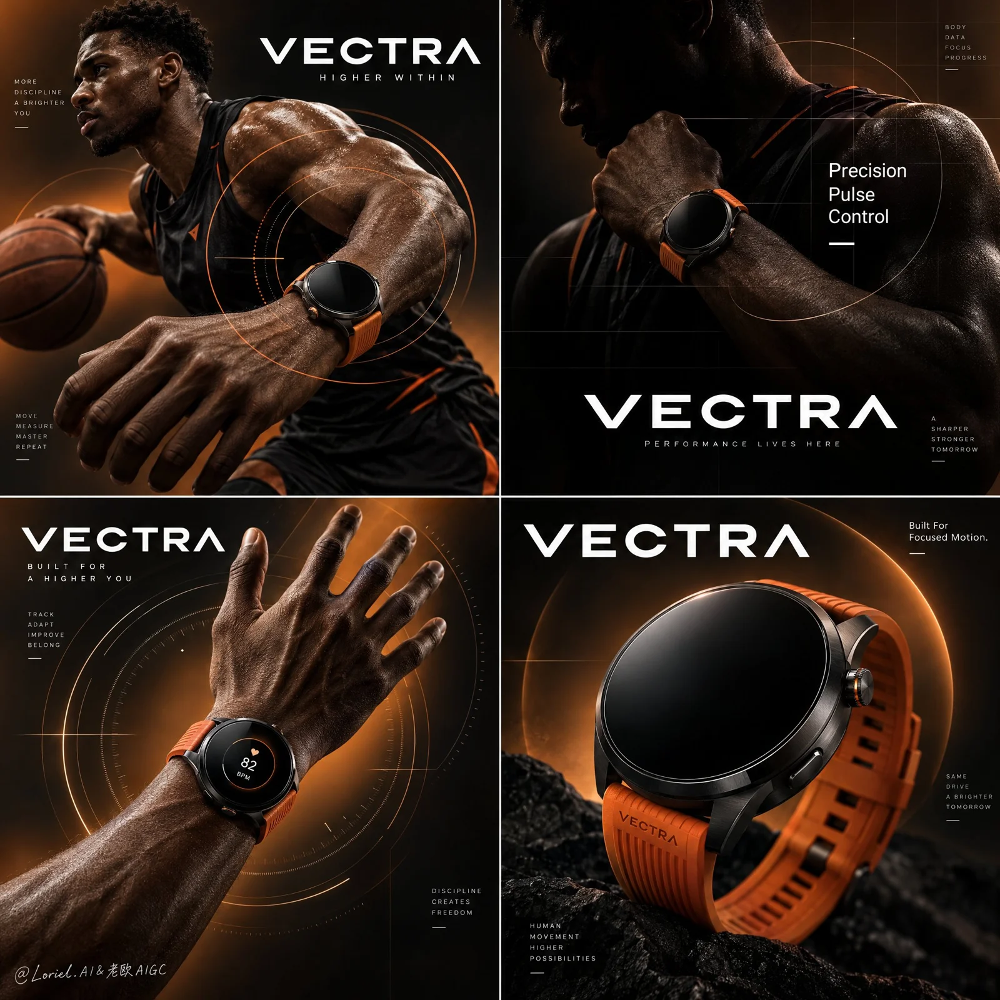

# Smartwatch Four-Panel Performance Campaign Poster

**中文标题：** 智能手表四格运动广告海报  
**ID:** `gi25-x-918` · **Mode:** `generate`  
**Categories:** `ecommerce`, `poster-typography`  
**Tags:** `x-twitter`, `community`, `gpt-image-2.5`, `x-direct`, `en`



### Smartwatch Four-Panel Performance Campaign Poster

```text
A Cannes-level commercial poster for the fictional premium performance smartwatch brand VECTRA, designed as a product-first four-panel campaign fusing cinematic athletic narrative, collector-grade industrial precision, and curator-level graphic restraint. Preserve a perfect 2x2 grid, a unified black-to-burnt-amber visual world, one elite basketball athlete, multiple wrist-focused compositions, one near-product-only hero panel, bold in-panel brand typography, and translucent circular tracking graphics. The smartwatch must remain the absolute hero in all four panels, while the athlete functions only as a performance signal and scale anchor.

Use a square poster split into four equal quadrants with crisp borders. Upper-left shows the athlete in controlled forward motion with a basketball, side-profile to three-quarter angle, the lead wrist enlarged and dominant, intersected by large translucent target rings. Upper-right is darker and more abstract, showing torso, shoulder, and wrist with the watch illuminated against a silhouette body, overlaid with a refined precision grid and short editorial text. Lower-left isolates a raised forearm and open hand wearing the watch, centered inside orbital circular graphics suggesting motion capture and pulse mapping. Lower-right becomes a near-product-only close-up of the smartwatch in a sculptural black field, backed by oversized abstract circular marks and a faint warm halo. Each panel contains a bold VECTRA wordmark integrated into the layout.

The hero product is a high-end round performance smartwatch with a matte black ceramic face, ultra-thin black titanium bezel, subtle sapphire-glass curvature, precise crown and button detailing, seamless lug integration, and a vivid burnt-orange performance strap in soft-touch elastomer with engineered ribbing. The watch must feel premium, athletic, and exacting, more like elite training equipment than consumer electronics. The design stays identical across all four panels. Most displays remain dark and reflective; one wrist shot may show a restrained circular performance UI glow, minimal and elegant.

Use one powerful male basketball athlete with deep skin tone, sharp side profile, a sleeveless black performance uniform with subtle orange accents, and focused competitive energy. In the upper-left he drives forward with measured explosive intent, the basketball secondary and the watch on the lead wrist dominant. In the upper-right the body becomes partially abstracted into shadow so the watch reads as the brightest control point. In the lower-left only the forearm and hand remain, fingers naturally spread and anatomically clean. In the lower-right the athlete disappears almost entirely, letting the product carry the climax.

Keep the environment fully studio-constructed and minimal. No court, no crowd, no extra props beyond the basketball in the upper-left. The world is built from a smooth black-to-burnt-amber gradient, localized warm glows, translucent ring systems, faint precision grids, and soft graphic arcs implying speed, targeting, pulse, and control. Depth comes from lighting, figure overlap, product scale, and layered transparent graphics, never from environmental clutter.

Use a disciplined 55/25/15/5 palette: 55% black and deep graphite shadow, 25% burnt amber and copper-orange glow, 15% skin and industrial graphite highlights, 5% crisp white typography accents. Build strong directional studio lighting from upper-left and side-rear positions to carve the athlete’s cheek, shoulder, forearm, fingers, and watch case edges. The watch must receive the cleanest highlight control in every panel: thin bezel rim light, soft reflective falloff on the sapphire glass, and saturated but controlled emphasis on the orange strap. Contrast should feel dramatic, premium, and sculptural, never muddy, flat, or crushed into dead black.

Render everything as hyper-real flagship advertising photography with immaculate industrial fidelity. The watch face shows smooth dark glass, subtle reflections, precise case tolerances, and clean shadow bands around the bezel. The strap feels like premium elastomer with matte performance texture and engineered flexibility. Skin must feel real and powerful, with natural pores, tendon structure, and controlled sheen rather than sweat-heavy gloss. Graphic overlays must feel embedded in the visual system, translucent and atmospheric, not pasted on. The final image should feel like a global luxury sports-tech launch campaign.

Create a bold minimalist white wordmark VECTRA across multiple panels as one unified brand system. In the upper-right panel, place: Precision / Pulse / Control. In the lower-right panel, place: Built For Focused Motion. Typography must be geometric, crisp, spacious, and premium, integrated into the grid without crossing the watch silhouette or cluttering the compositions.

Premium sports-tech commercial poster, product-dominant, hyper-real, editorial, high contrast, clean four-panel hierarchy, no distorted anatomy, no broken fingers, no warped watch geometry, no inconsistent strap design, no muddy gradients, no cheap gamer styling, no cluttered interface, no gibberish text, no extra accessories, no style drift, no topology collapse, no flat catalog lighting.
```

- **Recommended model:** `gpt-image-2.5-sunburst`
- **Settings:** _(defaults)_
- **Source:** [community](https://x.com/ou_zhen599/status/2112194819741323648) — @ou_zhen599
- **License note:** Original public X post; quoted with attribution — remix with attribution
- **Notes:** Collected directly from X; original post https://x.com/ou_zhen599/status/2112194819741323648; post text names GPT Image 2.5; discovered via X search, prompt re-verified against the original X post via api.fxtwitter.com; verified=True; original post compares GPT Image 2.5 (left) with Nano Banana 2.1 (right) on the same prompt; the brand is fictional
- **Preview:** `previews/gi25-x-918.webp`
