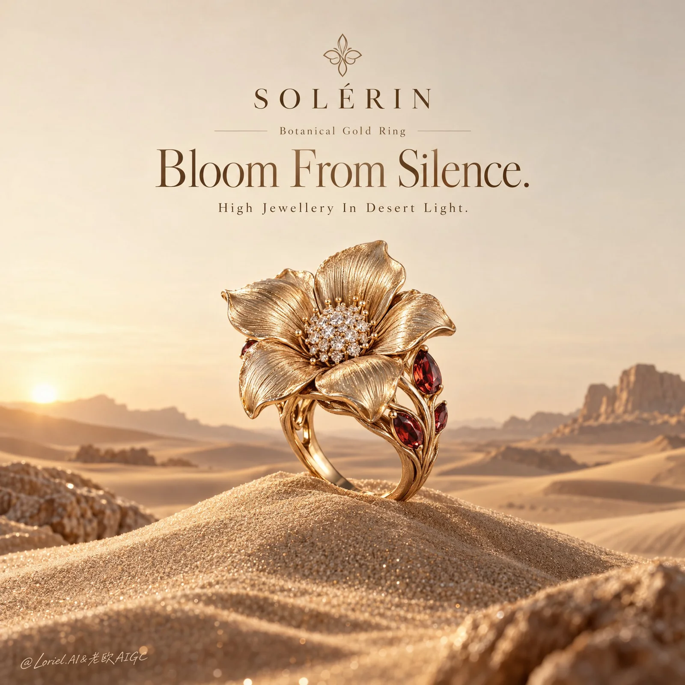

# Floral Gold Ring on Desert Dune Luxury Poster

**中文标题：** 沙丘花形金戒奢华珠宝海报  
**ID:** `gi25-x-919` · **Mode:** `generate`  
**Categories:** `ecommerce`, `poster-typography`  
**Tags:** `x-twitter`, `community`, `gpt-image-2.5`, `x-direct`, `en`



### Floral Gold Ring on Desert Dune Luxury Poster

```text
A Cannes-level luxury jewelry poster for the fictional maison SOLÉRIN, designed as a product-first editorial still life that fuses desert-poetry atmosphere, collector-grade material precision, and curator-level restraint. The hero object is a hyper-real floral gold ring rising alone from the crest of a sculpted sand dune, isolated against a vast pale desert sky. Preserve the core logic of a single bloom-like ring on a dune pedestal with centered luxury typography above, refined into a cleaner, rarer, museum-grade image where the jewel feels like a solitary treasure revealed by first light.

Use a vertical format with a centered axis and a seamless warm sand-beige sky filling the upper half as negative space for brand and headline typography. The floral ring stands slightly below center on the crest of a softly rounded dune mound, fully isolated and clearly readable. Keep only low abstract dune shapes and a few softened mineral forms near the lower horizon and extreme foreground corners, enough to support scale and framing without distracting from the product. The composition should feel spacious, airy, and exacting, with the jewelry instantly read as the sole hero.

The hero piece is an ultra-premium floral statement ring in antique champagne-gold, shaped like a blooming desert flower with five broad sculpted petals. The petals must feel hand-formed and couture, with fine brushed-metal veining, gently curled edges, subtle convex lift, and rich metallic depth. At the center sits a tightly clustered pavé diamond core with crisp dimensionality. Around the lower side branches, place a restrained number of garnet-red pear and marquise gemstones as precious nectar accents. The shank splits into elegant organic stems with believable engineering, open negative spaces, precise metal transitions, and luxurious weight. The ring should feel rare, collectible, and unmistakably haute joaillerie.

The ring is planted lightly but credibly on the dune crest, angled three-quarters toward the viewer so the flower face, side gemstone branches, and lower shank architecture are all legible. The sand beneath should show a subtle indentation and soft contact shadow. The surrounding dunes act as a natural plinth. No hands, no model, no props, no competing objects. The staging should feel like a quiet unveiling of a singular jewel in an immaculate desert chamber.

Foreground consists of finely textured dune surface with restrained micro-sparkle and elegant granular detail; midground is the sharply resolved hero ring and its immediate sand pedestal; background is a minimal desert horizon with low softened dunes and warm atmospheric falloff. The sky must remain clean, calm, and nearly seamless, giving the poster exceptional breathing room. Depth should feel serene and controlled, with the ring in crisp focus and the landscape softly receding.

Use a refined 60/25/10/5 palette: 60% sunlit sand-beige and warm ivory, 25% antique champagne-gold, 10% garnet-red gemstone depth, and 5% diamond-white highlights. Build a soft first-light key from upper-left front, giving the petals graceful highlight flow, revealing brushed veining, and casting a delicate readable shadow on the dune. Add subtle reflected warmth from the sand to the underside of the ring. Keep contrast gentle but sculptural, with no muddy browns or harsh desert glare.

Render with hyper-real luxury product photography and museum-grade fidelity. The gold petals must show brushed striation, polished edge catches, subtle thickness variation, and believable metal density. The pavé center should feel crisp and dimensional, with tightly set stones and controlled scintillation. Garnet-red stones must show depth, translucency, and precise bezels. The sand must feel fine, dry, and tactile, with elegant grain and only occasional light-catching spark points. The whole image should feel pristine, editorial, tactile, and globally campaign-ready.

Place a minimal refined emblem and the brand name SOLÉRIN near the upper-center or upper-right. Add the small descriptor: Botanical Gold Ring. Set the large editorial headline: Bloom From Silence. Add the smaller subline: High Jewellery In Desert Light. Typography must feel centered, balanced, softly ivory, and fully integrated into the negative space with generous spacing. Text must never crowd the ring.

Luxury jewelry poster, product-dominant, hyper-real, minimal, editorial, no human figure, no extra jewelry, no warped petals, no malformed shank, no duplicated gemstones, no plastic-looking gold, no excessive glitter, no cluttered desert scene, no gibberish text, no muddy sand, no dead black patches, no topology collapse, no style drift, no flat catalog lighting.
```

- **Recommended model:** `gpt-image-2.5-sunburst`
- **Settings:** _(defaults)_
- **Source:** [community](https://x.com/ou_zhen599/status/2112184999785152648) — @ou_zhen599
- **License note:** Original public X post; quoted with attribution — remix with attribution
- **Notes:** Collected directly from X; original post https://x.com/ou_zhen599/status/2112184999785152648; post text names GPT Image 2.5; discovered via X search, prompt re-verified against the original X post via api.fxtwitter.com; verified=True; original post compares GPT Image 2.5 (left) with Nano Banana 2.1 (right) on the same prompt; the brand is fictional
- **Preview:** `previews/gi25-x-919.webp`
