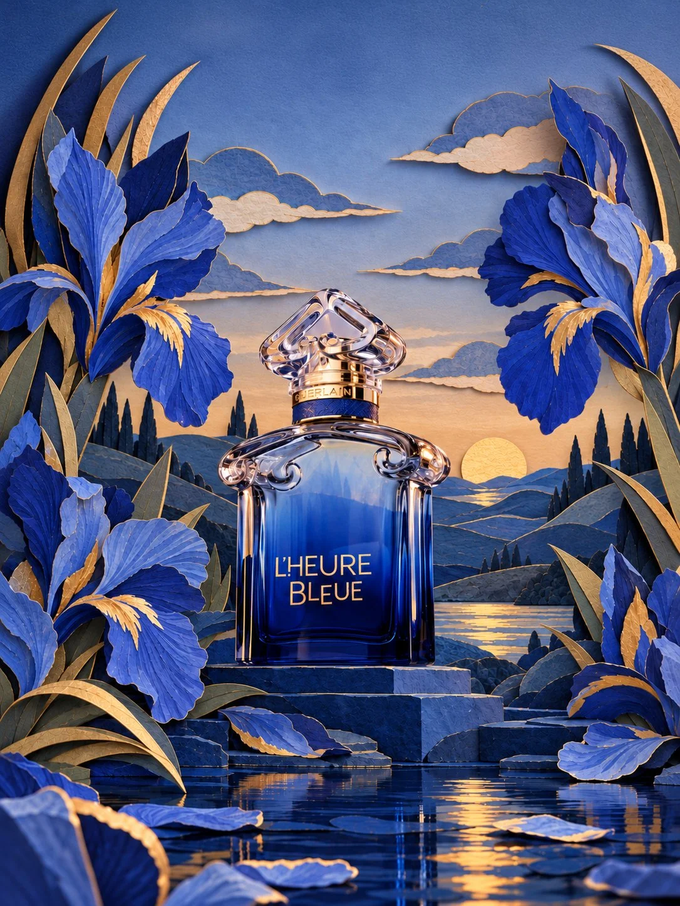

# Paper-Cut Diorama Fragrance Campaign Still

**中文标题：** 纸雕立体场景香水广告大片  
**ID:** `gi25-x-940` · **Mode:** `generate`  
**Categories:** `ecommerce`  
**Tags:** `x-twitter`, `community`, `gpt-image-2.5`, `x-direct`, `en`



### Paper-Cut Diorama Fragrance Campaign Still

```text
Create a luxurious Guerlain L'Heure Bleue fragrance campaign in the form of an elaborate 3D paper-cut diorama at blue hour.
Place the iconic deep cobalt-blue perfume bottle at the exact centre, resting on sculptural dark indigo stone steps above reflective water. Preserve its ornate glass shoulders, sculptural transparent cap, gold neck, GUERLAIN lettering, and gold L'HEURE BLEUE typography.
Frame the bottle with oversized cobalt and periwinkle blue irises, their individual petals crafted from embossed cardstock with delicate botanical veins and antique-gold accents. Build a layered landscape of rolling indigo mountains, dark cypress silhouettes, hand-cut ivory clouds, and a textured golden paper sun low on the horizon.
The water is deep blue with delicate strips of metallic gold paper reflecting the sunset. Every environmental element has visible paper grain, crisp hand-cut edges, raised layers, embossed textures, and delicate shadows between overlapping pieces.
Rich cobalt, midnight blue, periwinkle, muted blue-grey, ivory, and antique gold. Dramatic blue-hour lighting balanced by warm golden highlights. Symmetrical editorial composition, intricate handcrafted details, beautiful depth, refined luxury fragrance art direction.
The perfume bottle remains realistic glass, not paper. Keep it as the unmistakable focal point. No extra objects, no text outside the product packaging, no clutter.
The result should feel like a miniature luxury campaign photographed for a high-end fashion magazine.
```

- **Recommended model:** `gpt-image-2.5-sunburst`
- **Settings:** _(defaults)_
- **Source:** [community](https://x.com/AvaSmith771/status/2111765210088505558) — @AvaSmith771
- **License note:** Original public X post; quoted with attribution — remix with attribution
- **Notes:** Collected directly from X; original post https://x.com/AvaSmith771/status/2111765210088505558; post text names GPT Image 2.5; discovered via X search, prompt re-verified against the original X post via api.fxtwitter.com; verified=True; the author used this GPT Image 2.5 still as the start frame for a Seedance 2.5 video; brand names are from the author's own concept
- **Preview:** `previews/gi25-x-940.webp`
